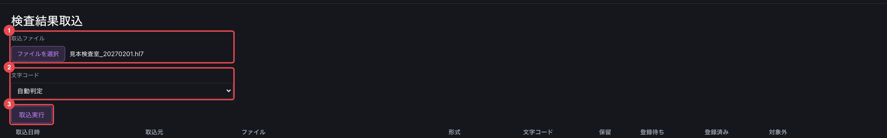
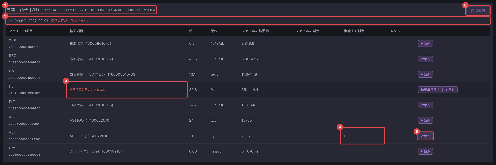
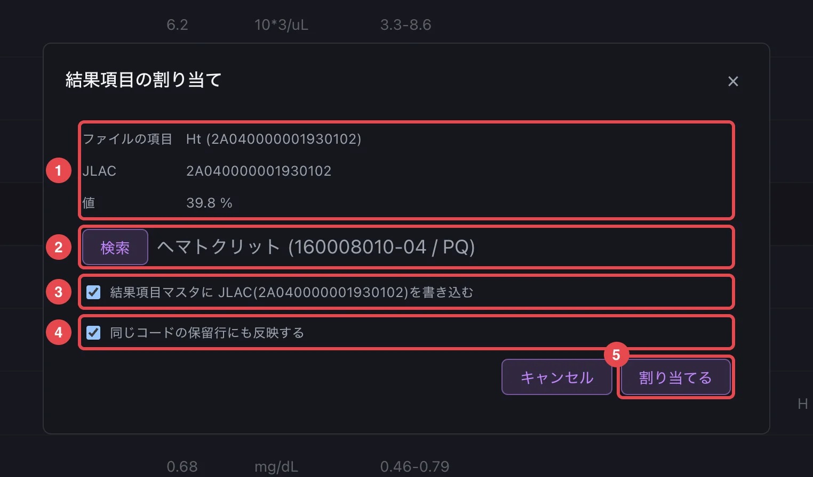

# 検査結果取込

検査室の分析装置・検査システムや外注の検査センターから受け取った結果のファイルを読み込み、検体検査の結果として登録する操作です。
登録した結果は手で入れた結果と同じに扱われ、パニック値の通知や、依頼医への結果の通知も同じように届きます。
検体検査の流れ全体は、業務フローの[検体検査オーダー](../flows/lab.md)を見てください。

- 検査結果取込は、画面の上の「部門業務」>「臨床検査部門」>「検査結果取込」で開きます。
- 読み込めるのは、JAHIS 臨床検査データ交換規約の形式の結果のファイルです。
- 結果を 1 件ずつ手で入れるときは、[検体検査一覧とラベル](lab-worklist.md)の「結果を登録する」を見てください。

## ファイルを読み込む

{ .screen }

1. 「取込ファイル」の「ファイルを選択」で、結果のファイルを選びます。
2. 「文字コード」は「自動判定」のままにします。読み込んだ結果の文字が化けたときだけ、「UTF-8」「Shift_JIS」「ISO-2022-JP」から選んで読み込み直します。
3. 「取込実行」を押すと、ファイルを読み込んで、取り込んだ結果の画面が開きます。

読み込んだだけでは、結果はまだ登録されません。次の画面で確かめてから登録します。

画面の下には、これまでの取込が新しい順に並びます。行ごとに、保留・登録待ち・登録済み・対象外の件数が出ます。
取込日時を押すと、その取込の画面が開きます。途中で止めた取込も、ここから続けられます。

## 取り込んだ結果を確かめる

ファイルの中の検査結果 1 件ごとに、枠が 1 つ並びます。

{ .screen }

1. ファイルに書かれた患者(氏名・患者番号・生年月日)、採取日、検体、ラベルの番号、報告区分が出ます。
2. 結果を付けるオーダーが出ます。オーダーは、ラベルの番号から引いた管のオーダーにします。
   ラベルの番号が無いときや、管の患者がファイルの患者と違うときは、患者番号と採取日でその日のオーダーを探します。
   その日のオーダーが無ければオーダーに紐付けずに登録し、複数あれば選びます。
   保留の行が残っているときは、その件数が赤く出ます。
3. ファイルの項目に当たる結果項目が見つからない行は保留になり、「結果項目が見つかりません」と出ます。行の「結果項目選択」で結果項目を選びます。
4. 「登録する判定」は、施設の基準値で付け直した H / L です。「ファイルの基準値」「ファイルの判定」は参考で、登録しません。
5. 登録しない行は「対象外」を押します。
6. 保留の行が無くなると「候補登録」を押せるようになります。

- 値が結果項目に合わない行(選択肢に無い値・数値でない値)も保留になります。行の中で選び直すか、打ち直します。
- 同じファイルをもう一度読み込むと、画面の上で知らせます。同じ結果を二重に登録していないか確かめます。

## 保留の行に結果項目を選ぶ

保留の行の「結果項目選択」を押すと、結果項目の割り当ての画面が開きます。

{ .screen width="762" }

1. ファイルの項目と、そのコード・値が出ます。
2. 「検索」を押して結果項目を探し、行を押して選びます。選んだ結果項目が横に出ます。
3. 「結果項目マスタに JLAC を書き込む」にチェックを付けたままにすると、選んだ結果項目にファイルのコードを書き込みます。次からは同じ項目が自動で当たります。
4. 「同じコードの保留行にも反映する」にチェックを付けたままにすると、この取込の、同じコードのほかの保留の行にも同じ結果項目を選びます。
5. 「割り当てる」を押します。

結果項目マスタを直したあとは、画面の上の「再引当」で、保留の行をもう一度引き当て直せます。

## 登録する

枠の「候補登録」を押すと、その結果を登録します。画面の上の「すべて登録」で、登録できる枠をまとめて登録します。

{ .screen }

1. 登録した枠には「カルテ」が出ます。押すと、その患者のカルテが開きます。

- 報告区分はファイルに書かれたとおりです(中間報告か最終報告)。
- すでに結果があるオーダーに登録すると、その結果に項目を足します。確定した結果に登録したときは訂正報告になります。
- 「すべて登録」で登録できなかった枠には、理由が出ます。残りの枠の登録は続けます。
