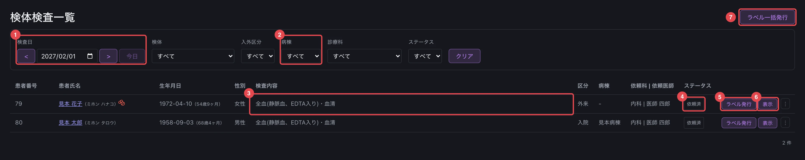
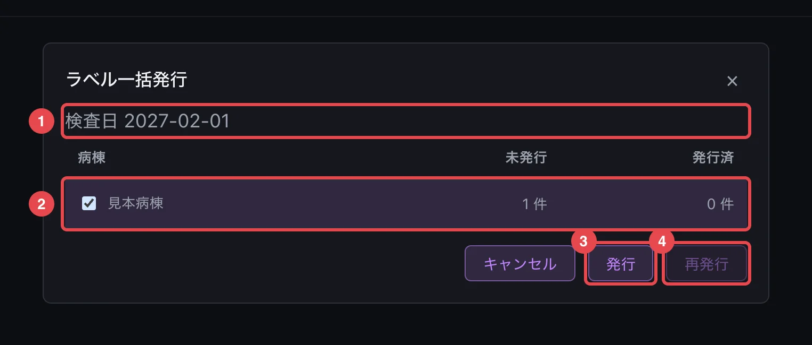
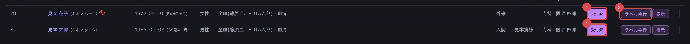
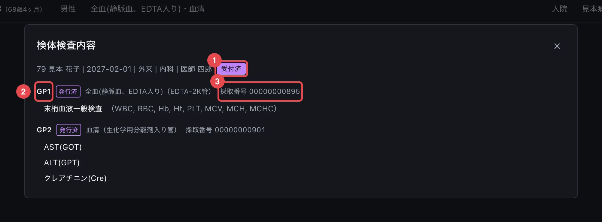
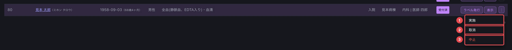
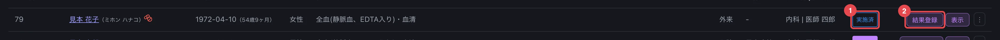
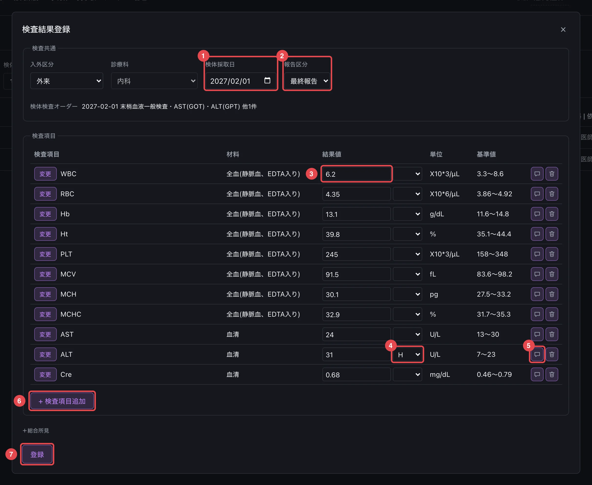

# 検体検査一覧

採血室・検査室が、医師の出した検体検査を検体検査一覧で受け、検体ラベルを発行し、結果を登録する操作です。
検体検査の流れ全体は、業務フローの[検体検査オーダー](../flows/lab.md)を見てください。

- 検体検査一覧は、画面の上の「部門業務」>「臨床検査部門」>「検体検査一覧」で開きます。ホームの「検体検査」のカードからも開けます。
- 作業は「依頼済」→(ラベル発行)→「受付済」→(管が全部到着)→「実施済」と進みます。ラベルの発行が受付を兼ねます。
- 管の到着は[検体到着確認](lab-arrival.md)で読みます。分析装置・外注のファイルから結果を入れるときは[検査結果取込](lab-result-import.md)を見てください。
- 外注の検査も、この一覧でラベルを発行して受け付けます。外注先への提出と結果の届き具合は[外注検査](lab-outsource.md)で見ます。

## 検体検査一覧の見方

{ .screen }

1. 「検査日」で、検体を採る日を選びます。「<」「>」で 1 日ずつ動かし、「今日」で今日に戻ります。
2. 「検体」「実施区分」「入外区分」「病棟」「診療科」「ステータス」で絞り込めます。「クリア」で絞り込みを外します。
3. 「検査内容」に、採る検体の名前が並びます。検査項目は「表示」で見ます。外注の項目を含む検査には「外注」の印が付きます。
4. 「ステータス」に作業の状態が出ます。至急の検査は「区分」に「至急」が付きます。
5. 依頼済・受付済の行は「ラベル発行」で検体ラベルを刷ります。
6. 「表示」を押すと、検査項目と管ごとのラベルの状態が開きます。
7. 「ラベル一括発行」で、病棟の検体ラベルをまとめて刷ります。

行を押すと、右に患者プロファイルが開きます。患者氏名を押すとカルテが開きます。

## 病棟のラベルをまとめて発行する

入院の検体ラベルは、前日か当日の朝に、病棟ごとに「ラベル一括発行」でまとめて刷ります。

{ .screen width="762" }

1. 一覧で表示中の検査日のオーダーが対象です。
2. 刷る病棟にチェックを付けます。病棟ごとに、未発行と発行済の件数が出ます。
3. 「発行」を押すと、未発行の管のラベルを 1 つにまとめて別のタブで開き、それらのオーダーを受付済にします。
4. 「再発行」を押すと、発行済で、まだ届いていない管のラベルを同じ番号で刷り直します。

- 対象は、オーダーを登録したときに入院していた病棟のオーダーです。外来のオーダーは対象になりません。一覧の絞り込みは効きません。
- ラベルは病棟をまたいで患者番号の順に並びます。

## 外来のラベルを発行する

外来の検体ラベルは、患者が採血室に来てから、行の「ラベル発行」で刷ります。ラベルが別のタブで開くので、そこから印刷します。

{ .screen }

1. ラベルを発行した行は「受付済」になります。
2. 受付済の行の「ラベル発行」は刷り直しです。同じ管は同じ番号で刷られ、状態は変わりません。

ラベルは管 1 本に 1 枚です。ラベルには患者番号・カナ氏名・性別・生年月日・検体・採取管・検査日と、管で測る項目の略称が刷られます。
同じ検体でも、院内で測る項目と外注の項目は別の管になります。外注の管のラベルには「外注」と外注先の名前も刷られます。

## 検査の内容と管の状態を見る

行の「表示」で、検査項目と、管ごとのラベルの状態が開きます。

{ .screen width="1002" }

1. 患者・検査日・区分・依頼科・依頼医師と、作業の状態が出ます。
2. 管ごとに、検体・採取管と、その管で測る検査項目が並びます。管の状態は「未発行」「発行済」「到着済」です。
3. ラベルを発行した管には、ラベルの番号(採取番号)が出ます。

外注の管は、見出しに「外注:」と外注先の名前が付きます(写真は[外注検査](lab-outsource.md)にあります)。

## 行のメニュー

行の「⋮」から、状態を手で進めたり戻したりします。出る項目は状態で変わります。

{ .screen }

1. 「実施」は、受付済の検査を実施済にします。バーコードリーダーが使えないときの代わりの操作で、管ごとの到着は記録されません。
2. 「取消」は、1 つ前の状態に戻します(受付済 → 依頼済、実施済 → 受付済)。押し間違いを直すときに使います。
3. 「中止」で検査を取りやめます。中止した検査は「中止取消」で依頼済に戻せます。

依頼済の行には、ラベルを刷れないときの代わりに、状態だけを受付済にする「受付」が出ます。

## 結果を登録する

管が全部届くと、行が「実施済」になり、「結果登録」が出ます。

{ .screen }

1. ステータスが「実施済」になります。
2. 「結果登録」を押すと、結果の入力画面が開きます。

{ .screen width="1210" }

検査項目は、オーダーの項目が並んだ状態で開きます。

1. 「検体採取日」は検査日が入っています。採った日が違うときは直します。
2. 「報告区分」を選びます。最終報告で登録すると、依頼医に結果の通知が届きます。途中の結果を先に返すときは「中間報告」にします。
3. 「結果値」を入れます。
4. 基準値を外れた値は、横の判定に「H」「L」が自動で入ります。パニック値の範囲なら「HH」「LL」になり、依頼医に緊急異常値の通知が届きます。
5. 溶血・再検などの但し書きは、行の吹き出しのボタンでコメントを入れます。
6. オーダーに無い項目を足すときは「+ 検査項目追加」を押します。測らなかった項目は、行のゴミ箱のボタンで外します。
7. 「登録」を押します。

- 結果全体に添える文は「+総合所見」で入れます。
- 外注の項目には「外注」の印が付きます。オーダーの項目が並んだ状態から入れると、外注先で測った結果として残ります。
- 結果を登録した行は「結果登録」を押せなくなります。結果を直すときは、カルテの「検体検査」タブから開きます。確定した結果を直すと訂正報告になります。
