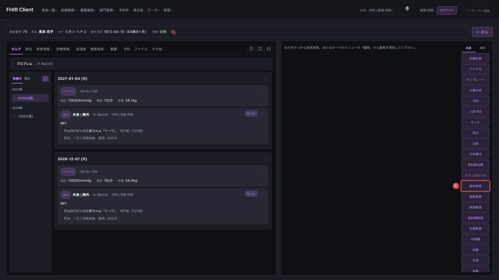
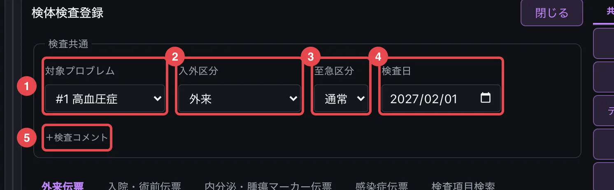
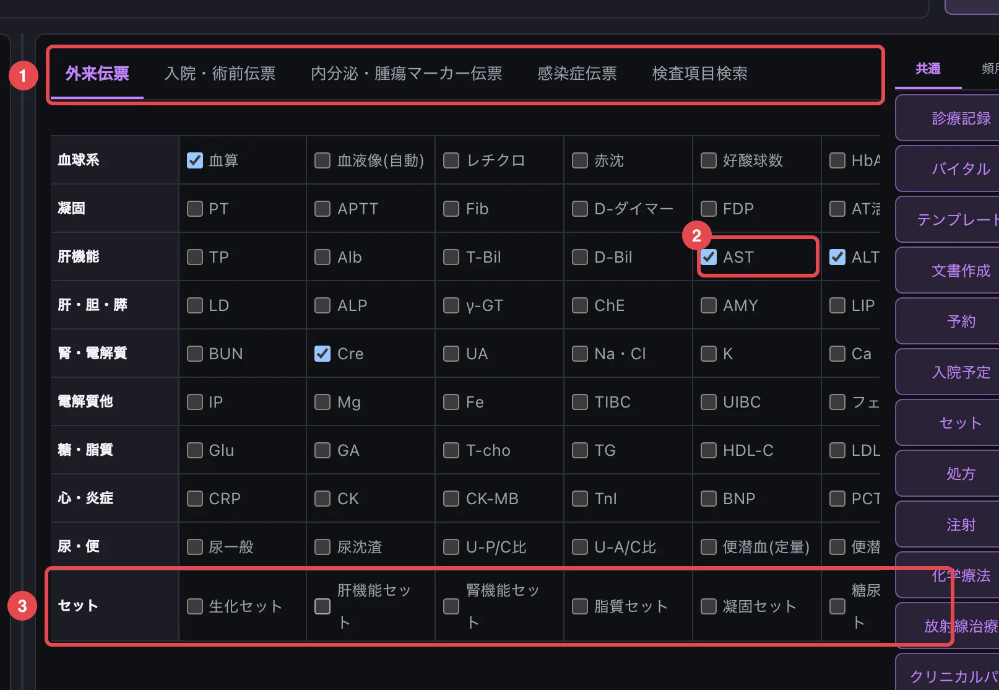
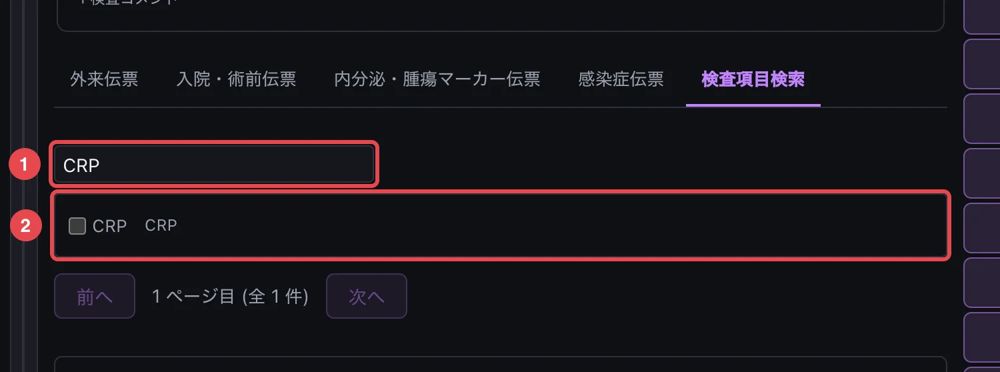
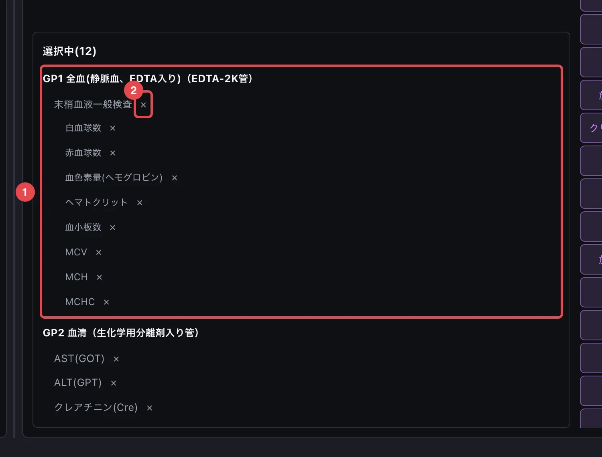
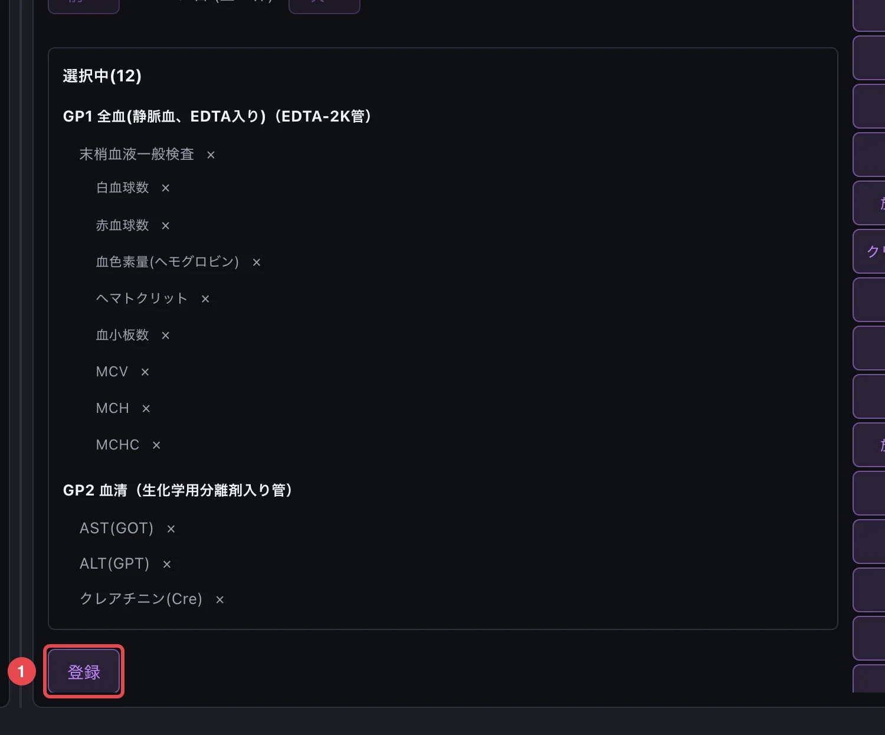
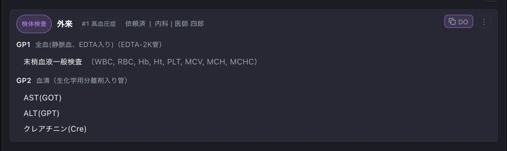
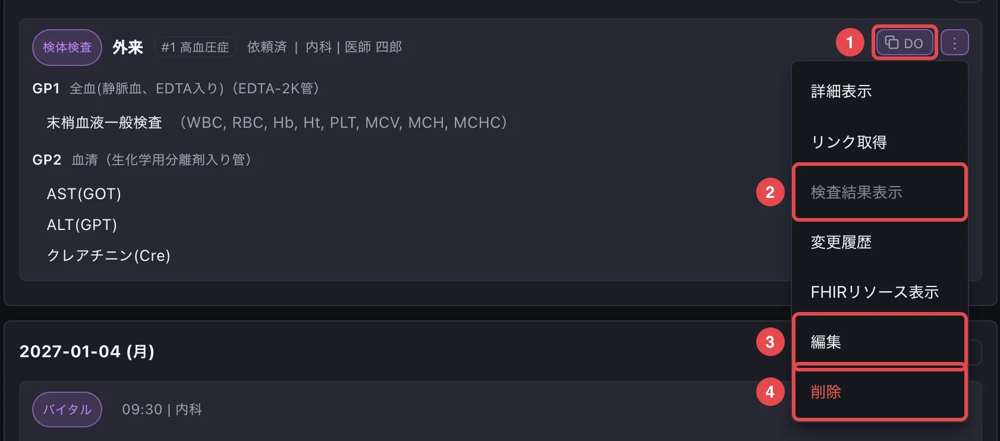

# 検体検査

医師がカルテから検体検査の項目を選んで登録する操作です。登録した検体検査のラベル発行・採取・到着・結果報告・
結果の確認までの流れは、業務フローの[検体検査オーダー](../flows/lab.md)を見てください。

このページで使う呼び名です。

- **伝票**: 検査項目をよく使う順に並べた選択表です。施設で作り、タブで切り替えます。
- **管(採取管)**: 検体を入れる容器 1 本です。選んだ項目は、採る管ごとにまとまります。

## 検体検査登録を開く

患者のカルテを開いておきます。

{ .screen }

1. カルテの右側に並ぶボタンから「検体検査」を押します。右側に「検体検査登録」が開きます。

## 検査共通を入れる

{ .screen width="746" }

1. 「対象プロブレム」で、この検査の対象の病名を選びます。プロブレムを選ばないときは「(プロブレムなし)」のままにします。
2. 「入外区分」で「入院」か「外来」を選びます。
3. 「至急区分」で「通常」か「至急」を選びます。
4. 「検査日」に、検体を採る日を入れます。初期値は今日です。時刻は入れません。
5. 検査室へ伝えることがあれば「＋検査コメント」を押して入れます。

## 検査項目を選ぶ

### 伝票から選ぶ

{ .screen width="807" }

1. 伝票のタブを押して、伝票を切り替えます。
2. 検査する項目にチェックを付けます。チェックを外すと、選んだ項目から外れます。
3. 「肝機能セット」のような項目のまとまりも、ほかの項目と同じくチェックを付けて選びます。

伝票の表が右側に収まらないときは、表を横に送って見ます。

### 名前で探す

伝票に無い項目は、「検査項目検索」のタブで探します。

{ .screen width="750" }

1. 項目の名称・略称・カナの一部を入れます。
2. 見つかった項目にチェックを付けます。

### 選んだ項目を確かめる

選んだ項目は、下の「選択中」に並びます。

{ .screen width="750" }

1. 項目は、採る管ごとにまとまります。見出しに検体と管の種類が出ます。
2. 「×」を押すと、その項目を外します。血算のような項目のまとまりは、中の項目を 1 つずつ外すこともできます。

## 登録する

{ .screen width="750" }

1. 「登録」を押します。

項目を 1 つも選んでいないときや、検査日が無いときは、上に内容が出ます。直してからもう一度「登録」を押します。

登録すると右側が閉じ、カルテに検体検査のカードが出ます。項目は管ごとに並びます。

{ .screen width="841" }

登録した検体検査は、採血室・検査室の「検体検査一覧」に並びます。外来は患者が採血室に来てから、入院は病棟ごとにまとめて、
検体ラベルを刷ります。

## 登録した検体検査を使う・直す

カルテの検体検査のカードから操作します。

{ .screen width="841" }

1. 「DO」を押すと、同じ項目が右側の「検体検査登録」に入ります。検査日などを直して「登録」を押します。
2. 結果が報告されると、「⋮」の「検査結果表示」で結果を開けます。結果が無いあいだは押せません。
3. 「⋮」の「編集」を押すと、右側に編集が開きます。直して「更新」を押します。
4. 「⋮」の「削除」を押すと、理由を入れて検体検査を削除します。

- 編集は、結果が出たあとでもできます。ラベルを刷ったあとに項目を足して管が増えたときは、新しい管のラベルを刷ります。
- 結果があるオーダーは削除できません。先に結果を削除します。
- 検査をやめるときの「中止」は、カルテのカードではなく、検体検査一覧の行のメニューで行います。

結果は、カルテの「検査結果」の「検体検査」タブで見ます。結果が報告されると依頼医に通知が届き、
通知の一覧かカルテのタブで「確認」を押して、結果を読んだことを残します(業務フローの[結果の確認](../flows/lab.md#結果の確認))。
