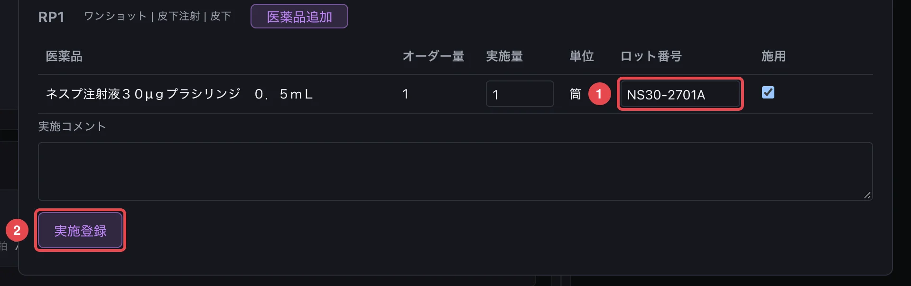
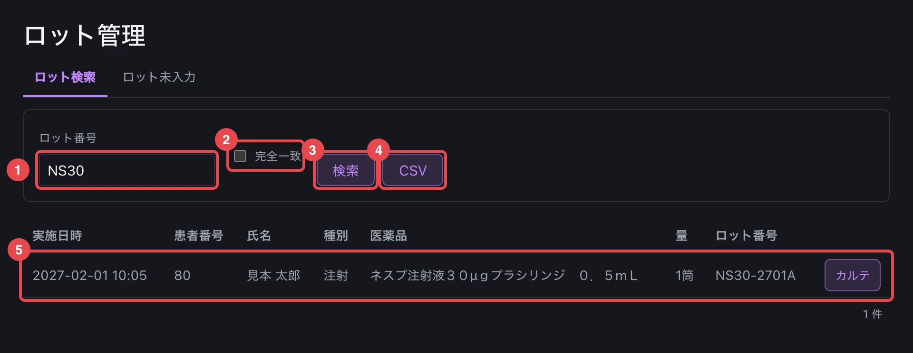
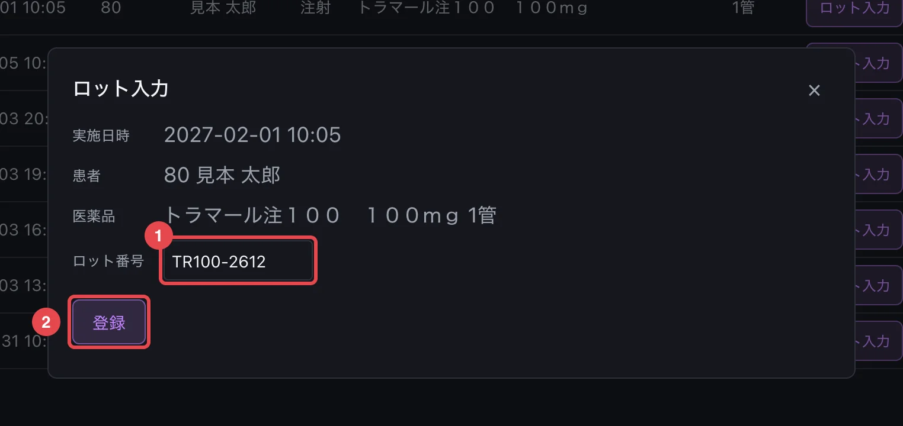

# ロット管理

特定生物由来製品などのロット番号を投与のときに記録し、薬剤部がロット番号から投与した患者を探す操作です。
ロット番号の入っていない投与を探して、あとから入れることもできます。

- ロット番号を記録する薬(ロット管理の薬)は、施設で決めてマスタに設定してあります。生物学的製剤は、設定が無くてもロット管理の薬です。
- ロット番号は、注射・処置・手術・内視鏡・放射線(造影剤)の実施入力で入れます。

## 投与のときにロット番号を入れる(病棟など)

ロット管理の薬は、実施入力の薬の行に「ロット番号」の欄が出ます。画面は注射の実施入力です。注射の実施入力の操作は、看護の[注射の実施入力](nursing-injection.md)を見てください。

{ .screen width="960" }

1. 薬の箱や容器に書かれたロット番号を入れます。全角で入れても半角になります。
2. 「実施登録」を押します。

- ロット番号が空でも登録できます。空の行があると、列の見出しに「未入力」が出ます。入れていない投与は、あとから薬剤部などが入れられます(下の「ロット番号の入っていない投与」)。
- 同じ記録で、同じ薬に同じロット番号は重ねて入れられません。

## ロット番号から投与した患者を探す(薬剤部)

画面の上の「部門業務」>「薬剤部門」>「ロット管理」を開きます。

{ .screen width="960" }

1. 「ロット番号」を入れます。初めの何文字かだけでも探せます。
2. 入れたロット番号と同じものだけを探すときは、「完全一致」にチェックを付けます。
3. 「検索」を押します。
4. 「CSV」を押すと、探した結果をファイルに書き出します。
5. 実施日時・患者・種別(注射・処置など)・医薬品・量・ロット番号が並びます。「カルテ」で患者のカルテを開きます。

輸血の製剤番号も、同じ欄で探せます。

## ロット番号の入っていない投与

「ロット未入力」のタブで、ロット管理の薬なのにロット番号の入っていない投与を探します。

- 「実施日(から)」「実施日(まで)」を入れて「検索」を押します。初めは、今日までの 30 日です。
- 行の「ロット入力」を押すと、ロット番号を入れる画面が開きます。

{ .screen width="762" }

1. ロット番号を入れます。
2. 「登録」を押します。投与の記録にロット番号が入り、一覧から消えます。
