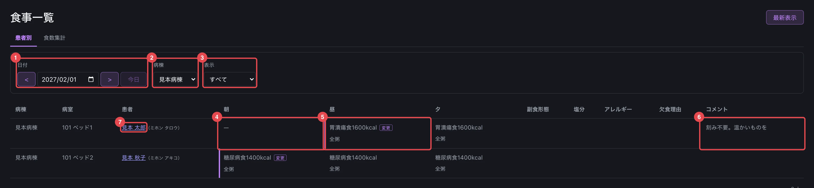
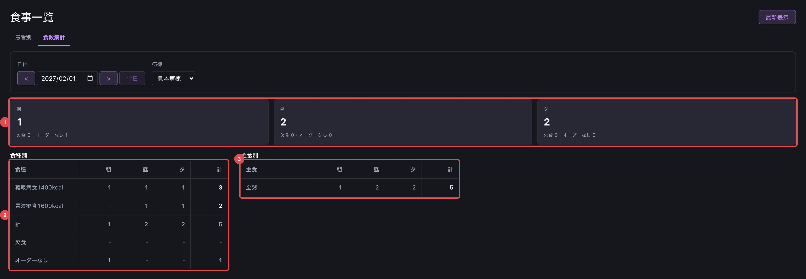

# 食事一覧

給食部門(栄養部門)が、その日の入院患者の食事を患者別に確かめ、食種・主食ごとの食数を数える画面です。
食事の流れ全体は、業務フローの[食事オーダー](../flows/meal.md)を見てください。指示は[食事](meal.md)のページです。

- 食事一覧は、画面の上の「部門業務」>「栄養部門」>「食事一覧」で開きます。
- 給食部門は依頼を 1 件ずつ受け付けません。医師の指示は、その食からそのまま一覧に反映されます。
- 気になる指示があるときは、主治医や病棟に確かめます。

## 患者別に見る

{ .screen }

1. 「日付」を選びます。「<」「>」で 1 日ずつ動かし、「今日」で今日に戻ります。
2. 「病棟」で絞り込みます。
3. 「表示」で、「変更あり」(その日に食事が変わる患者)や「オーダーなし」(食事の指示が無い患者)に絞れます。
4. 朝・昼・夕ごとに、食種と主食が出ます。指示の無い食は「—」です。
5. その食から食事が変わる欄には「変更」の印が付き、左に線が出ます。
6. 副食形態・塩分・アレルギー・欠食理由・コメントが出ます。
7. 患者名を押すと、その患者のカルテの「食事」タブが開きます。

- その日に在院した入院患者が 1 人 1 行で並びます。病棟は、いまのベッドの病棟です。
- 右上の「最新表示」で読み直します。

## 食数を数える

「食数集計」のタブで、配膳する食数を数えます。

{ .screen }

1. 朝・昼・夕ごとの食数と、欠食・オーダーなしの数が出ます。
2. 「食種別」に、食種ごとの朝・昼・夕と計の食数が出ます。下に、計・欠食・オーダーなしの行が出ます。
3. 「主食別」に、主食ごとの食数が出ます。

- 病棟の食事摂取量は、病棟が経過表か一括入力で主食・副食ごとに 0〜10 割で記録します。
- 配膳の進み具合の記録、はい膳表・食札の印刷、栄養量の合計は、まだありません。
