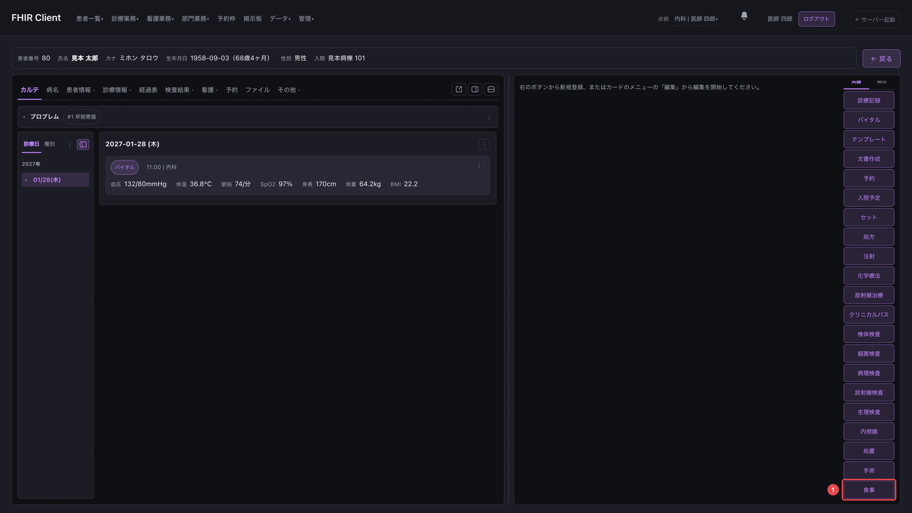
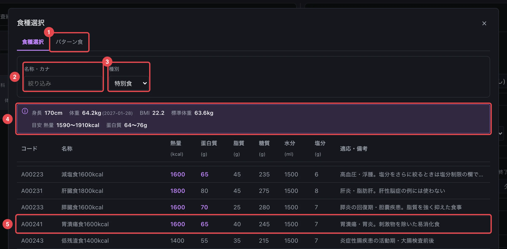
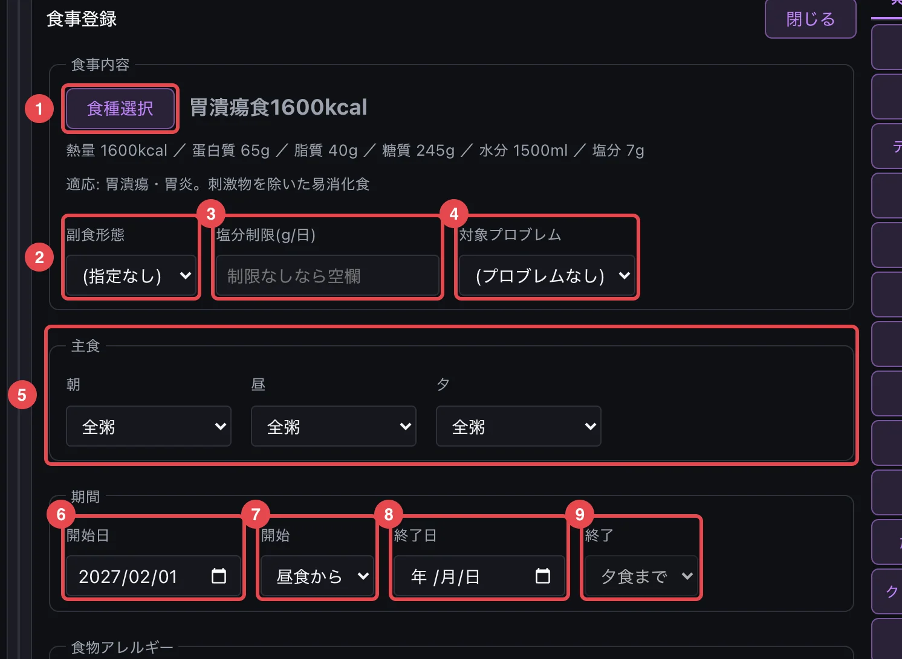
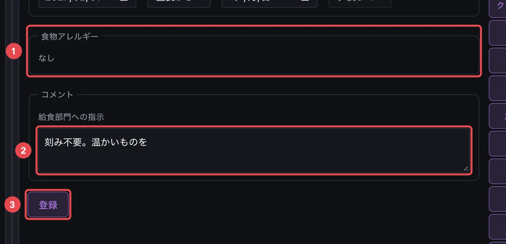
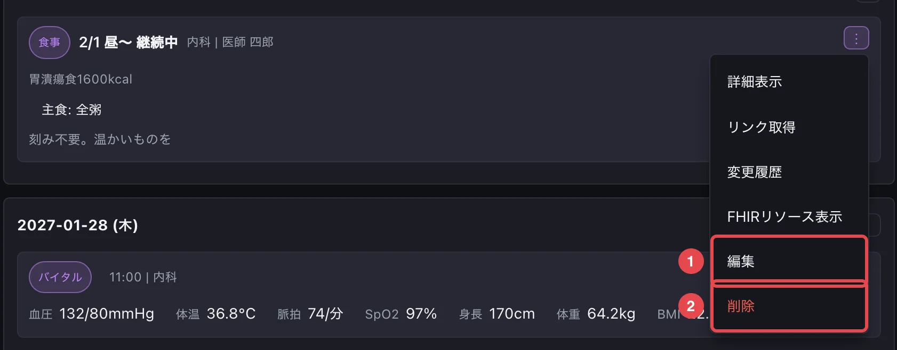
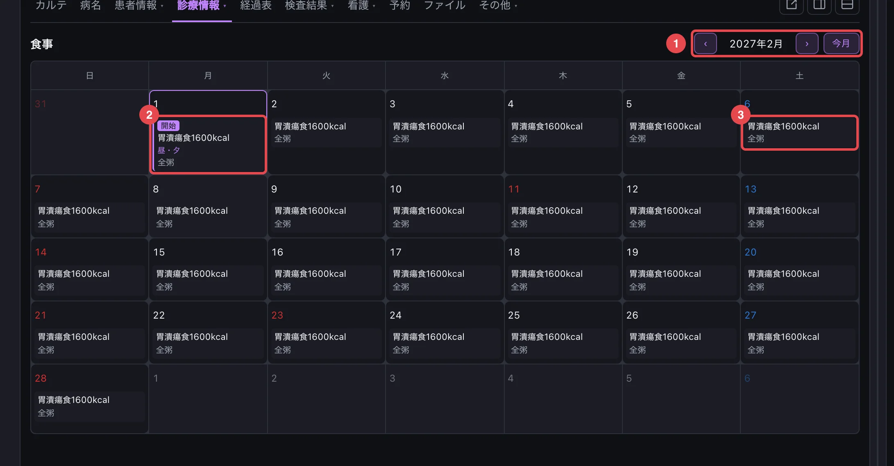

# 食事

医師が入院中の患者の食事(食種・主食・期間)を指示する操作です。給食部門での食事一覧や、入退院・外出泊との連動、
食物アレルギーの扱いは、業務フローの[食事オーダー](../flows/meal.md)を見てください。

食事は、入院中の患者にだけ登録できます。食事オーダーに「中止」はありません。終わらせるときは終了を入れます。

## 食事登録を開く

入院中の患者のカルテを開いておきます。

{ .screen }

1. カルテの右側に並ぶボタンから「食事」を押します。右側に「食事登録」が開きます。

## 食種を選ぶ

「食種選択」を押すと、食種の一覧が開きます。

{ .screen width="1200" }

1. 段階的に食事を上げる決まった組み合わせは、「パターン食」のタブから選びます。
2. 「名称・カナ」に名前の一部を入れて絞り込みます。
3. 「種別」(一般食・特別食・経管栄養など)で絞り込みます。3 食とも出さないときは「食止め」を選びます。
4. 患者の身長・体重・BMI と、熱量・蛋白質の目安が出ます。目安に収まる熱量・蛋白質は強調して出ます。
5. 使う食種の行を押します。

## 食事内容・主食・期間を入れる

{ .screen width="746" }

1. 選んだ食種と、熱量・蛋白質などの量・適応が出ます。選び直すときは「食種選択」を押します。
2. 「副食形態」(軟菜・きざみ・ミキサーなど)を選びます。
3. 塩分を制限するときは「塩分制限(g/日)」に入れます。制限しないときは空にします。
4. 「対象プロブレム」で、対象の病名を選びます。
5. 「主食」を朝・昼・夕ごとに選びます。その食を出さないときは「欠食」を選びます。1 食でも欠食があると、欠食理由の欄が出ます。
6. 「開始日」を入れます。初期値は今日です。
7. 「開始」で、開始日のどの食から出すかを選びます。
8. 終わりが決まっていれば「終了日」を入れます。空のときは、次の指示まで続きます。
9. 「終了」で、終了日のどの食までにするかを選びます。

食止めの食種を選ぶと、主食・副食形態・塩分制限は入れられません。

## 登録する

{ .screen width="748" }

1. 「食物アレルギー」に、患者に登録された食物アレルギーが出ます。ここでは選びません。登録した時点の食物アレルギーが、そのまま給食部門に伝わります。
2. 給食部門へ伝えることがあれば、「給食部門への指示」に入れます。
3. 「登録」を押します。

いま出ている食事があるときは、フォームに「前のオーダーを終了する」のチェックが出ます(下の「食事を変える」)。

登録すると右側が閉じ、カルテに食事のカードが出ます。見出しに、いつの食から始まるかと、続いているかが出ます。

{ .screen width="841" }

1. 「⋮」の「編集」を押すと、右側に編集が開きます。終わらせるときは、ここで終了を入れます。直して「更新」を押します。
2. 「⋮」の「削除」を押すと、理由を入れて食事を削除します。摂取量の記録がある食事は削除できません。

## 食事タブで予定を見る

カルテの左側の「診療情報」にマウスを載せ、「食事」を押すと、月の暦で食事の予定が出ます。

{ .screen width="1091" }

1. 「‹」「›」で月を送ります。「今月」で今月に戻ります。
2. オーダーが始まった日のマスには「開始」の印が付きます。このマスを押すと、そのオーダーを直せます。
3. 続いている途中の日のマスを押すと、その日から食事を変える登録が開きます(下の「食事を変える」)。

## 食事を変える

食事を途中から変えるときは、暦の変えたい日のマスを押すか、右側の「食事」から新しく登録します。
いま出ている食事があると、フォームにチェックが 2 つ出ます。どちらも初めからチェックが入っています。

| チェック | 出るとき | チェックを入れたままにすると |
|---|---|---|
| 前のオーダーを終了する | いま出ている食事があるとき | 前の食事が、新しい食事の 1 つ前の食で終わる |
| 終了後、この食事に戻す | 新しい食事に終了があるとき | 終了の次の食から、元の食事がまた始まる |

たとえば、一般食が続いているときに、10 日朝〜11 日夕の検査のための食止めを出すと、一般食は 9 日夕で終わり、12 日朝から一般食がまた始まります。

- 途中の日のマスから登録しても、過去の食事は変わりません。
- 新しい食事を削除しても、前の食事の終了は元に戻りません。前の食事を編集して、終了を外します。
- カードに「DO」はありません。同じ内容をもう一度出すときは、暦の続いている日のマスから登録します。
