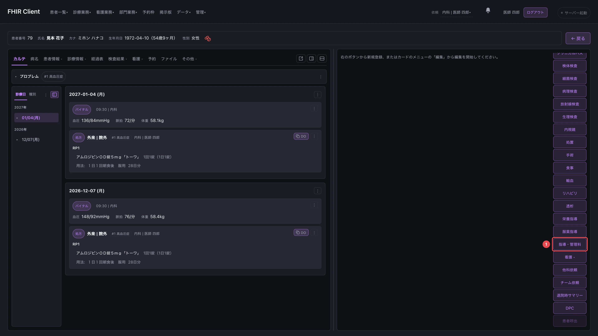
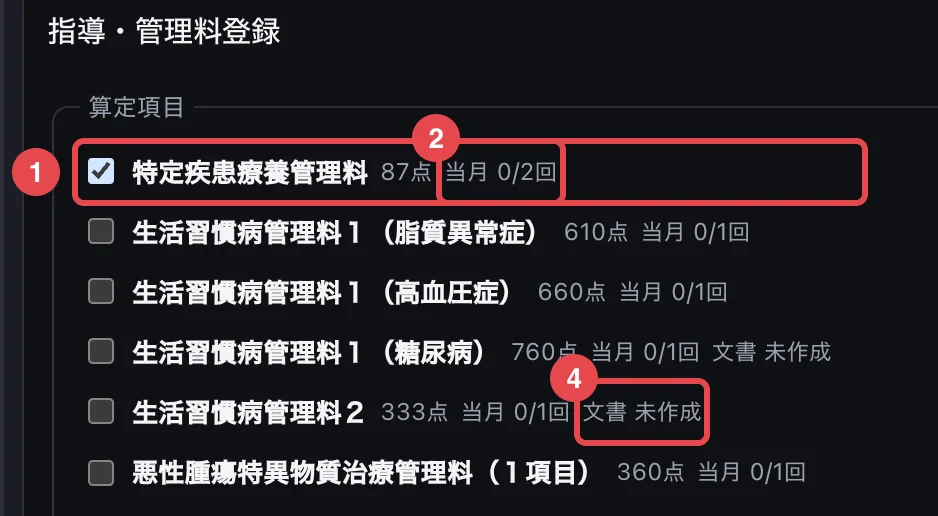
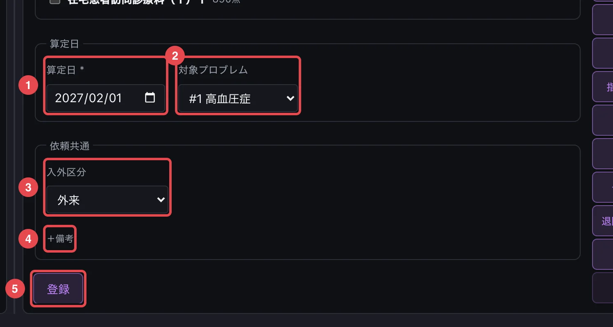
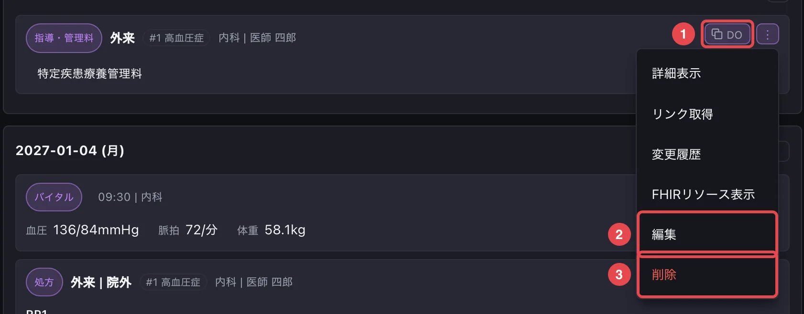

# 指導・管理料

医師が、特定疾患療養管理料のような医学管理等の指導料・管理料を、カルテから算定する操作です。
算定日の決まり方や医事会計への送り方は、業務フローの[指導・管理料](../flows/medical-management.md)を見てください。

ここに並ぶ項目は、施設が「指導・管理料」の項目マスタに登録したものです。算定できるかどうかの最終の判断は、医事会計システムで行います。

## 指導・管理料登録を開く

患者のカルテを開いておきます。

{ .screen }

1. カルテの右側に並ぶボタンから「指導・管理料」を押します。右側に「指導・管理料登録」が開きます。

## 算定項目を選ぶ

{ .screen width="469" }

1. 算定する項目にチェックを付けます。いくつでも選べます。項目名の横に点数が出ます。
2. 項目ごとに、前回算定した日と、算定日の月にもう算定した回数(上限があるときは「当月 1/2回」のように上限も)が出ます。
3. 加算がある項目は、チェックを付けると下に加算の候補が出ます。算定する加算にチェックを付けます。
4. 算定の要件になる文書(療養計画書・診療情報提供書など)がある項目は、その文書を最後に作った日か「未作成」が出ます。

月の上限を超えるときや文書が足りないときは、フォームに注意が出ます。どれも登録は止めません。
文書が足りない項目を登録すると、指示医師に文書作成の督促が届きます。

## 算定日を入れて登録する

{ .screen width="748" }

1. 「算定日」を確かめます。初期値は今日です。
2. 「対象プロブレム」で、対象の病名を選びます。
3. 「入外区分」を確かめます。
4. 書き添えることがあれば「＋備考」を押して入れます。
5. 「登録」を押します。

登録すると右側が閉じ、カルテの算定日のところに指導・管理料のカードが出ます。項目が複数のときは「特定疾患療養管理料 ほか1件」のようにまとめて出ます。

## 登録した指導・管理料を使う・直す

カルテの指導・管理料のカードから操作します。

{ .screen width="841" }

1. 「DO」を押すと、同じ項目が右側の「指導・管理料登録」に入ります。
2. 「⋮」の「編集」を押すと、右側に編集が開きます。項目・加算・算定日・入外区分・対象プロブレム・備考を直して「更新」を押します。
3. 「⋮」の「削除」を押すと、理由を入れて削除します。算定の記録も一緒に消えます。

- 指導・管理料に「中止」はありません。算定を取り消すときは削除します。
- 医事会計システムへ送ったあとにカルテを直しても、医事会計システムの側は自動では直りません。医事課が送り直します。
- 文書作成の画面で、算定の要件になる文書を作るときにも、一緒に管理料を算定できます([文書作成](document.md))。
