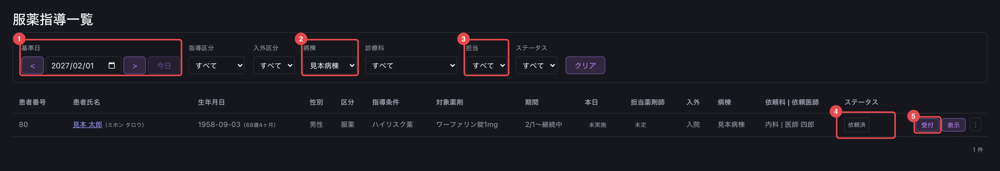
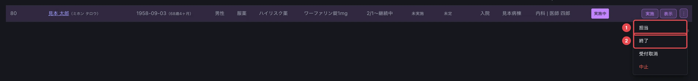
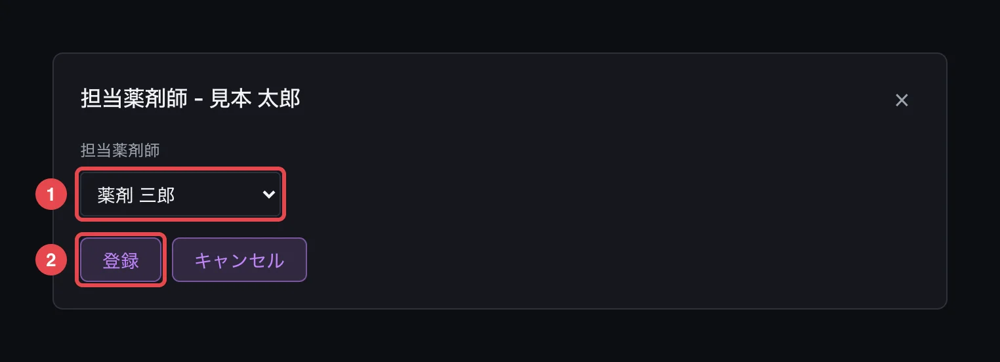
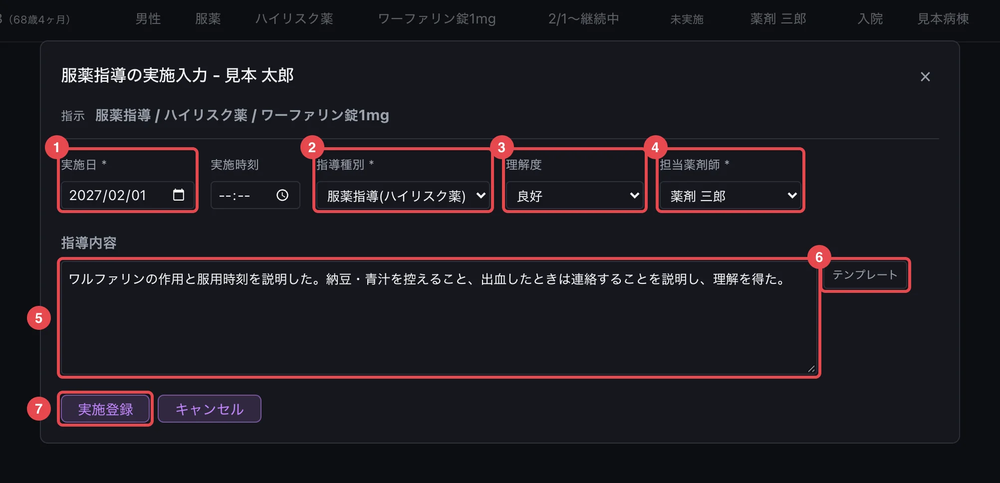
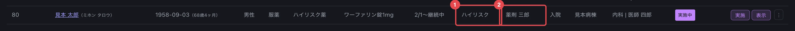
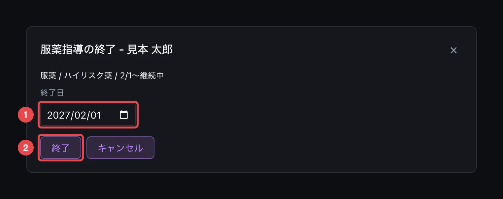

# 服薬指導

薬剤部が、医師から依頼された服薬指導を服薬指導一覧で受け付け、担当の薬剤師を決め、指導のたびに記録して終了する操作です。
医師の依頼の操作は[栄養指導・服薬指導](guidance.md)、流れ全体は業務フローの[栄養指導・服薬指導](../flows/guidance.md)を見てください。

- 服薬指導は 1 つの依頼で期間を決めて出し、期間の中で何回でも指導を記録します。
- 薬剤部の状態は「依頼済」→(受付)→「実施中」→(終了)→「終了」と進みます。指導を記録しても状態は「実施中」のままです。

## 服薬指導一覧の見方

画面の上の「部門業務」>「薬剤部門」>「服薬指導一覧」を開きます。ホームの「服薬指導」のカードからも開けます(担当が決まっていない件数も出ます)。

{ .screen }

1. 「基準日」の日に期間がかかっている依頼が並びます。「<」「>」で 1 日ずつ動かし、「今日」で今日に戻ります。
2. 「病棟」で絞り込めます。ほかに「指導区分」「入外区分」「診療科」「ステータス」でも絞り込めます。
3. 「担当」で、自分が担当の依頼(「自分」)や、担当が決まっていない依頼(「未定」)に絞り込めます。
4. 「ステータス」に薬剤部の状態が出ます。
5. 依頼済の行の「受付」を押して受け付けます。状態が「実施中」になり、「実施」が出ます。

行には、指導区分・指導条件(ハイリスク薬など)・対象薬剤・期間と、基準日に指導したかどうか(「本日」)が出ます。
「表示」を押すと、依頼の内容が開きます。

## 担当の薬剤師を決める

{ .screen }

1. 行の「⋮」から「担当」を押します。
2. 指導を終えるときは「終了」を押します(下の「終了する」)。

メニューにはほかに、受付をやめる「受付取消」と、依頼を中止する「中止」があります。

{ .screen width="762" }

1. 担当の薬剤師を選びます。
2. 「登録」を押します。担当を外すときは「解除」を押します。

## 指導を記録する

指導をしたら、行の「実施」を押します。

{ .screen width="1002" }

1. 「実施日」を入れます。必要なら「実施時刻」も入れます。
2. 「指導種別」を選びます。指導条件にハイリスク薬がある依頼は「服薬指導(ハイリスク薬)」、退院時指導の依頼は「退院時指導」が初期値です。
3. 患者の「理解度」を選びます。
4. 指導した「担当薬剤師」を選びます。
5. 「指導内容」に、説明したことを入れます。
6. 「テンプレート」を押すと、施設で用意したテンプレートで指導内容を記入できます。
7. 「実施登録」を押します。

{ .screen }

1. 「本日」に、その日の指導の種別が出ます。
2. 「担当薬剤師」に、担当の薬剤師が出ます。

カルテの服薬指導のカードにも、直近の指導の記録と回数が出ます。

## 終了する

入院中の指導を終えたら、行の「⋮」から「終了」を押します。

{ .screen width="762" }

1. 「終了日」を入れます。初期値は今日です。
2. 「終了」を押します。依頼の期間も終了日までになり、それより後の日には一覧に出なくなります。

- 退院の操作でも、服薬指導の依頼を退院日で終了できます。
- 間違えて終了したときは、行の「⋮」の「終了取消」で実施中に戻せます。
