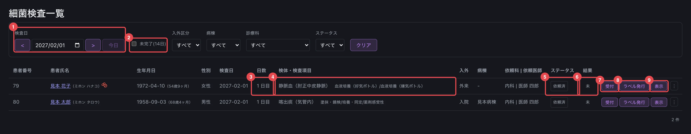
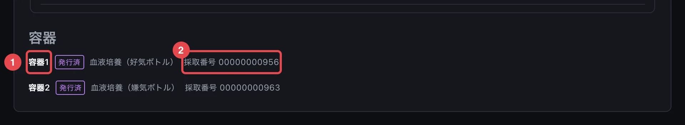
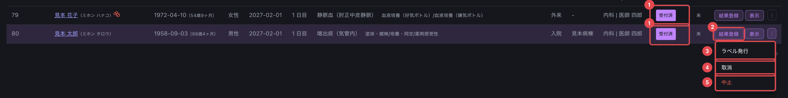
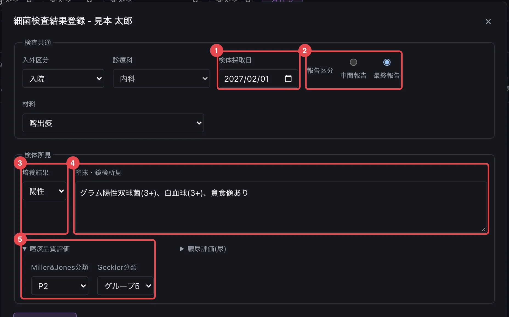
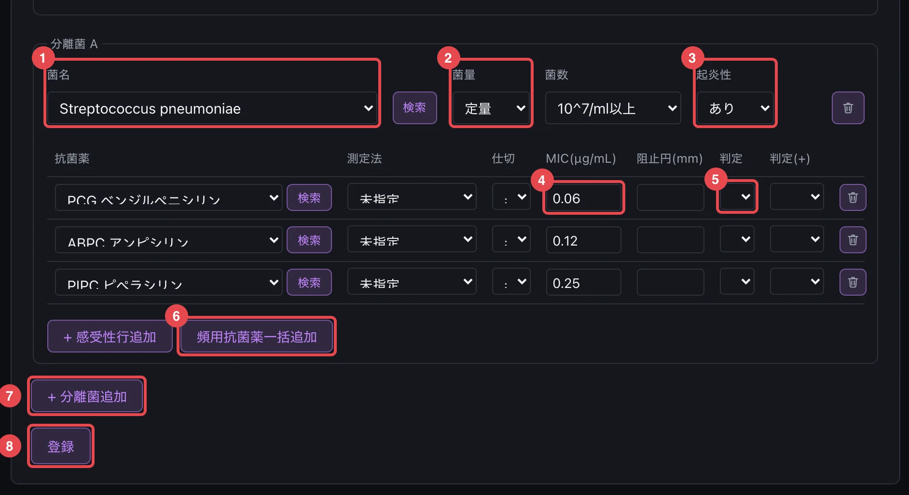
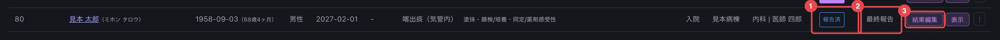

# 細菌検査一覧

検査室が、医師の出した細菌検査を細菌検査一覧で受け、検体ラベルの発行・受付・結果の登録をする操作です。
細菌検査の流れ全体は、業務フローの[細菌検査オーダー](../flows/micro.md)を見てください。

- 細菌検査一覧は、画面の上の「部門業務」>「臨床検査部門」>「細菌検査一覧」で開きます。ホームの「細菌検査」のカードからも開けます。
- 作業は「依頼済」→(検体が検査室に届く)→「受付済」→(最終報告の結果を登録)→「報告済」と進みます。
- 検体検査と違い、ラベルを発行しても受付済にはなりません。容器が全部届いたとき([検体到着確認](lab-arrival.md)で読む)か、
  行の「受付」を押したときに受付済になります。

## 細菌検査一覧の見方

1 行が検体 1 つです。

{ .screen }

1. 「検査日」で、検体を採る日を選びます。「<」「>」で 1 日ずつ動かし、「今日」で今日に戻ります。
   ほかに「入外区分」「病棟」「診療科」「ステータス」で絞り込めます。
2. 「未完了(14日)」にチェックを付けると、選んだ日までの 14 日間の依頼済・受付済の検査を、古い検査日から並べます。培養の結果待ちを追うときに使います。
3. 「日数」に、検査日を 1 日目として今日が何日目かが出ます。報告済・中止の行は「-」です。
4. 「検体・検査項目」に、検体と採取部位、検査項目が出ます。
5. 「ステータス」に作業の状態が出ます。
6. 「結果」に、結果の報告区分(「未」「中間報告」「最終報告」)が出ます。
7. ラベルを貼らずに届いた検体は「受付」を押して受け付けます。
8. 依頼済の行は「ラベル発行」で検体ラベルを刷ります。
9. 「表示」を押すと、検体・目的菌・臨床情報などの依頼の内容と、容器ごとのラベルが開きます。結果があれば、結果も続けて出ます。

## 検体ラベルを発行する

ラベルは容器 1 つに 1 枚です。血液培養の好気ボトル・嫌気ボトルのように、検体と別の容器で出す検査項目は、項目ごとに 1 枚刷ります。
病棟では、カルテの細菌検査のカードのメニューの「ラベル発行」でも刷れます。

「表示」の下の「容器」に、容器ごとのラベルの状態が出ます。

{ .screen }

1. 容器ごとに、状態(「未発行」「発行済」「到着済」)と、容器の中身が出ます。
2. ラベルを発行した容器には、ラベルの番号(採取番号)が出ます。届かない容器の問い合わせは、この番号で行います。

刷り直しても、同じ容器は同じ番号で刷られます。医師が検査項目を外したあとに刷り直すと、外した項目の容器のラベルは取り下げになり、
検体到着確認で読んでも弾かれます。

## 受け付ける

{ .screen }

1. 容器が全部届くか「受付」を押すと、ステータスが「受付済」になります。
2. 受付済の行に「結果登録」が出ます。
3. 受付済の行の「⋮」の「ラベル発行」で、ラベルを刷り直せます。
4. 「⋮」の「取消」で依頼済に戻します。
5. 「⋮」の「中止」で検査を取りやめます。中止した検査は「中止取消」で依頼済に戻せます。

## 結果を登録する

受付済の行の「結果登録」を押すと、結果の入力画面が開きます。オーダーは行で決まっていて、材料・依頼科・検体採取日はオーダーから写されます。

{ .screen width="1002" }

1. 「検体採取日」は、採取を記録していればその日、無ければ検査日が入っています。違うときは直します。
2. 「報告区分」を選びます。塗抹の結果だけを先に返すときは「中間報告」で登録し、培養・感受性が出てから「結果編集」で「最終報告」に切り替えます。
3. 「培養結果」で、陰性・陽性を選びます。
4. 「塗抹・鏡検所見」に、グラム染色の所見などを書きます。
5. 喀痰は「喀痰品質評価」で Miller&Jones 分類・Geckler 分類を、尿は「膿尿評価(尿)」を選びます。押すと開きます。

{ .screen width="1002" }

1. 「+ 分離菌追加」で分離菌の枠を足し、「菌名」を選びます。一覧に無い菌は「検索」で探します。
2. 「菌量」「菌数」を選びます。
3. 「起炎性」を選びます。
4. 感受性は抗菌薬ごとに 1 行です。「MIC(µg/mL)」か「阻止円(mm)」を入れます。
5. 「判定」で S / I / R を選びます。
6. 「頻用抗菌薬一括追加」で、よく測る抗菌薬の行をまとめて足します。1 行ずつ足すときは「+ 感受性行追加」です。使わない行は、行のゴミ箱のボタンで消します。
7. 2 つ目の菌は、もう一度「+ 分離菌追加」を押します。分離菌は 5 株(A〜E)まで入れられます。
8. 「登録」を押します。

## 報告したあと

{ .screen }

1. 最終報告で登録すると、ステータスが「報告済」になります。中間報告で登録したときは受付済のままです。
2. 「結果」に報告区分が出ます。
3. 結果を直すときや、中間報告を最終報告に切り替えるときは「結果編集」を押します。

結果を消すと、報告済の検査は受付済に戻ります。
