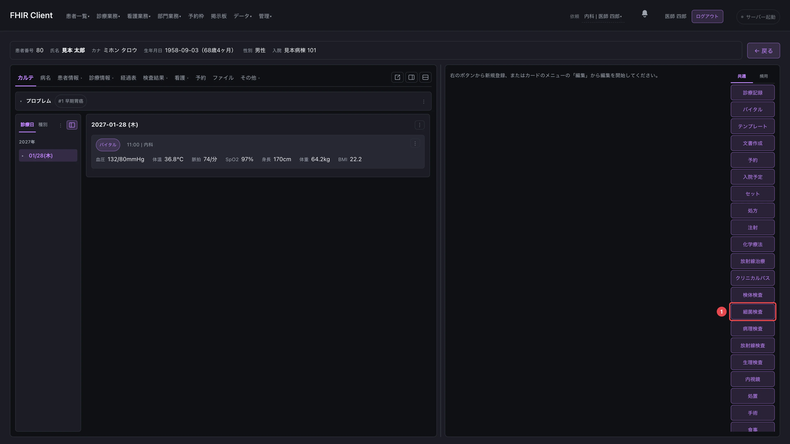
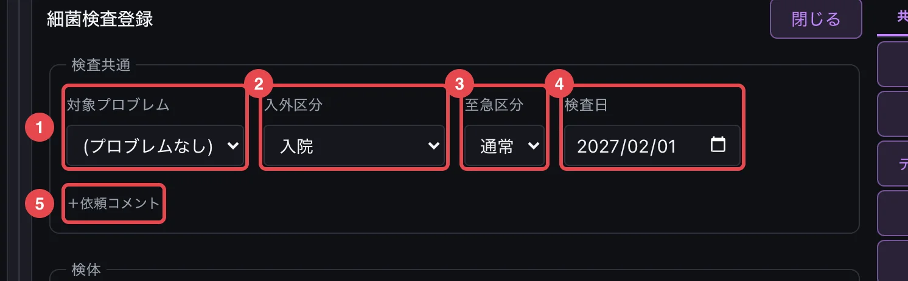
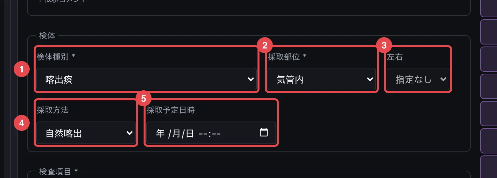
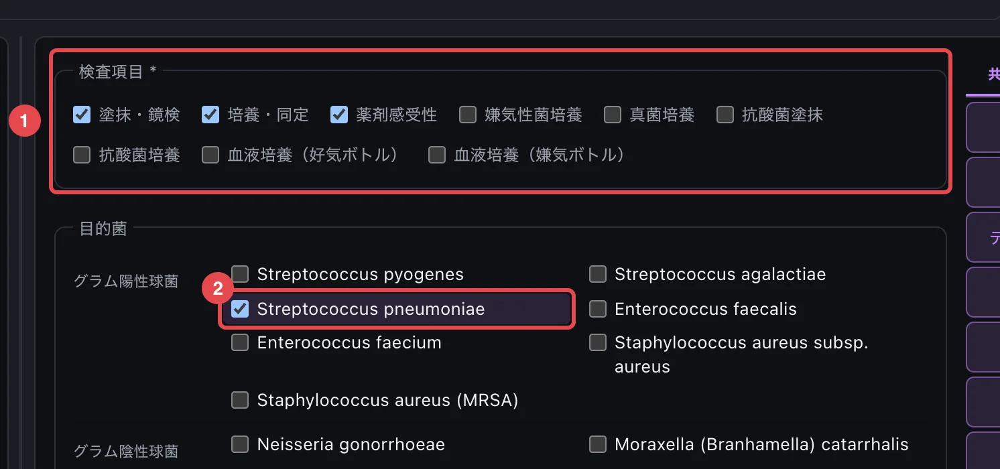
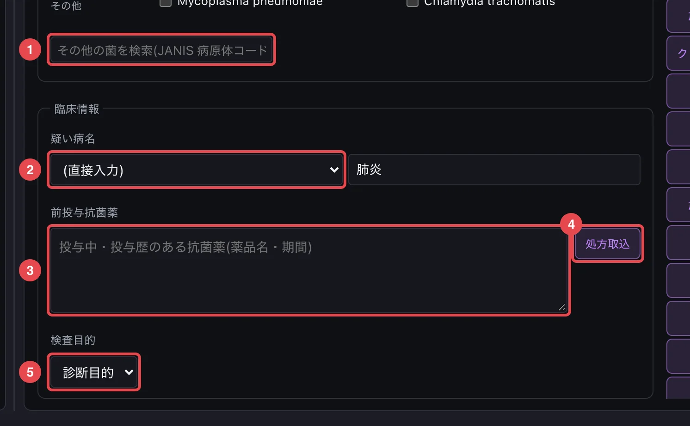
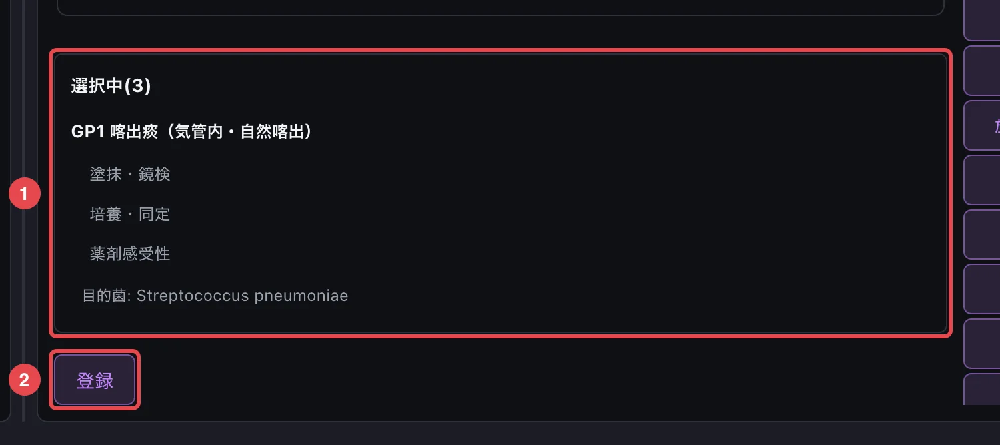
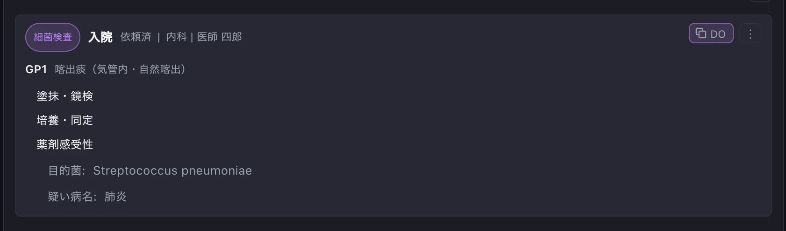
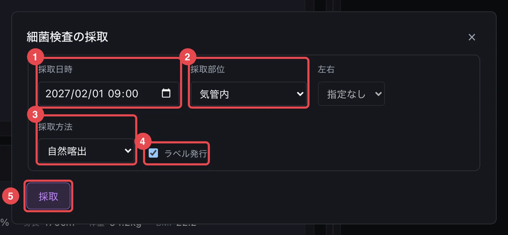
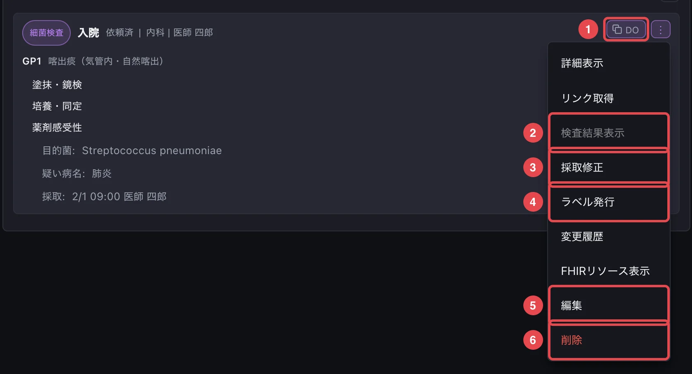

# 細菌検査

医師がカルテから細菌検査(塗抹・培養・感受性など)を登録し、病棟・診察室で採取を記録する操作です。
ラベル発行・到着・中間報告・最終報告・結果の確認までの流れは、業務フローの[細菌検査オーダー](../flows/micro.md)を見てください。

迅速抗原・毒素・PCR は、細菌検査ではなく[検体検査](lab.md)で出します。

## 細菌検査登録を開く

患者のカルテを開いておきます。

{ .screen }

1. カルテの右側に並ぶボタンから「細菌検査」を押します。右側に「細菌検査登録」が開きます。

## 検査共通を入れる

{ .screen width="746" }

1. 「対象プロブレム」で、この検査の対象の病名を選びます。プロブレムを選ばないときは「(プロブレムなし)」のままにします。
2. 「入外区分」で「入院」か「外来」を選びます。
3. 「至急区分」で「通常」か「至急」を選びます。
4. 「検査日」に、検体を採る日を入れます。初期値は今日です。
5. 検査室へ伝えることがあれば「＋依頼コメント」を押して入れます。

## 検体を入れる

1 つの細菌検査で、検体を 1 つ出します。項目名に「*」が付いたものは必ず入れます。

{ .screen width="746" }

1. 「検体種別」で、喀出痰・静脈血・自然排尿などを選びます。
2. 「採取部位」を選びます。
3. 必要なら「左右」を選びます。
4. 「採取方法」を選びます。
5. 採る日時が決まっていれば「採取予定日時」に入れます。採取を記録するまでは、この日時がラベルに出ます。

## 検査項目と目的菌を選ぶ

{ .screen width="746" }

1. 「検査項目」で、行う検査にチェックを付けます。1 つ以上選びます。
2. 疑っている菌があれば、「目的菌」でチェックを付けます。いくつでも選べます。

血液培養の好気ボトル・嫌気ボトルは、検体とは別の容器になり、ラベルも別に刷られます。

## 臨床情報を入れる

{ .screen width="746" }

1. 目的菌の一覧に無い菌は、「その他の菌を検索」に名前を入れて探して足します。
2. 「疑い病名」で、患者のプロブレムから選ぶか、「(直接入力)」にして横に病名を入れます。
3. 「前投与抗菌薬」に、投与中・投与歴のある抗菌薬を入れます。培養の結果を読むときに使います。
4. 「処方取込」を押すと、期間内(初期値は 3 か月)に出した処方・注射の抗菌薬が並びます。チェックを付けて「取込」を押すと、
   「前投与抗菌薬」に書き足されます。書き足したあとで直せます。
5. 「検査目的」で「診断目的」か「監視培養」を選びます。

## 登録する

{ .screen width="750" }

1. 「選択中」に、検体と、選んだ検査項目・目的菌が出ます。確かめます。
2. 「登録」を押します。

検体種別・採取部位・検査項目・検査日が足りないときは、上に内容が出ます。直してからもう一度「登録」を押します。

登録すると右側が閉じ、カルテに細菌検査のカードが出ます。

{ .screen width="841" }

## 採取を記録する

病棟・診察室で検体を採ったら、カードの「⋮」の「採取」で記録します。「細菌検査の採取」が開きます。

{ .screen width="714" }

1. 「採取日時」を確かめます。初期値はいまの日時です。
2. 予定と違う部位から採ったときは「採取部位」と「左右」を直します。
3. 予定と違う方法で採ったときは「採取方法」を直します。
4. その場でラベルを刷るときは「ラベル発行」にチェックを付けたままにします。後で刷るときは外します。
5. 「採取」を押します。

採取した人は、記録したログインの人になります。採取を記録すると、カードに採取の日時と採取した人が出ます。
患者が持ち込む検体は、採取を記録せずに、検査室の細菌検査一覧の行の「ラベル発行」でラベルを刷ります。

## 登録した細菌検査を使う・直す

カルテの細菌検査のカードから操作します。

{ .screen width="841" }

1. 「DO」を押すと、同じ内容が右側の「細菌検査登録」に入ります。採取の記録・ラベル・結果は写りません。
2. 結果が報告されると、「⋮」の「検査結果表示」で結果を開けます。結果が無いあいだは押せません。
3. 採取を記録したあとは「⋮」の「採取修正」で直せます。採取した人は、最初に記録した人のままです。
4. 「⋮」の「ラベル発行」で、ラベルを刷ります(刷り直しも同じ番号のラベルになります)。
5. 「⋮」の「編集」を押すと、右側に編集が開きます。直して「更新」を押します。項目を足し引きしたら、ラベルを刷り直します。
6. 「⋮」の「削除」を押すと、理由を入れて細菌検査を削除します。結果があるときは、先に結果を削除します。

- 採取の記録と修正は、検査室が結果を報告するまでのあいだ(依頼済・受付済)にできます。
- 検査をやめるときの「中止」は、カルテのカードではなく、細菌検査一覧の行のメニューで行います。

結果は、カルテの「検査結果」の「細菌検査」タブで見ます。最終報告になると依頼医に通知が届きます(業務フローの[結果の確認](../flows/micro.md#結果の確認))。
