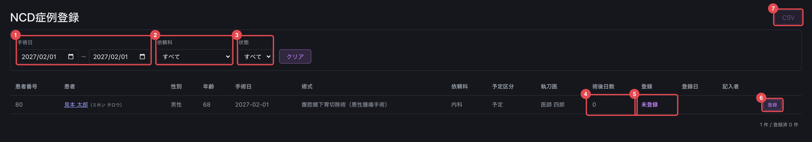
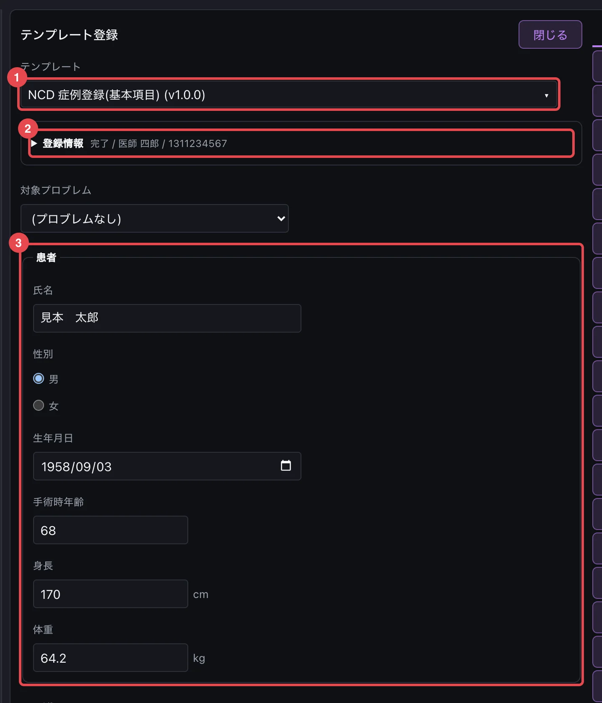
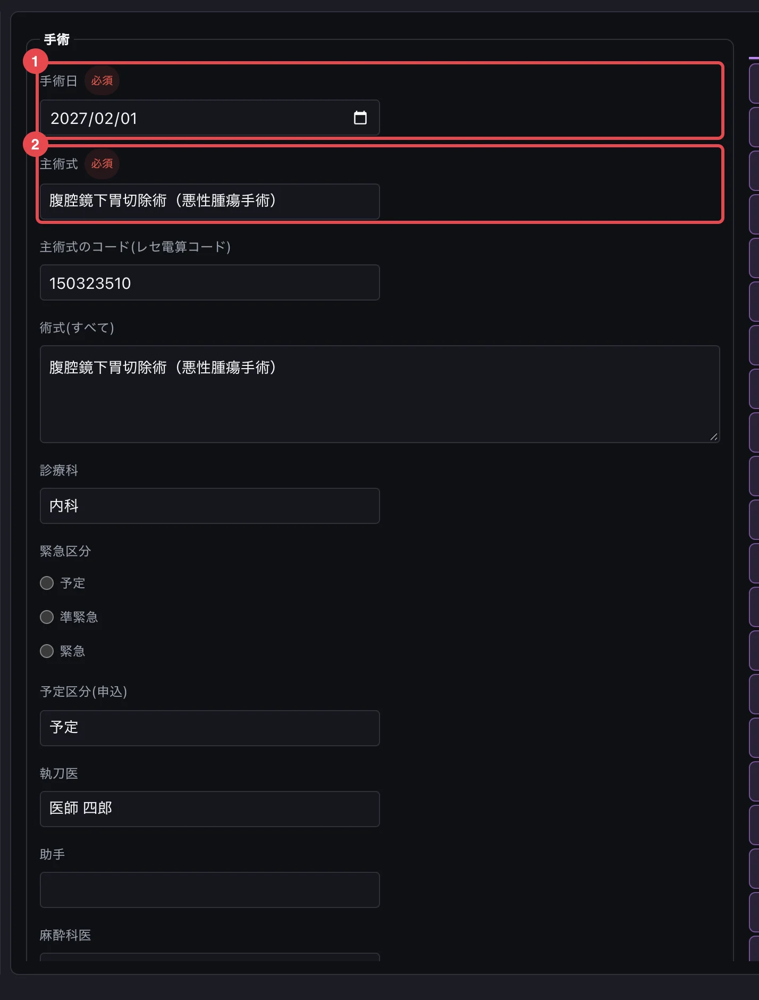
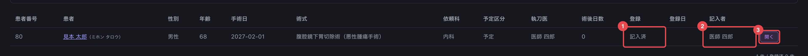

# NCD 症例登録

NCD(National Clinical Database)の症例登録の対象になる手術を一覧にし、基本項目の記入と NCD への登録の状況を追う操作です。

- NCD 症例登録は、画面の上の「データ」>「NCD症例登録」で開きます。
- 一覧に並ぶのは、手術の実施記録(手術一覧で実施入力をした手術)です。手術の申し込みだけでは並びません。
- 記入は、NCD 症例登録(基本項目)のテンプレートで行います。使うテンプレートは施設設定で決めます。
- NCD の画面への入力(領域別の詳細項目・リスク計算)と送信は、この画面では行いません。記入した内容を見ながら NCD に入力し、登録の状況をここに残します。

## 対象の手術を見る

{ .screen }

1. 「手術日」(入室日)の期間で絞ります。開いたときは直近 90 日です。
2. 「依頼科」で絞ります。
3. 「状態」で、未登録・記入中・記入済・登録済に絞ります。
4. 「術後日数」は手術日からの日数です。30 日を過ぎて未登録の行は赤で出ます。
5. 登録の状態です。記入していない手術は「未登録」です。
6. 「登録」で、その手術の症例登録を始めます。記入した行は「開く」になり、記入した内容が開きます。
7. 「CSV」で、表示している行のうち登録済の症例登録を、テンプレートの項目の順に出します。

## 記入する

一覧の「登録」を押すと、その患者のカルテが開き、右側に症例登録のテンプレートが出ます。登録は選んだ手術に結び付きます。

{ .screen width="718" }

1. 施設設定の NCD 症例登録のテンプレートが選ばれています。
2. 「登録情報」を押すと、ステータス・記入者名・保険医療機関番号を直せます。
3. 患者の氏名・性別・生年月日・手術時年齢と、最新の身長・体重が入っています。

{ .screen width="714" }

1. 手術日は手術の実施記録から入ります。
2. 主術式・術式・執刀医・助手・麻酔科医・手術時間・麻酔時間・出血量・輸血・創分類・術中の合併症も、実施記録から入ります。
   診療科・予定区分・麻酔方法は手術の申し込みから、入院日・退院日・術後在院日数は手術日を含む入院から入ります。

- 術前の ASA-PS・リスク因子を入れて「登録」を押します。術後の項目を書くまで書きかけで残すときは、「下書き保存」を押します(必須の項目が空でも残せます)。
- 術後 30 日の合併症(NCD の区分と Clavien-Dindo 分類)・再手術・転帰は、術後にカルテのカードの「編集」で開いて追記します。
- 入れ方は[テンプレート](template.md)と同じです。

## 登録の状況を残す

{ .screen }

1. 記入して登録すると「記入済」になります。「下書き保存」で書きかけのまま残すと「記入中」です。
2. 記入した人が出ます。
3. 「開く」で記入した内容を見ます。直すときは、カルテのテンプレートのカードの「編集」で開きます。

- NCD の画面に入力したら、カードの「編集」で開き、「NCD 登録」の「登録状況」を登録済にして、登録日・NCD 症例番号を入れます。一覧の登録が「登録済」になり、登録日が出ます。
