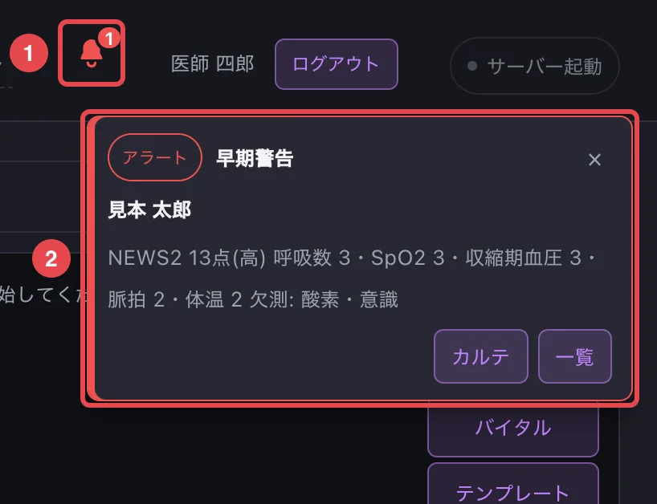
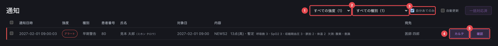

# 通知

検査の緊急異常値・オーダーの承認・疑義照会など、自分あてに届いた「対応してほしいこと」を受け取って片付ける操作です。

通知には急ぐ度合い(強度)があります。

| 強度 | 意味 |
|---|---|
| アラート | すぐに見てほしいもの(緊急異常値・重要所見・早期警告の高い区分など) |
| 注意 | 早めに見てほしいもの(疑義照会など) |
| お知らせ | 手が空いたときに見ればよいもの(検査結果の確認・オーダー承認など) |

## 通知が届いたとき

{ .screen width="409" }

1. 上の帯のベルに、自分あての未対応の通知の件数が出ます。アラートが 1 件でもあると、ベルが赤くなります。ベルを押すと、通知の一覧が開きます。
2. 新しく届いた通知は、画面の右上に知らせが出ます。「カルテ」でその患者のカルテを、「一覧」で通知の一覧を開きます。
   注意とお知らせの知らせは 10 秒で消えます。アラートの知らせは「×」で閉じるまで残ります。

新しい通知は、画面を移ったとき・ブラウザの画面に戻ったとき・登録をしたあとに読み直して知らせます。
同じ画面を開いたままにするときは、通知の一覧の「自動更新」に印を付けると、1 分ごとに読み直します。
「自動更新」は端末ごとの設定です。

## 通知の一覧で片付ける

上の帯の「診療業務」の「通知」か、ベルを押して開きます。未対応の通知が、新しく届いた順に並びます。アラートの行は左端に赤い線が付きます。

{ .screen }

1. 「強度」で、アラート・注意・お知らせのどれかに絞り込みます。括弧の中は、その強度の件数です。
2. 「種別」で、通知の種類に絞り込みます。
3. 「自分あてのみ」の印を外すと、宛先の決まっていない通知(依頼した医師の分からない検査結果など)も並びます。
4. 「カルテ」で、その通知の患者のカルテを開き、内容を確かめます。
5. 確かめたら、行の右端のボタンを押して片付けます。片付けた通知は一覧から消えます。

行の右端のボタンは、通知の種類で変わります。

| ボタン | 使う通知 | 押したとき |
|---|---|---|
| 確認 | 緊急異常値・検査結果確認・重要所見・早期警告など | 確認したことを残して片付けます |
| 承認 | オーダー承認・カルテ承認 | 代行入力や研修医のオーダー・記録を承認します |
| 対応済 | 文書作成・カルテ差戻しなど | 対応したことにして片付けます |

- いくつかの通知をまとめて片付けるときは、行の左端に印を付けて「一括対応済」を押します。
- 疑義照会と特定抗菌薬の届出は、一覧からは片付けられません。カルテの詳細や抗菌薬適正使用の画面で回答・届出をすると片付きます。
- 文書の確定や再測定などで、通知が自動で片付くこともあります(文書作成・カルテ差戻し・早期警告など)。
