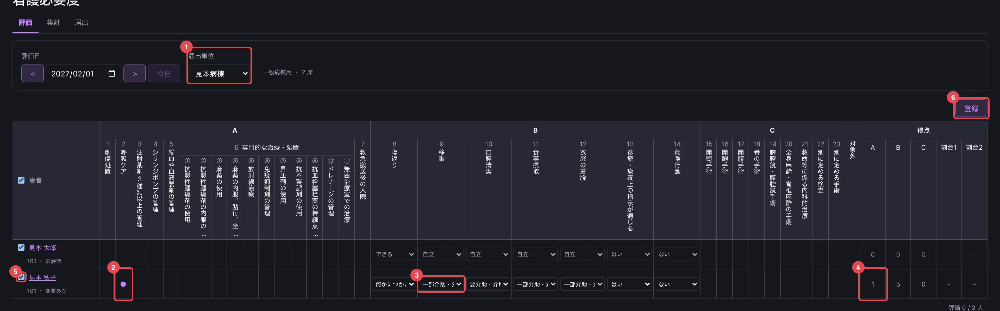
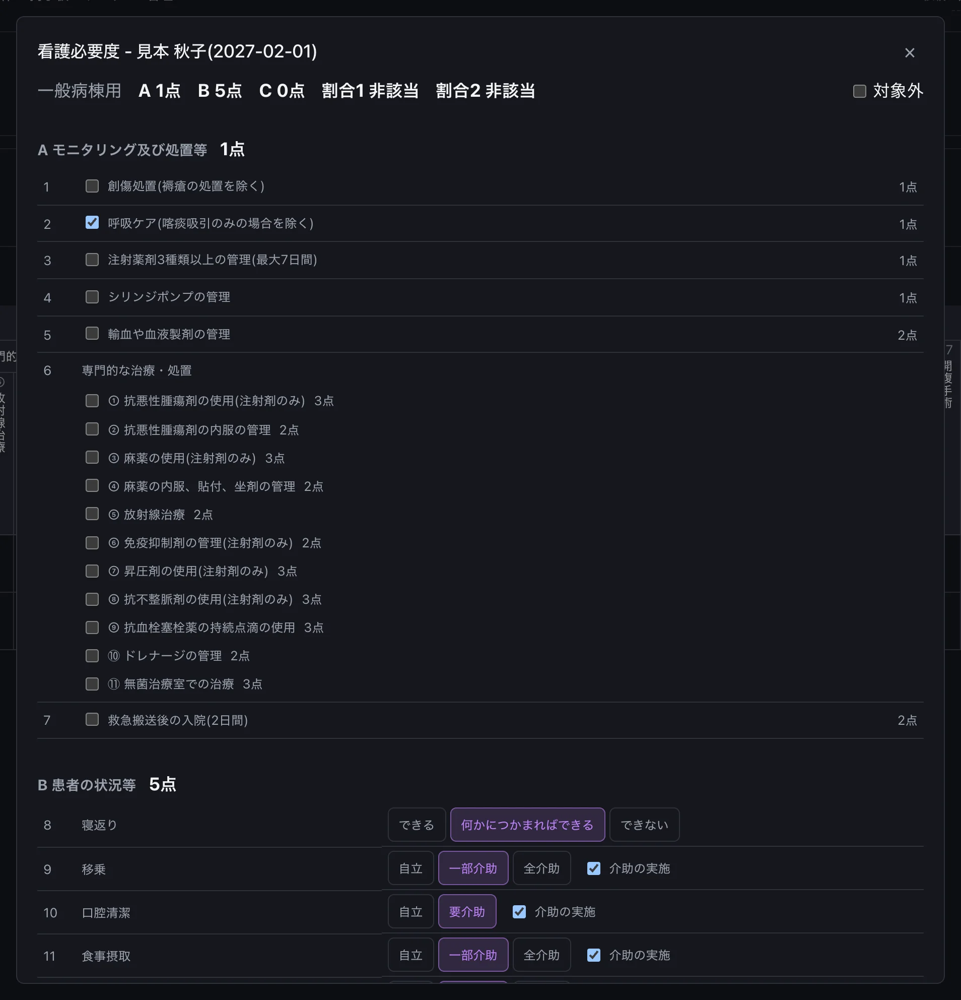
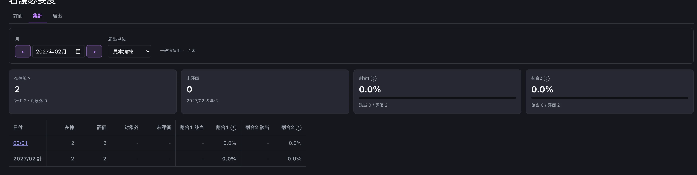
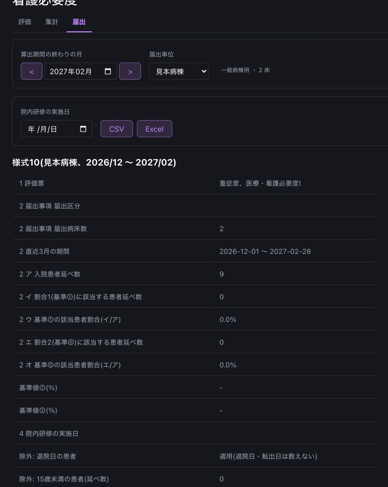

# 看護必要度

重症度、医療・看護必要度を、届出単位(病棟、または ICU・HCU などの病室)の患者ごとに 1 日ずつ評価し、
該当患者割合を集計して、届出の様式の欄を出す操作です。評価票は令和 8 年度改定の一般病棟用(必要度Ⅰ)・特定集中治療室用・ハイケアユニット用です。

届出単位ごとの届出区分・評価票・届出病床数・基準値は、施設の設定で決めます。

## 評価する

ヘッダーの「看護業務」から「看護必要度」を開きます。入院患者一覧の「⋮」からも開けます。

{ .screen }

1. 「評価日」と「届出単位」を選びます。横に評価票・届出区分・届出病床数が出ます。行には、その日に届出単位のベッドにいた患者が病室の順に並びます。
2. A(モニタリング及び処置等)と C(手術等の医学的状況)の項目は、セルを押して「●」(あり)を付けたり外したりします。
3. B(患者の状況等)の項目は、選択肢から選びます。介助の実施を掛ける項目は「一部介助・介助あり」のように、状態と介助の実施を 1 つの選択肢で選びます。
4. 右の「得点」に A・B・C の点と、割合1・割合2 に該当するかが出ます。
5. 登録するのは、行の先頭にチェックを付けた患者だけです。セルを触った行には自動で付きます。触らずにそのまま登録する患者(すべて自立など)は、手でチェックを付けます。見出しのチェックで全員に付きます。
6. 「登録」を押します。

新しく評価するときは、B は前の日の評価が、A・C は注射・処置・手術などの記録から推した項目が初めから入ります。
記録から推した「●」は枠付きで出て、マウスを乗せると根拠(コードの名称と日)が出ます。どれも、確かめて直す前提の初期値です。
該当患者割合の基準は、割合1・割合2 の列見出しにマウスを乗せると出ます。

## 1 人ずつ評価する

氏名を押すと、その患者の評価が 1 人ぶんの画面で開きます。

{ .screen width="954" }

上に得点と割合1・割合2 の判定が出て、項目ごとに点数を見ながら入れられます。
「対象外」(短期滞在手術など)にすると得点を持たず、割合の分母から外れます。
C を選ぶための直近の手術の目安(術後何日か)、記録から推した項目の根拠、「前日複写」もこの画面にあります。

## 集計を見る

「集計」のタブでは、届出単位ごと・月ごとに、日ごとの在棟・評価・対象外・未評価の人数と、割合1・割合2 の該当数と割合を出します。

{ .screen }

上のタイルに月の在棟延べ・未評価・割合1・割合2 が出ます。基準値を下回るものは赤く出ます。
日付を押すと、その日の評価のタブに移ります。届出区分によっては、合計の下に割合指数(救急患者応需係数を足したもの)と基準値の行が出ます。

## 届出の様式を出す

「届出」のタブでは、届出の様式(一般病棟用は様式10、ICU・HCU 用は様式43)の欄を、様式の並びのまま表に出します。

{ .screen width="768" }

「算出期間の終わりの月」と「院内研修の実施日」を入れます。「CSV」「Excel」でダウンロードできます。
入院患者延べ数は様式の定義どおりに数え(退院日・転出日の患者、15 歳未満などを除く)、適用した除外は表の下に並びます。厚生局の様式への転記は手作業です。
