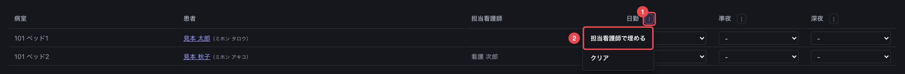
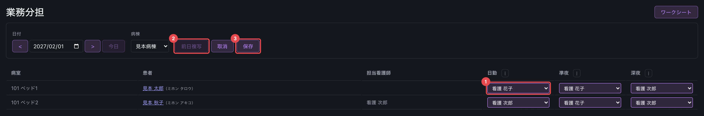
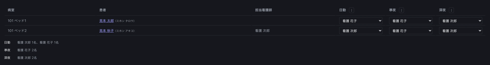

# 業務分担

病棟の 1 日を勤務帯(日勤・準夜・深夜)ごとに分け、患者 1 人に看護師 1 人を受け持ちとして割り付ける操作です。
割り付けた受け持ちは、[ワークシート](nursing-worksheet.md)の「担当」の絞り込みと、ホームの看護師のカードに使います。

入院のときに決める「担当看護師」は入院の期間を通した受け持ちで、業務分担はその日の勤務の受け持ちです。

## 業務分担を開く

ヘッダーの「看護業務」から「業務分担」を開き、「病棟」と「日付」を選びます。ワークシートの「業務分担」、指示簿の「⋮」からも開けます。
行には、その日に病棟のベッドに居た患者が病室の順に並びます。

## 担当看護師で埋める

{ .screen }

1. 勤務帯の見出しの「⋮」を押します。
2. 「担当看護師で埋める」を押すと、その勤務帯の空いている枠に、入院の担当看護師(複数いるときは先頭の人)が入ります。「クリア」で、その勤務帯の割り付けを全部外します。

## 割り付けて保存する

{ .screen }

1. 患者と勤務帯の枠で、受け持つ看護師を選びます。選べるのは、看護師・保健師・助産師と、入院の担当看護師です。
2. 「前日複写」で、前の日の割り付けを空いている枠に写します。
3. 「保存」を押します。病棟のその日の 3 つの勤務帯をまとめて保存します。保存の前に「取消」を押すと、保存してある割り付けに戻ります。

{ .screen }

表の下に、勤務帯ごとの看護師別の受け持ち人数が出ます。
病棟に居ない日の患者の割り付けは残りません。同じ日・同じ勤務帯でほかの病棟に割り付けてあった患者は、この病棟の割り付けに置き換わります。
