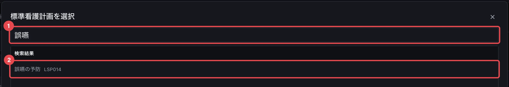
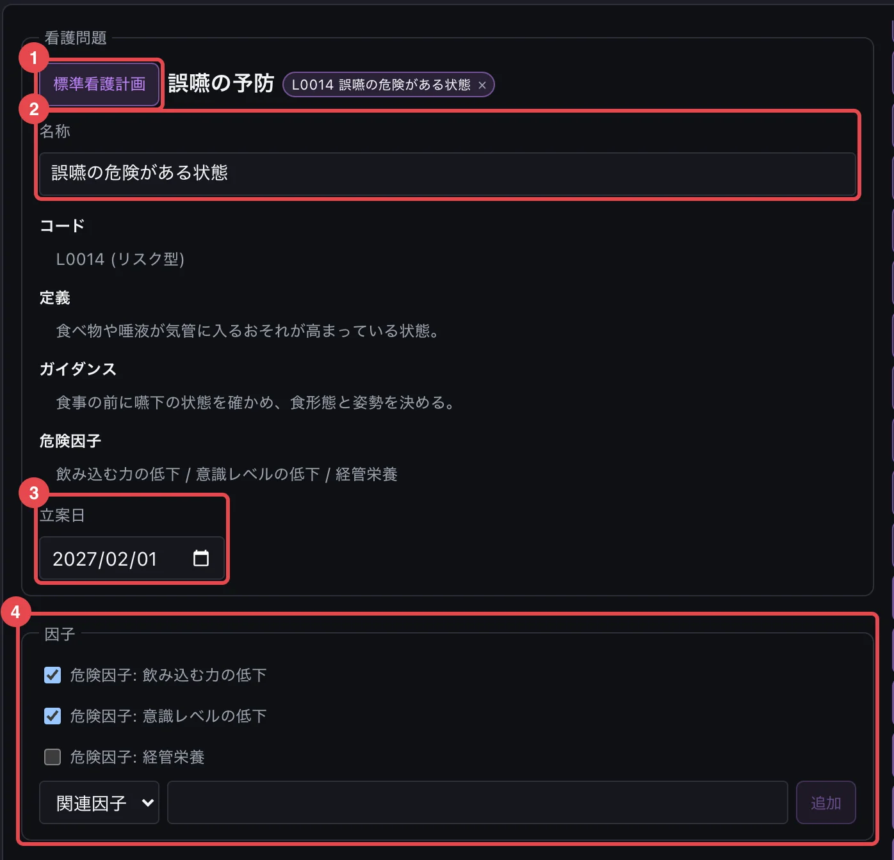
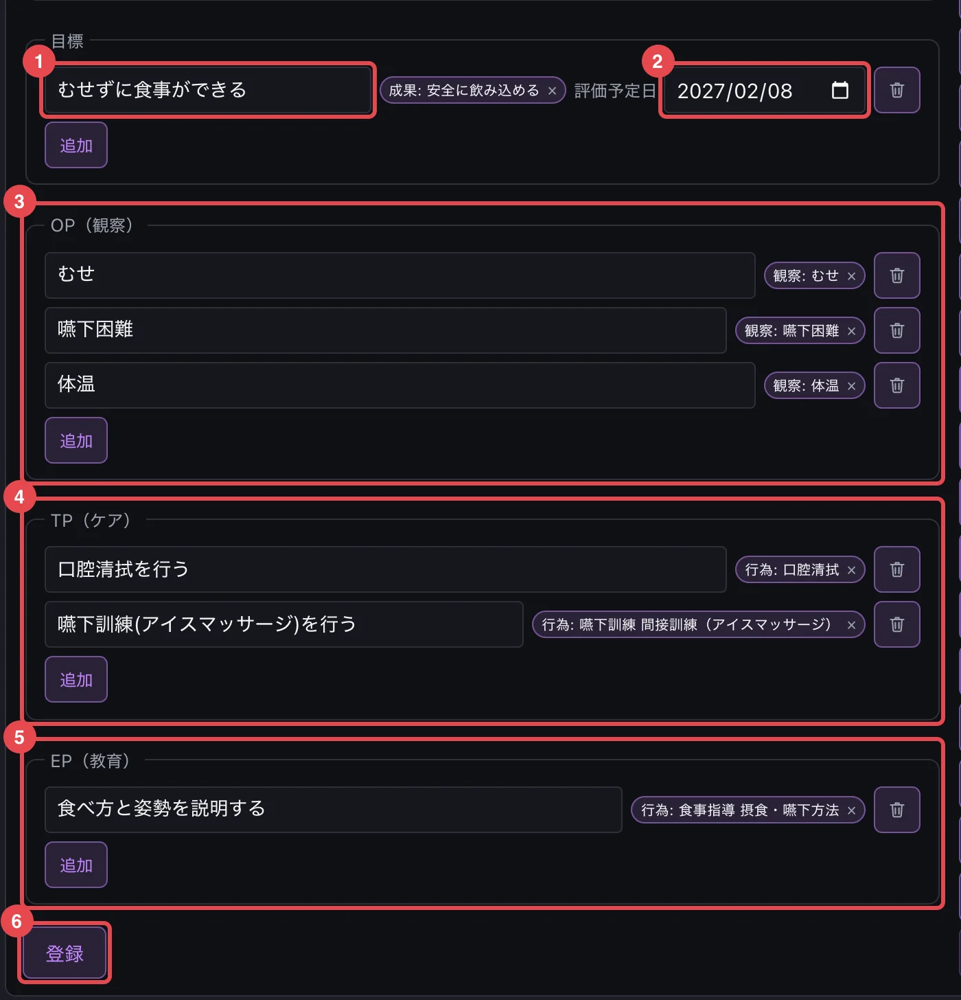
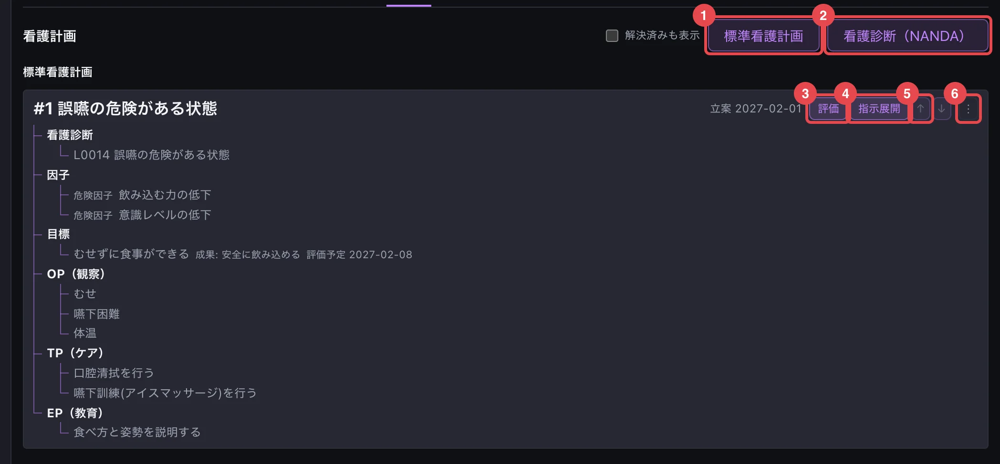
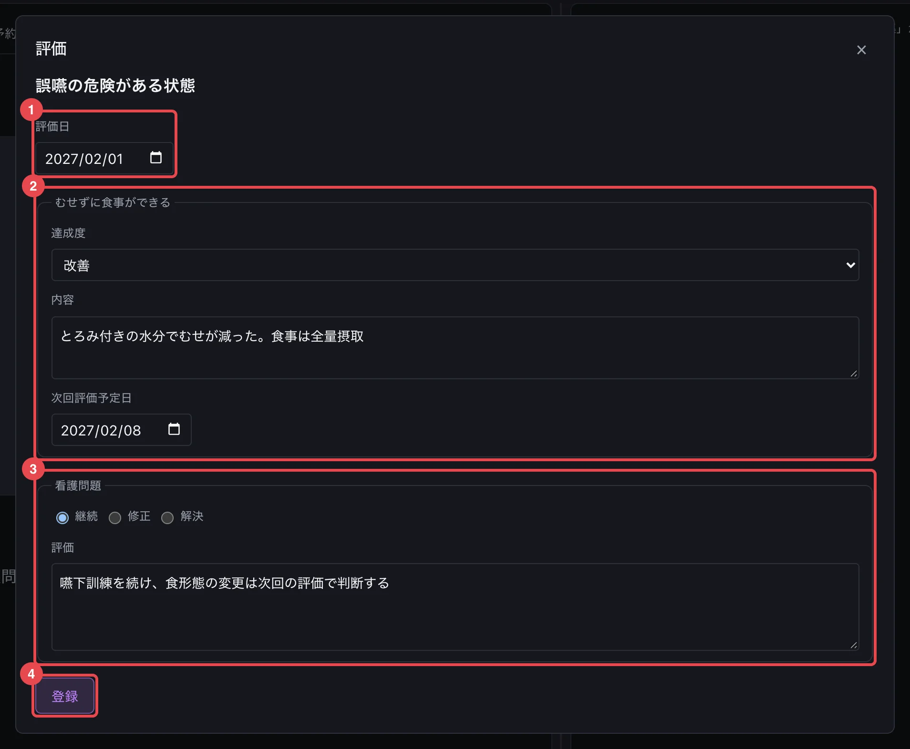
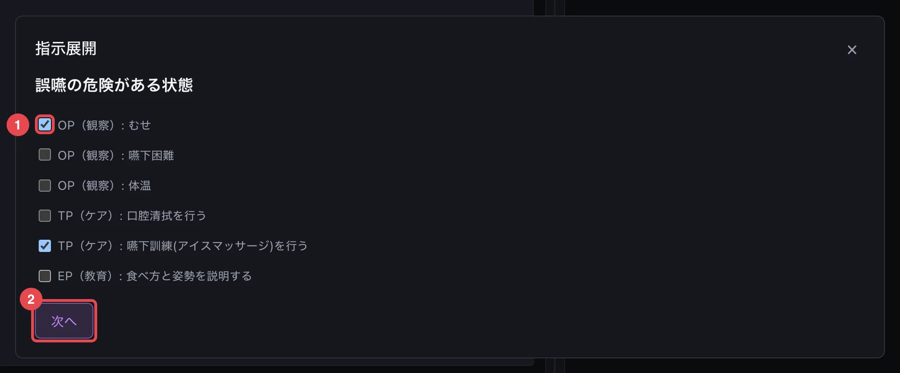
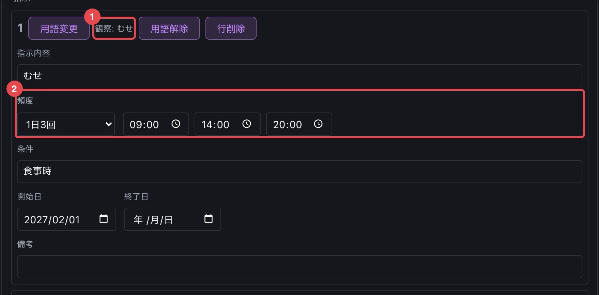
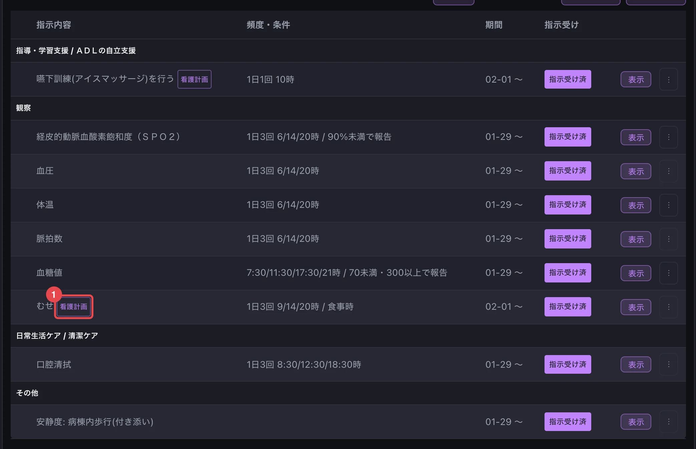
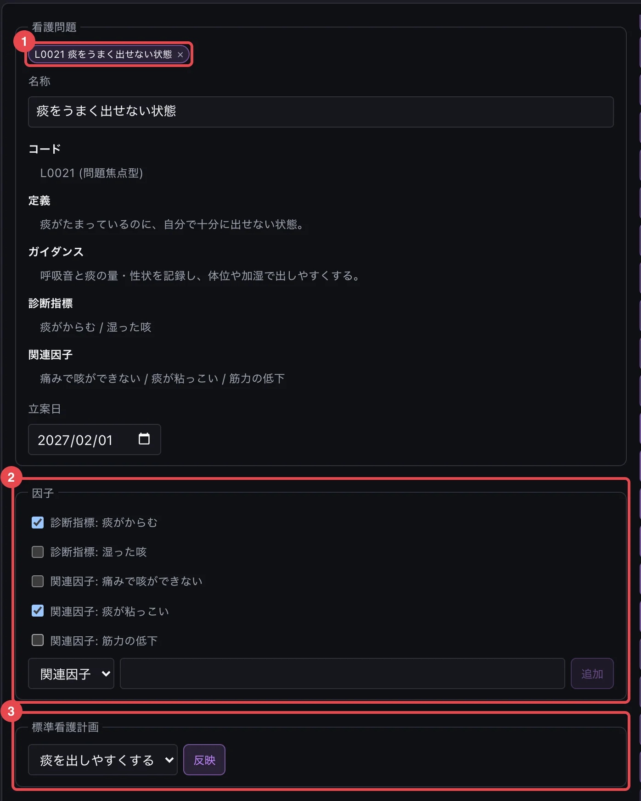
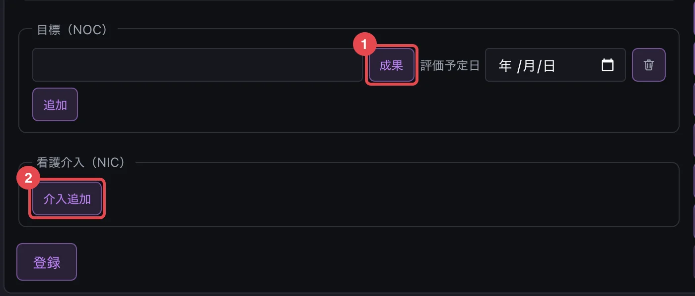

# 看護計画・看護診断

看護師が、入院中の患者の看護問題ごとに看護計画(因子・目標・OP/TP/EP)を立て、評価し、計画の行から看護指示を出す操作です。

立案の入口は 2 つあります。

| 入口 | 使い方 |
|---|---|
| 標準看護計画 | 施設の標準看護計画を選ぶと、看護問題・目標・OP(観察)/TP(ケア)/EP(教育)の行が写ります |
| 看護診断(NANDA) | 看護診断を選んで因子をチェックし、目標に看護成果(NOC)、計画に看護介入(NIC)を選びます |

どちらも、カルテの右側に並ぶボタンの「看護」の下(「看護計画」「看護診断」)か、カルテの「看護」タブの「看護計画」の上のボタンから始めます。

## 標準看護計画から立てる

患者のカルテを開き、右側の「看護」→「看護計画」を押し、「看護計画登録」の「標準看護計画」を押します。

{ .screen width="1168" }

1. 計画の名前の一部を入れると、分類をまたいで探します。入れずに、領域 → 類 → 計画の列を順にたどって選ぶこともできます。
2. 使う計画を押します。

### 看護問題と因子

{ .screen width="698" }

1. 選んだ計画と、結びついた看護診断が札で出ます。「×」で外せます。
2. 「名称」が看護問題の名前になります。直してもかまいません。看護診断の定義・ガイダンス・因子が下に出ます。
3. 「立案日」を確かめます。初期値は今日です。
4. 「因子」で、この患者に当てはまるものにチェックを付けます。一覧に無いものは、種類を選んで文で足せます。

### 目標と計画

{ .screen width="700" }

1. 「目標」は計画から写った文を、患者に合わせて直します。「追加」で目標を足します。
2. 目標ごとに「評価予定日」を入れます。
3. 「OP(観察)」に、観察する項目が並びます。
4. 「TP(ケア)」に、行うケアが並びます。
5. 「EP(教育)」に、患者や家族への説明・指導が並びます。要らない行はゴミ箱で消し、「追加」で足します。
6. 「登録」を押します。

## 看護計画を見る

カルテの「看護」タブの「看護計画」を開きます。看護問題ごとに、看護診断・因子・目標・OP/TP/EP・評価がツリーで並びます。

{ .screen width="1048" }

1. 「標準看護計画」で、標準看護計画からもう 1 つ看護問題を立てます。
2. 「看護診断(NANDA)」で、看護診断から看護問題を立てます。
3. 「評価」で、目標の達成度と看護問題の判定を記録します。
4. 「指示展開」で、計画の行から看護指示を出します。
5. 「↑」「↓」で優先度(番号)を入れ替えます。
6. 「⋮」から「編集」(右側に開きます)・「ガイダンス」(看護診断の定義など)・「取消」(誤って立てた看護問題を取り消す)を選びます。

看護問題は、立案の入口ごとに「標準看護計画」「看護診断(NANDA)」の区画に分けて並びます。解決した看護問題は「解決済みも表示」で見ます。

## 評価する

{ .screen width="954" }

1. 「評価日」を確かめます。
2. 目標ごとに「達成度」(達成・改善・変化なし・悪化・未達成)と内容を入れ、「次回評価予定日」を確かめます。
3. 「看護問題」を「継続」「修正」「解決」から選び、評価を書きます。「解決」にすると、看護問題と計画を終わりにし、この計画から出した看護指示に解決日を終了日として入れます。
4. 「登録」を押します。評価は看護計画のツリーの「評価」に並びます。

## 計画の行から看護指示を出す

{ .screen width="954" }

1. 看護指示にする行にチェックを付けます。すでに有効な指示を出してある行は、初めはチェックが外れています。
2. 「次へ」を押します。

{ .screen width="879" }

1. 選んだ行が、看護指示の行として写ります。入れ方は医師の看護指示と同じです([指示簿](nursing-orders.md))。
2. 行ごとに「頻度」と「条件」を入れ、下の「登録」を押します。

看護計画から出した指示は、出した看護師が依頼者で、出した時点で指示受け済みになります。

{ .screen width="1043" }

1. 看護計画から出した指示には「看護計画」の印が付きます。

## 看護診断(NANDA)から立てる

右側の「看護」→「看護診断」を押し、「看護診断(NANDA)」を押して看護診断を選びます。選び方は標準看護計画と同じです。

{ .screen width="698" }

1. 選んだ看護診断が札で出て、下に定義・ガイダンス・診断指標・関連因子が出ます。
2. 「因子」で、当てはまる診断指標・関連因子・危険因子にチェックを付けます。
3. その看護診断に結びついた標準看護計画があれば、選んで「反映」を押すと OP/TP/EP の行が入ります。

{ .screen width="700" }

1. 「目標(NOC)」の「成果」で看護成果を選び、目標の文と評価予定日を入れます。
2. 「看護介入(NIC)」の「介入追加」で看護介入を選ぶと、マスタの行動が介入の下の行になります。要らない行は消します。

「登録」を押します。評価と指示展開は、標準看護計画から立てたときと同じです。
