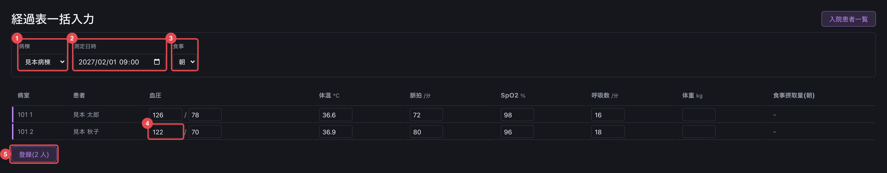
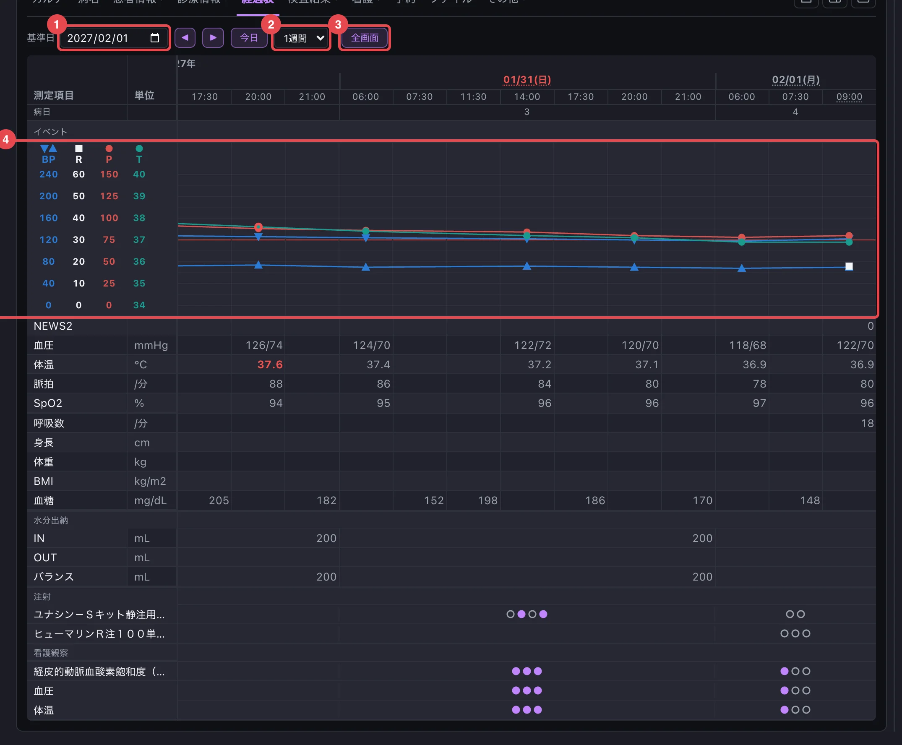

# 経過表と一括入力

入院中の患者の測定値と、注射・看護指示などの予定と実施を、時刻の列で並べて見る「経過表」と、
病棟の患者の測定をまとめて入れる「経過表一括入力」の操作です。

1 人ずつ測定を入れるときは、カルテの右側の「バイタル」を使います([バイタル](vital.md))。
看護指示の観察として測った値は、指示簿の実施入力で入れます([看護指示の実施](nursing-perform.md))。どれで入れても、同じ経過表の行に並びます。

## 病棟の測定をまとめて入れる

ヘッダーの「看護業務」から「経過表一括入力」を開きます。入院患者一覧の「⋮」からも開けます。

{ .screen }

1. 「病棟」を選びます。その病棟に入院中の患者が病室の順に並びます。
2. 「測定日時」を確かめます。初期値はいまの日時です。
3. 「食事」で、食事摂取量の欄をどの食事(朝・昼・夕)のものにするかを選びます。食事のオーダーが無い患者は「-」です。
4. 患者ごとに、測った値を入れます。測っていない項目は空欄のままにします。血圧は上と下の 2 つとも入れます。
5. 「登録」を押します。ボタンには、値を入れた患者の人数が出ます。値を入れた患者の分だけが記録されます。

入れる項目(列)は施設の設定で決まっています。

## 経過表を見る

患者のカルテの「経過表」タブを開きます。看護ワークシートの患者の欄の「経過表」からも開けます。

{ .screen width="1075" }

1. 「基準日」までの期間を表示します。「◀」「▶」で期間をずらし、「今日」で今日に戻ります。
2. 期間を「1週間」「2週間」「1か月」から選びます。列が多いときは表を横に送って見ます。
3. 「全画面」で、経過表を画面いっぱいに広げます。
4. 温度板のグラフに、血圧(BP)・呼吸数(R)・脈拍(P)・体温(T)が出ます。左の目盛りは項目ごとの色です。

グラフの下には、次の行が並びます。

| 区画 | 内容 |
|---|---|
| 病日 | 入院日を 1 とした日数 |
| イベント | 入院・手術などの出来事 |
| 測定 | 血圧・体温・脈拍・SpO2・呼吸数・身長・体重・BMI・血糖など。基準を外れた値は赤く出ます |
| 水分出納 | IN・OUT とバランス |
| 注射・内服 | 予定と実施の印 |
| 看護観察・看護行為 | 看護指示の予定と実施の印 |

印の「●」は実施済み、「○」はまだ実施していない予定です。日付の見出しを押すと、その日の時刻の列を畳んだり広げたりできます。
看護指示の印を押すと、その指示の実施入力が開き、押した印の日時が記録日時の初期値になります。
