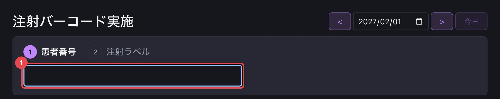
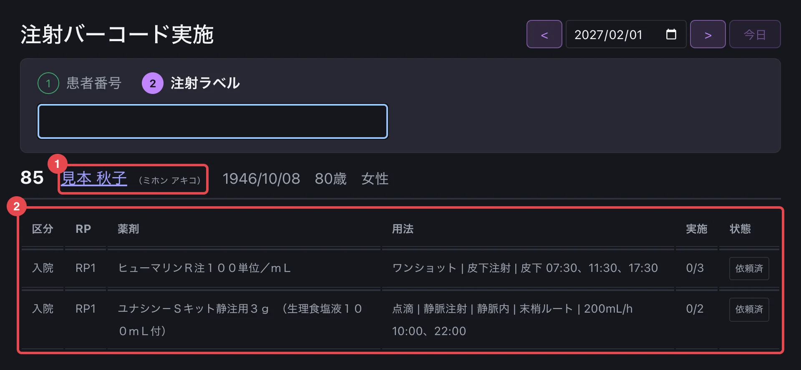
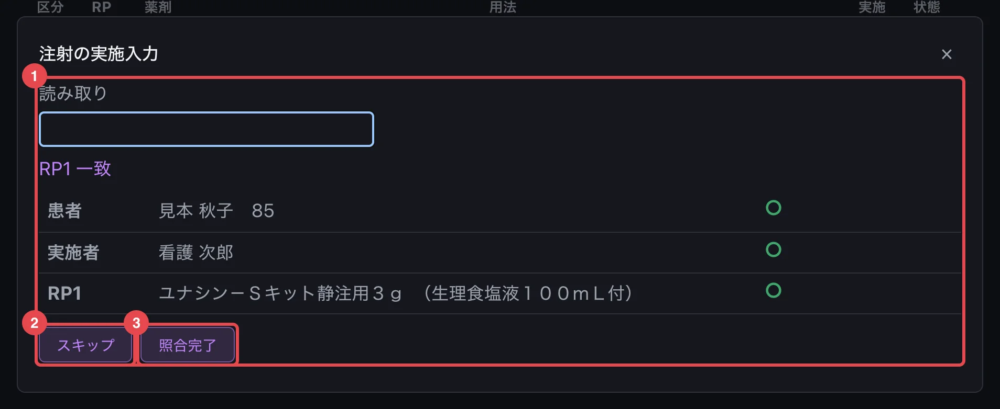
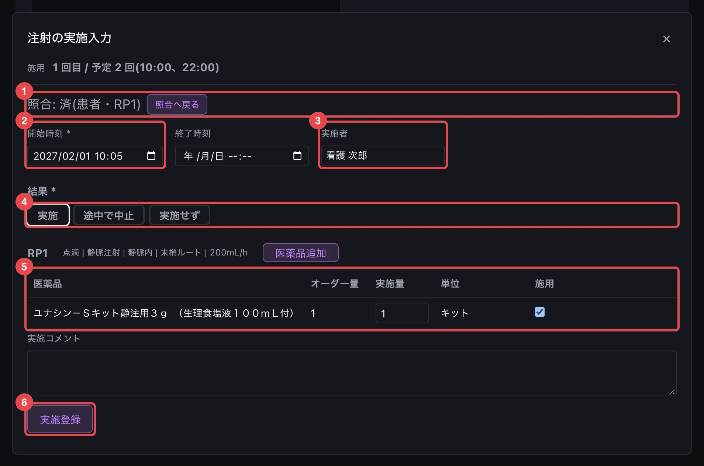
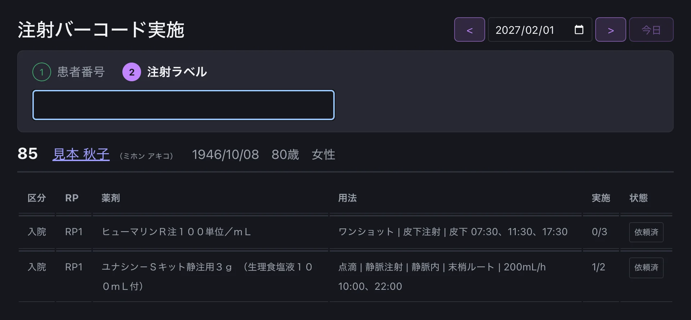
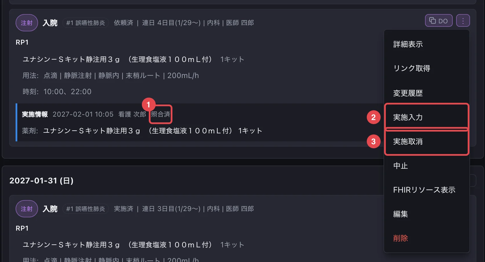

# 注射の実施入力

病棟で注射(点滴・静注など)を行い、実施を記録する操作です。ベッドサイドでは「注射バーコード実施」で、
患者番号と注射ラベルのバーコードを読んで照合してから記録します。カルテの注射のカードからも記録できます。
注射の出し方は[注射オーダー](injection.md)、流れは業務フローの[注射オーダー](../flows/injection.md)にあります。

施設の設定で「注射の3点認証」を使っていると、どこから実施入力を開いても、先に照合(患者・実施者・注射ラベル)の画面が出ます。

## 注射バーコード実施を開く

ヘッダーの「看護業務」から「注射バーコード実施」を開きます。日付は今日が初期値です。

{ .screen width="960" }

1. 読み取りの欄にカーソルがある状態で、患者のリストバンド(または注射ラベル)の患者番号をバーコードリーダーで読みます。

## 患者の注射を確かめる

{ .screen width="960" }

1. 読んだ患者が出ます。患者を間違えたときは、もう一度患者番号を読みます。
2. その患者のその日の注射が、RP ごとに並びます。「実施」に予定の回数のうち実施済みの数、「状態」に進み具合が出ます。

続けて、注射ラベルの RP のバーコードを読みます。

## 照合する

{ .screen width="954" }

1. 患者・実施者・RP がそろうと「○」になります。実施者はログインしている本人です。違う患者のラベルを読むと先へ進めません。
2. ラベルが読めないなど照合できないときは「スキップ」を押し、理由を選んで先へ進みます。
3. 「照合完了」を押します。

## 実施を入れる

{ .screen width="954" }

1. 照合の結果が出ます。上の「施用」に、何回目の実施かと、その日の予定の時刻が出ます。
2. 「開始時刻」を確かめます。初期値はいまの日時です。点滴が終わった時刻は「終了時刻」に入れます。
3. 「実施者」はログインしている本人です。
4. 「結果」を選びます。途中でやめたときは「途中で中止」、行わなかったときは「実施せず」を選び、理由を入れます。
5. 薬剤ごとに「実施量」を確かめます。使わなかった薬剤は「施用」のチェックを外します。オーダーに無い薬剤を使ったときは「医薬品追加」で足します。
6. 「実施登録」を押します。

{ .screen width="960" }

一覧の「実施」の数が進みます。予定の回数をすべて実施すると、状態が「実施済」になります。

## カルテの注射のカードから記録する・取り消す

{ .screen width="841" }

1. 記録した実施は、カルテの注射のカードの「実施情報」に出ます。照合して記録したものには「照合済」、スキップしたものには理由が付きます。
2. カードの「⋮」の「実施入力」からも記録できます。3点認証を使っているときは、同じ照合の画面から始まります。
3. 「実施取消」を押し、確かめの画面で OK を押すと、そのオーダーのその日の実施の記録を取り消して依頼済に戻します。
