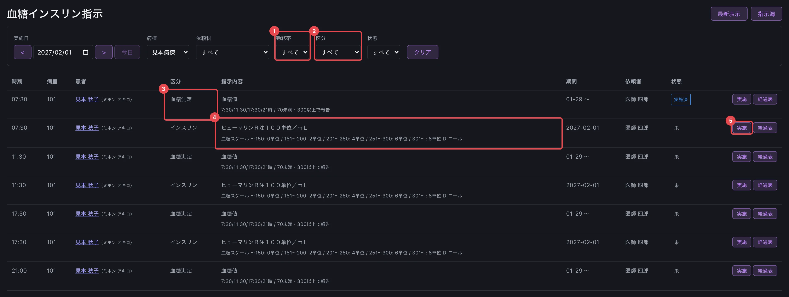
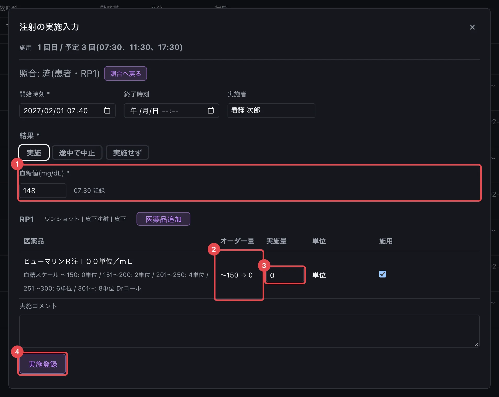
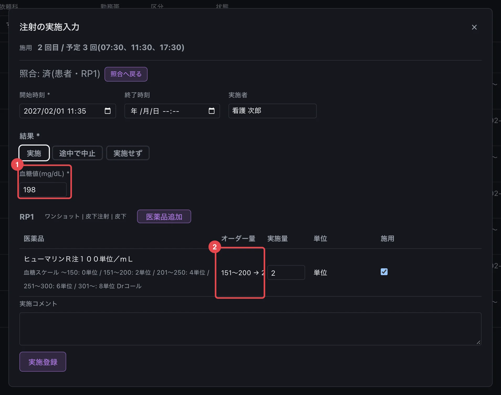
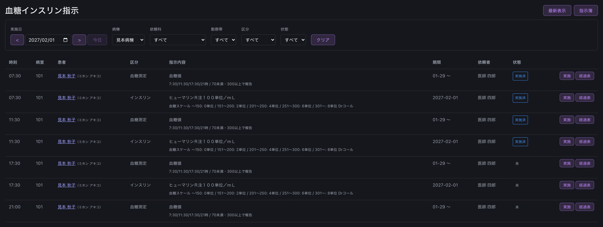

# 血糖インスリン

血糖値によって単位を決めるインスリン(血糖スケール)を、病棟で測った血糖値に合わせて施行し、記録する操作です。
「血糖インスリン指示」の画面に、病棟の 1 日ぶんのインスリンの施用と血糖測定(看護指示「血糖値」)が時刻の順に並びます。

インスリンの指示は医師が注射オーダーで出します。血糖スケール(血糖値の幅ごとの単位)は注射オーダーの薬剤の行で決めます([注射オーダー](injection.md))。

## 血糖インスリン指示を開く

ヘッダーの「看護業務」から「血糖インスリン」を開き、「病棟」を選びます。指示簿の「⋮」、入院患者一覧からも開けます。

{ .screen }

1. 「勤務帯」で、日勤・準夜・深夜の時刻に絞れます。
2. 「区分」で、インスリンと血糖測定のどちらかに絞れます。「状態」で未実施だけにも絞れます。
3. 血糖測定の行は、看護指示「血糖値」の予定の時刻ごとに並びます。測った行は「実施済」になります。
4. インスリンの行には、薬剤と血糖スケールが出ます。
5. 行の「実施」で実施入力を開きます。患者名でカルテ、「経過表」で経過表タブを開けます。

血糖測定の行の「実施」は、看護指示の実施入力です([看護指示の実施](nursing-perform.md))。

## インスリンを施行する

インスリンの行の「実施」を押すと、注射の実施入力が開きます。「注射の3点認証」を使っているときは、先に患者番号と注射ラベルを読んで照合します([注射の実施入力](nursing-injection.md))。

{ .screen width="954" }

1. 施用の時刻の前 2 時間から後 30 分までに測った血糖値があれば、「血糖値」に初めから入ります。横に測った時刻が出ます。
2. 血糖スケールの、血糖値に当てはまる幅と、施行する単位(案内量)が出ます。
3. 「実施量」に案内量が入ります。案内と違う量にしたときは、変更の理由を入れます。
4. 「実施登録」を押します。

この例では血糖値が 148 で、スケールの「〜150」に当たるので 0 単位です。

### その場で血糖値を測ったとき

{ .screen width="954" }

1. 近い時刻の血糖値が無いときは「血糖値」が空欄です。測った値を入れます。
2. 入れた血糖値で、当てはまる幅と案内量が出ます。

ここで入れた血糖値は、看護指示「血糖値」の記録にもなります。経過表の「血糖」の行にも並びます。

## 施行したあと

{ .screen }

施行したインスリンと、インスリンの実施入力で入れた血糖値の血糖測定の行が「実施済」になります。
施行の記録の取り消しは、カルテの注射のカードの「⋮」の「実施取消」で行います。
