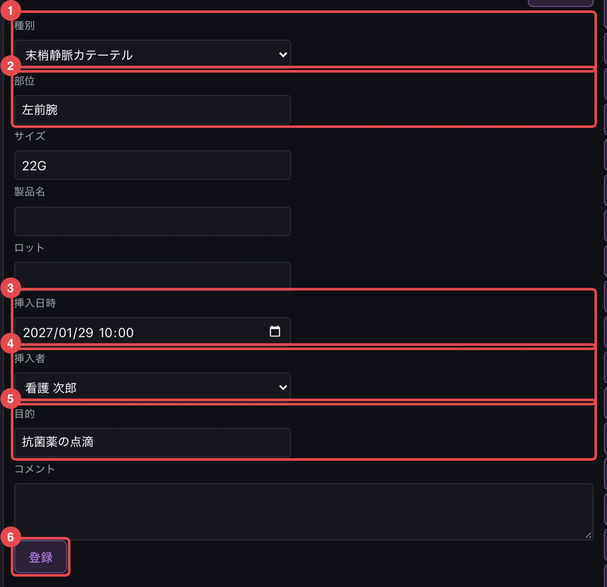
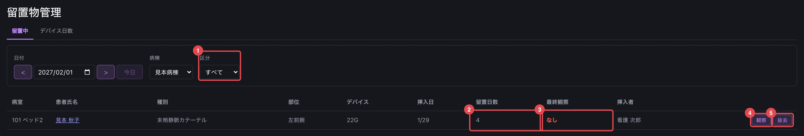
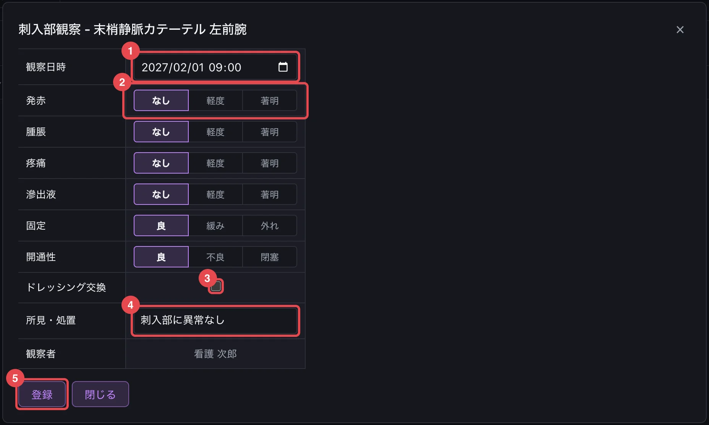
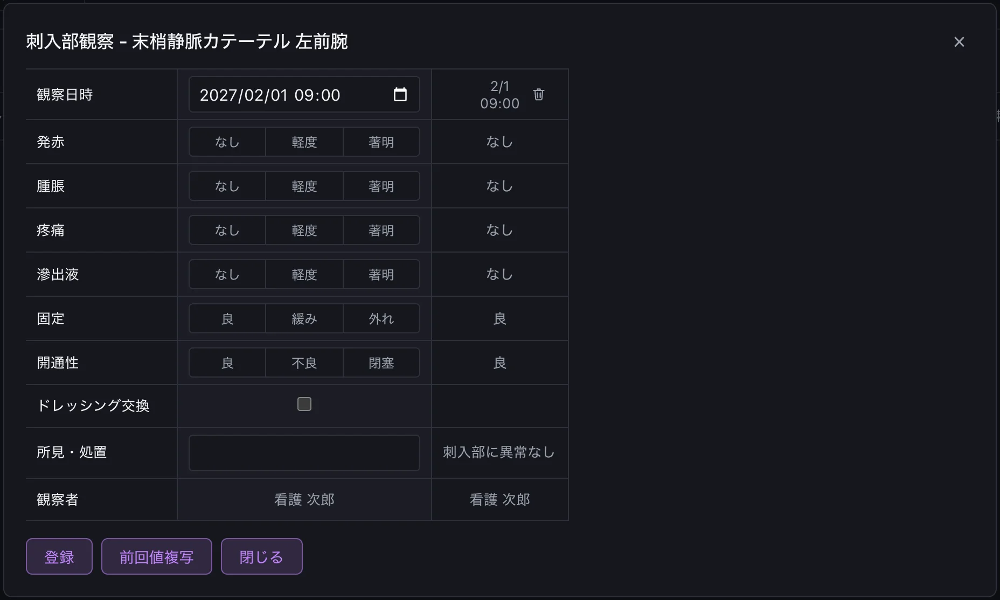
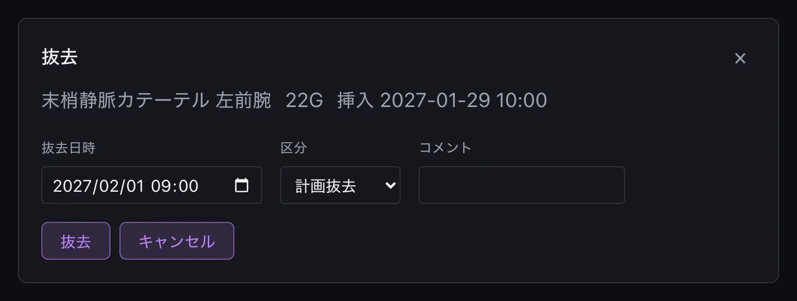
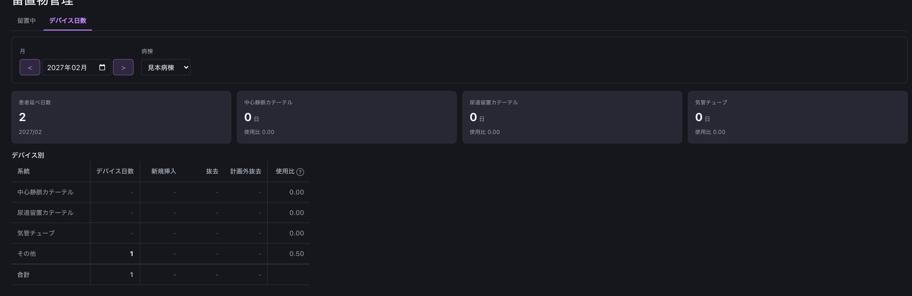

# 留置物管理

中心静脈カテーテル・末梢静脈カテーテル・尿道カテーテル・ドレーン・気管チューブなど、体に入っている管(留置物)を 1 本ずつ登録し、
刺入部の観察と抜去を記録する操作です。病棟の「留置物管理」で、留置している管と留置日数を一覧で見ます。

留置中の管がある患者は、患者の帯にカテーテルの印と本数が出ます。看護ワークシートの患者の欄と、経過表の「留置物」の欄にも出ます。

## 留置物を登録する

患者のカルテを開き、右側に並ぶボタンの「看護」→「留置物」を押します。

{ .screen width="702" }

1. 「種別」を選びます(中心静脈カテーテル・末梢静脈カテーテル・尿道留置カテーテル・胸腔ドレーンなど)。
2. 「部位」「サイズ」を入れます。分かれば「製品名」「ロット」も入れます。
3. 「挿入日時」を入れます。初期値はいまの日時です。前に入れた管を登録するときは、入れた日時に直します。
4. 「挿入者」の初期値はログインしている本人です。ほかの人が入れたときは選び直します。
5. 「目的」と「コメント」を書きます。
6. 「登録」を押します。入院中なら、いまの入院の記録になります。

登録すると、挿入日のカルテに留置物のカードが出ます。カードには留置日数と直近の観察が出ます。

## 留置物管理で見る

ヘッダーの「看護業務」から「留置物管理」を開き、「病棟」と「日付」を選びます。入院患者一覧の「⋮」からも開けます。

{ .screen }

1. 「区分」(中心静脈・末梢静脈・尿路・ドレーンなど)で絞れます。
2. 「留置日数」に、挿入日から数えた日数が出ます。種別ごとに決めた日数を超えると赤く出ます。
3. 「最終観察」に、最後に観察した日時が出ます。観察が無いときや 3 日以上前のときは赤く出ます。
4. 「観察」で刺入部の観察を記録します。
5. 「抜去」で抜去を記録します。

## 刺入部を観察する

{ .screen width="928" }

1. 「観察日時」を確かめます。
2. 発赤・腫脹・疼痛・滲出液・固定・開通性を、それぞれのボタンで選びます(開通性は血管・尿路・消化管・ドレーンの管だけ)。
3. ドレッシングを交換したときはチェックを付けます。
4. 「所見・処置」を書きます。
5. 「登録」を押します。

{ .screen width="928" }

登録すると、画面は開いたまま、右に観察の履歴が日時ごとに並びます。誤って入れた観察はゴミ箱で消せます。
次からは「前回値複写」で前の観察を写せます。「閉じる」で一覧に戻ります。

{ .screen }

「最終観察」が更新されます。

## 抜去する

{ .screen width="714" }

「抜去日時」(初期値はいま)と「区分」(計画抜去・自己抜去・事故抜去・感染疑い・閉塞・不良・その他)を選び、「抜去」を押します。
抜去した管は留置中の一覧から外れます。誤って抜去を記録したときは、患者プロファイルの「留置物」の区画で「抜去したものも表示」にし、行のメニューの「抜去取消」で留置中に戻せます。

## デバイス日数を見る

「デバイス日数」のタブでは、病棟ごと・月ごとに管を使った延べ日数を集計します。感染対策(CLABSI・CAUTI・VAP)の分母に使います。

{ .screen }

上に患者延べ日数と、中心静脈カテーテル・尿道留置カテーテル・気管チューブのデバイス日数と使用比が出ます。
下の表に、系統ごとのデバイス日数・新規挿入・抜去・計画外抜去(自己・事故)・使用比が並びます。使用比はデバイス日数 ÷ 患者延べ日数で、計算式は見出しの「?」で見られます。
