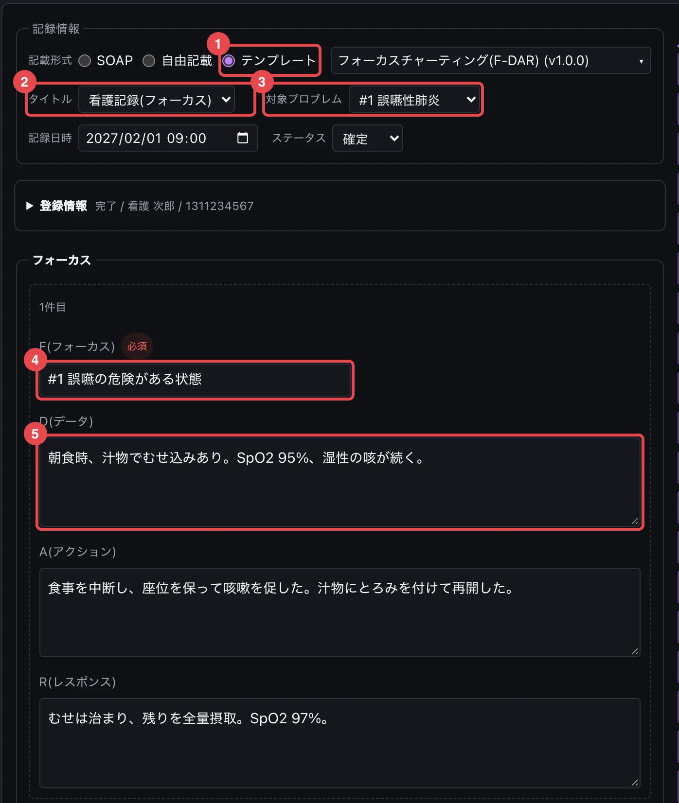
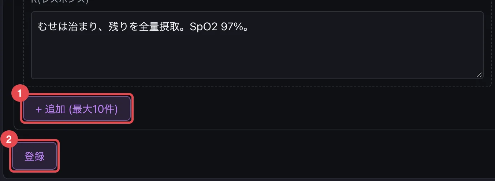
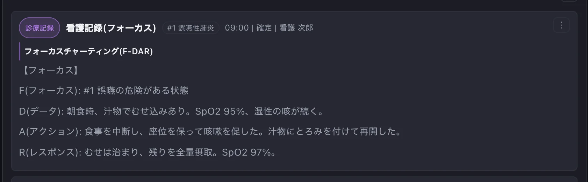

# 看護記録

看護師が、カルテに看護記録を書く操作です。看護記録は診療記録の一つで、タイトルで分けます。
ここでは、フォーカスチャーティング(F-DAR)の書式で書く方法を説明します。SOAP や自由記載で書くときの操作は[診療記録](clinical-note.md)と同じです。

看護師(看護職)が書いた記録は「看護記録」として扱われ、看護サマリーを書くときに「看護経過」へ取り込めます([看護サマリー](nursing-summary.md))。

## フォーカスチャーティングで書く

患者のカルテを開き、右側の登録のボタンから「診療記録」を押します。

{ .screen width="698" }

1. 「記載形式」は「テンプレート」になり、「フォーカスチャーティング(F-DAR)」の書式が出ます。
2. 「タイトル」で「看護記録(フォーカス)」を選びます。タイトルを選ぶと、決まった記載形式と書式に切り替わります。
3. 「対象プロブレム」で、記録に関係するプロブレムを選びます。
4. 「F(フォーカス)」に、記録の焦点(看護問題や出来事)を書きます。看護問題は「#1 誤嚥の危険がある状態」のように番号ごと書きます。F だけは必ず入れます。
5. 「D(データ)」に観察した情報、「A(アクション)」に行ったケア、「R(レスポンス)」に患者の反応を書きます。反応を後で書くときなど、D・A・R は空欄でもかまいません。

{ .screen width="676" }

1. 1 回の記録に別のフォーカスを足すときは「+ 追加」を押します。10 件まで足せます。
2. 「登録」を押します。

## 記録を見る

{ .screen width="841" }

登録すると、カルテに看護記録のカードが出ます。見出しにタイトル・対象プロブレム・時刻・状態・書いた人が並びます。
直すときは、カードの「⋮」の「編集」を押します(診療記録と同じです)。
