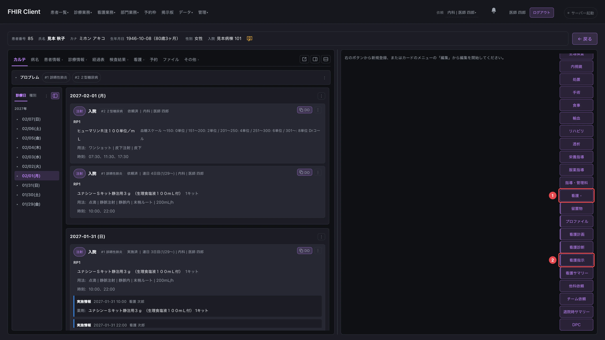
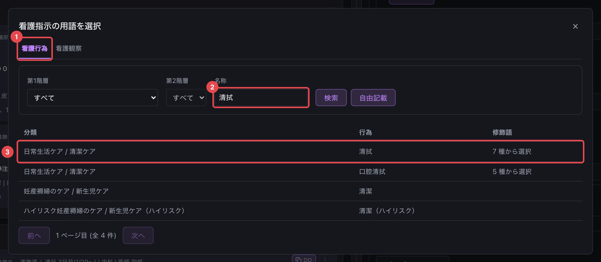
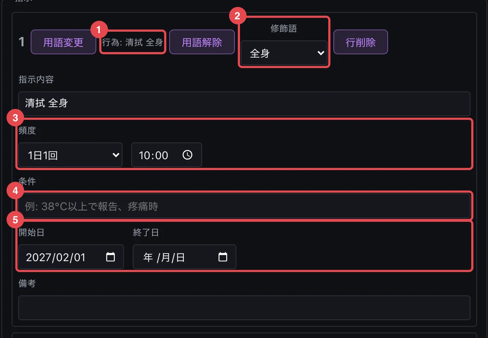
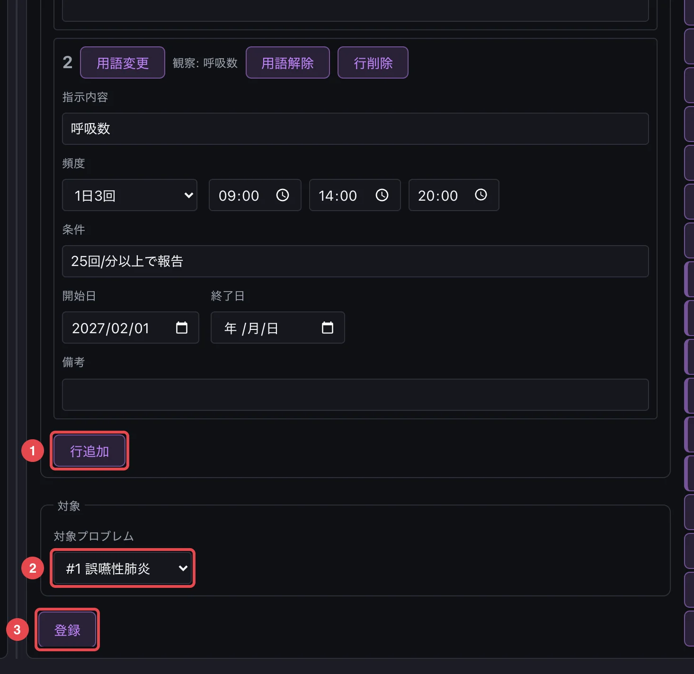
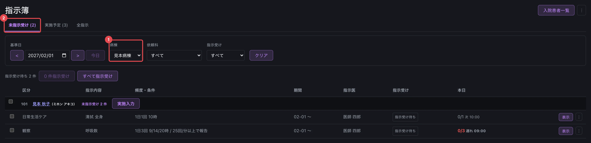
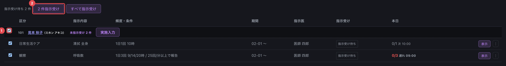
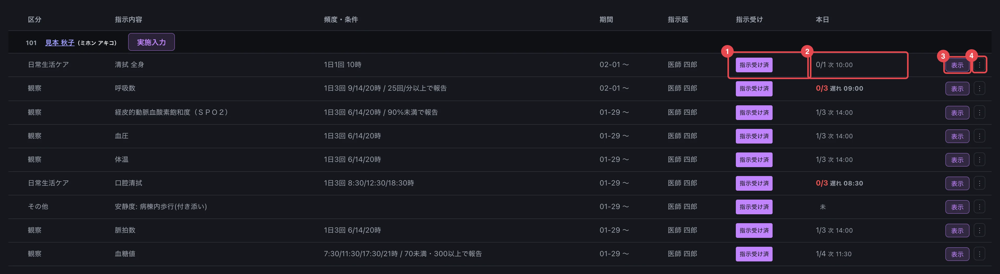
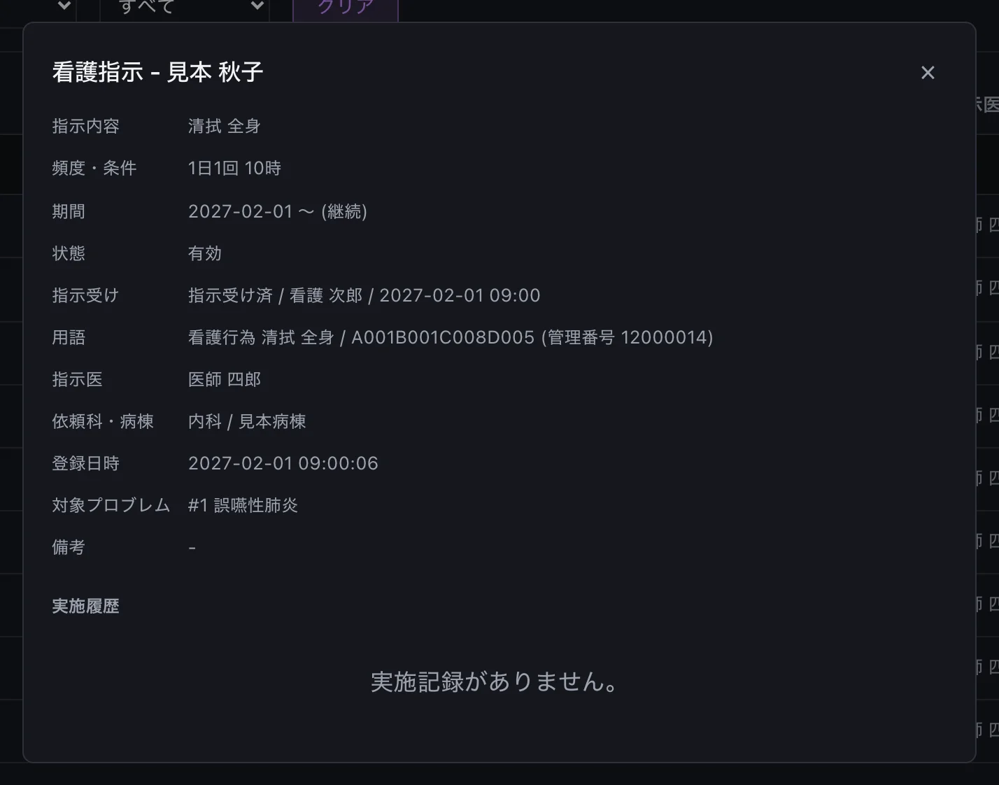
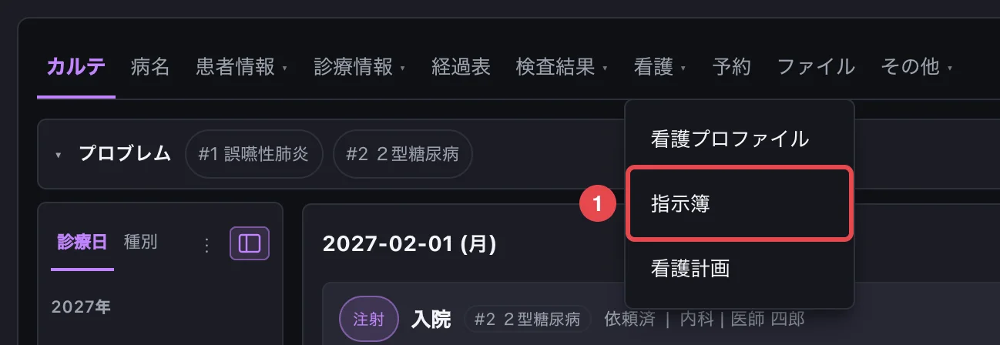
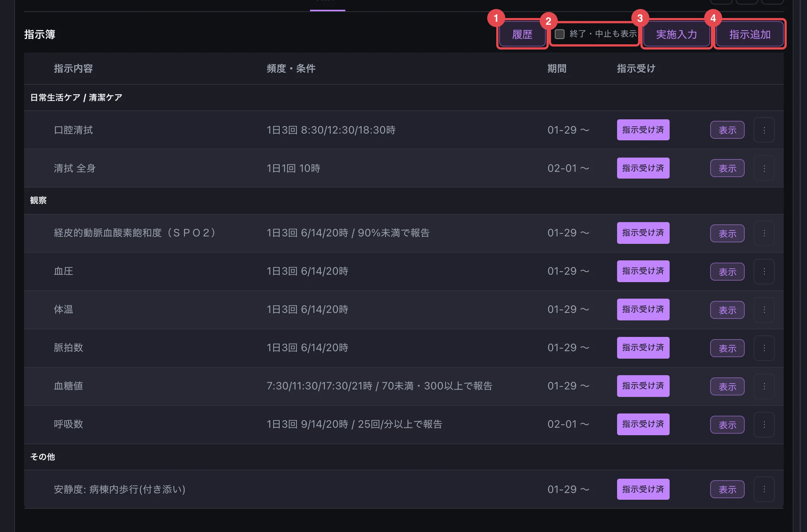

# 指示簿

医師が入院中の患者に看護指示(観察・ケア・安静度など)を出し、病棟の看護師が「指示簿」で受ける操作です。
指示の実施の記録は[看護指示の実施](nursing-perform.md)を見てください。指示受けから終了までの流れは、業務フローの[看護指示](../flows/nursing.md)にあります。

- 看護指示は入院中の患者にだけ出せます。
- 看護指示はカルテのカードにはならず、「指示簿」でだけ見ます。
- 1 回の登録で何行でも出せます。登録したあとは 1 行ずつ別の指示になり、1 行ずつ中止します。

## 看護指示を出す(医師)

患者のカルテを開き、右側に並ぶボタンから操作します。

{ .screen }

1. 「看護」を押すと、看護の登録のボタンが開きます。
2. 「看護指示」を押します。右側に「看護指示登録」が開きます。

### 指示内容を用語から選ぶ

行の「用語選択」を押すと、「看護指示の用語を選択」が開きます。

{ .screen width="597" }

1. ケア・処置などの行為は「看護行為」、測る・観る項目は「看護観察」のタブで探します。
2. 「名称」に言葉の一部を入れて「検索」を押します。「第1階層」「第2階層」で分類から絞ることもできます。
3. 指示する用語の行を押します。用語に無い指示は「自由記載」を押して、文で書きます。

### 行の内容を入れる

{ .screen width="669" }

1. 選んだ用語が出ます。選び直すときは「用語変更」、用語を外して文だけにするときは「用語解除」を押します。
2. 看護行為には「修飾語」(「全身」「部分介助」など)を選べるものがあります。選ぶと「指示内容」の文言も変わります。
3. 「頻度」を選び、時刻を確かめます。「1日N回」の時刻は施設で決めた初期値が入るので、必要なら直します。

    | 頻度 | その日の予定 |
    |---|---|
    | 適宜・必要時 | 予定を持たない |
    | 1日1回〜1日4回 | 入れた時刻 |
    | 4時間毎・6時間毎・8時間毎 | 起点の時刻から、その間隔ごと |
    | 時刻指定 | 入れた時刻 |
    | 週N回(曜日指定) | 選んだ曜日の、入れた時刻 |

4. 「条件」に、報告の基準や行う場面(「38℃以上で報告」「疼痛時」など)を書きます。
5. 「開始日」を確かめます。初期値は今日です。終わりが決まっているときは「終了日」を入れます。空なら継続します。

### 行を足して登録する

{ .screen width="733" }

1. 「行追加」で指示の行を足します。要らない行は「行削除」で消します。
2. 「対象プロブレム」で、指示に関係するプロブレムを選びます。
3. 「登録」を押します。指示は「指示受け待ち」で病棟の指示簿に出ます。

## 指示受けする(看護師)

ヘッダーの「看護業務」から「指示簿」を開きます。ホームの「看護指示」のカードからも開けます。

{ .screen }

1. 「病棟」を選びます。「基準日」は今日が初期値です。
2. 「未指示受け」のタブに、まだ受けていない指示が患者ごとに並びます。タブの数は指示の件数です。

{ .screen }

1. 指示を確かめ、受ける行のチェックを付けます。患者の行のチェックで、その患者の指示をまとめて選べます。
2. 「N 件指示受け」を押します。表示している指示をすべて受けるときは「すべて指示受け」を押します。

指示に疑問があるときは、受けずに医師に確かめます。直すのは医師の操作です(カルテの右側の「看護指示編集」)。
受けた指示を指示受け待ちに戻す操作はありません。

## 指示を見る

「全指示」のタブに、その日に効いている指示がすべて並びます。

{ .screen }

1. 「指示受け」に、受けたかどうかが出ます。
2. 「本日」に、その日の予定のうち実施済の数と、次の予定の時刻が出ます。予定の時刻を過ぎて実施していないものは赤で「遅れ」と出ます。
3. 「表示」で指示の詳しい内容を見ます。
4. 「⋮」から指示を中止します。

「実施予定」のタブには、遅れている予定と、いまの前後 1 時間に予定のある指示だけが並びます。

{ .screen width="714" }

指示の内容・期間・指示受けした人と日時・指示医・対象プロブレムと、「実施履歴」が出ます。

## 指示を中止する

{ .screen }

行の「⋮」の「中止」を押し、確かめの画面で OK を押します。中止した指示は指示受けも中止になり、指示簿の初めの表示からは消えます。
中止に取消はありません。続けるときは、新しく指示を出します。

## カルテで患者の指示簿を見る

患者 1 人ぶんの指示は、カルテの「看護」タブの「指示簿」で見ます。

{ .screen width="649" }

1. 「看護」にマウスを乗せ、「指示簿」を押します。

{ .screen width="1075" }

1. 「履歴」で、同時に出した指示をまとめて、発行日・指示医・各行の状態を新しい順に見ます。
2. 「終了・中止も表示」にチェックを付けると、終わった指示と中止した指示も並びます。
3. 「実施入力」で、この患者の実施を記録します([看護指示の実施](nursing-perform.md))。
4. 「指示追加」で、右側に「看護指示登録」を開きます。医師以外が入れると代行入力になり、指示を出した医師の承認待ちになります([代行入力とカルテ承認](proxy-countersign.md))。
