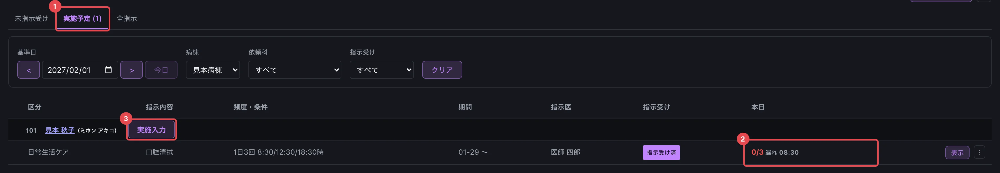
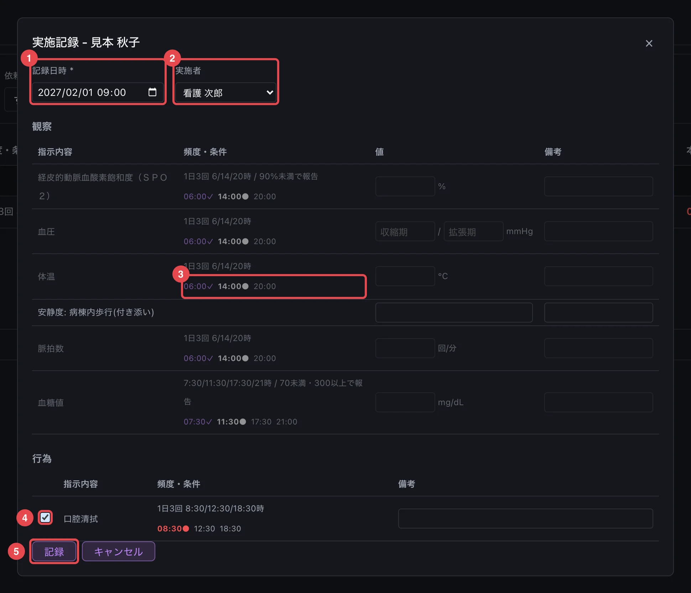
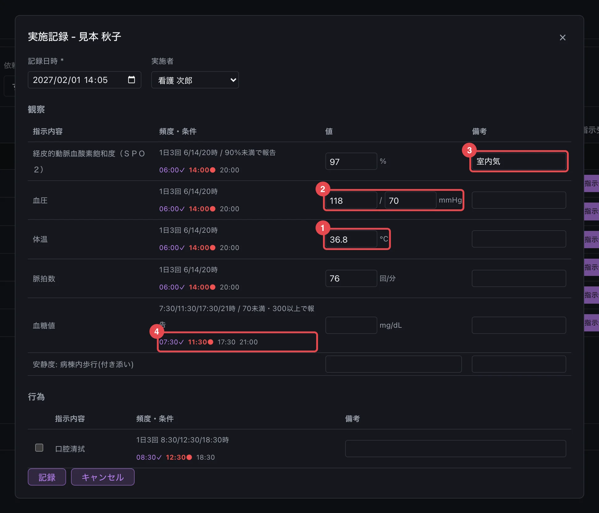
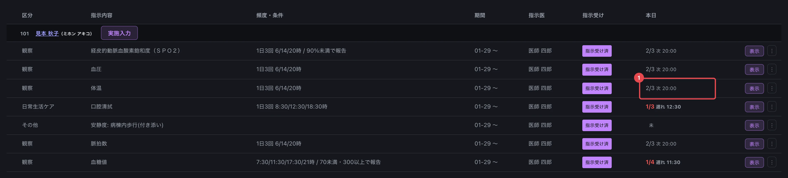
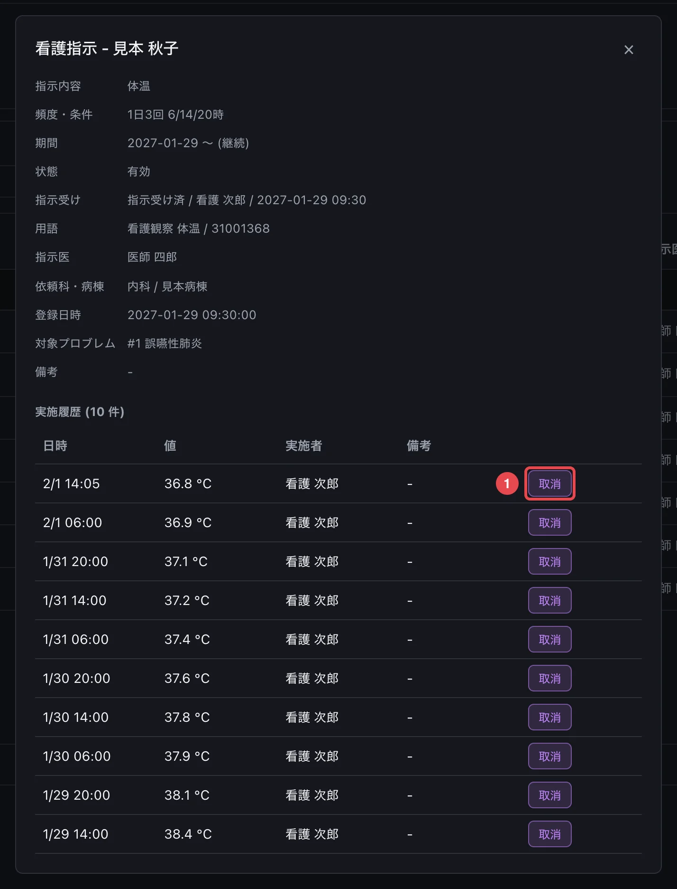

# 看護指示の実施

受けた看護指示を、病棟で実施して記録する操作です。観察は測った値を入れ、ケアなどの行為は「実施した」のチェックを付けます。
指示の出し方と指示受けは[指示簿](nursing-orders.md)を見てください。流れは業務フローの[看護指示](../flows/nursing.md)の「実施」にあります。

実施入力は、病棟の指示簿のほか、カルテの「指示簿」タブ、看護ワークシートと経過表の未実施の印からも開けます。どこから開いても同じ画面です。

## 実施予定を見る

ヘッダーの「看護業務」から「指示簿」を開き、病棟を選びます。

{ .screen }

1. 「実施予定」のタブを押します。遅れている予定と、いまの前後 1 時間に予定のある指示だけが患者ごとに並びます。表示は 1 分ごとに見直されます。
2. 「本日」に、その日の予定のうち実施済みの数と、次の予定の時刻が出ます。予定の時刻を過ぎて実施していないものは赤で「遅れ」と出ます。
3. 患者の行の「実施入力」を押します。

## 実施を記録する

「実施記録」の画面に、その患者のその日に効いている指示がすべて並びます。いま予定のある指示が上に来て、予定の時間でない指示も薄く出て入力できます(臨時の測定や頓用の記録のため)。

{ .screen width="970" }

1. 「記録日時」を確かめます。初期値はいまの日時です。変えると、予定の印もその日時に合わせて変わります。
2. 「実施者」の初期値はログインしている本人です。ほかの人が実施したときは選び直します。
3. 指示ごとに、その日の予定の時刻が並びます。「✓」は実施済み、「●」は次に入れる予定です。遅れている予定は赤で出ます。
4. 行為は、実施したものにチェックを付けます。
5. 「記録」を押します。値を入れた観察とチェックを付けた行為だけが記録されます。

### 観察の値を入れる

{ .screen width="970" }

1. 観察は「値」の欄に入れます。欄の形(数値と単位・選択肢・文字など)は項目ごとに決まっています。
2. 血圧は収縮期と拡張期の 2 つとも入れます。
3. 「備考」に、測ったときの状況(「室内気」「体動あり」など)を書けます。
4. 入れない観察は空欄のままにします。この例では、遅れている 11:30 の血糖値は別に記録します。

体温・SpO2・脈拍数・呼吸数・血圧・体重・身長の観察は、手で入れたバイタルと同じ経過表の行に並びます。

## 記録したあと

{ .screen }

1. 「本日」の数と次の予定が進みます。実施を記録しても、指示受けの状態は変わりません。

## 記録を取り消す

行の「表示」を押すと、指示の内容と「実施履歴」が出ます。

{ .screen width="714" }

1. 取り消す記録の「取消」を押し、確かめの画面で OK を押します。1 件ずつ取り消します。
