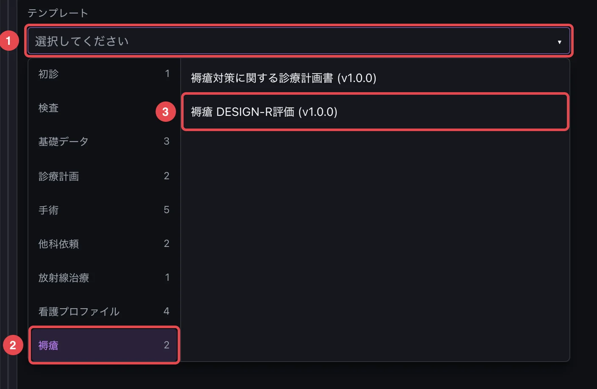
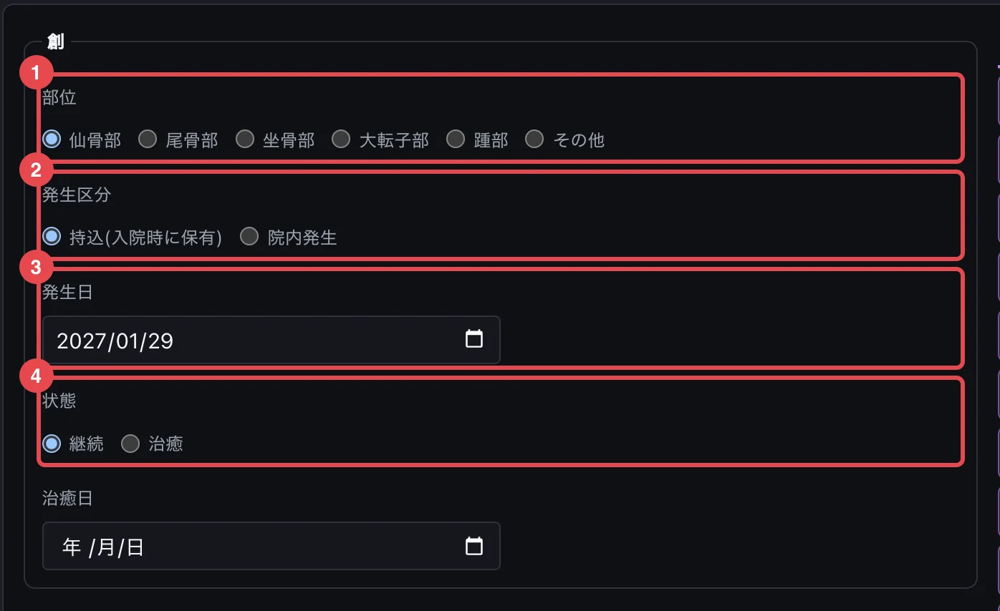
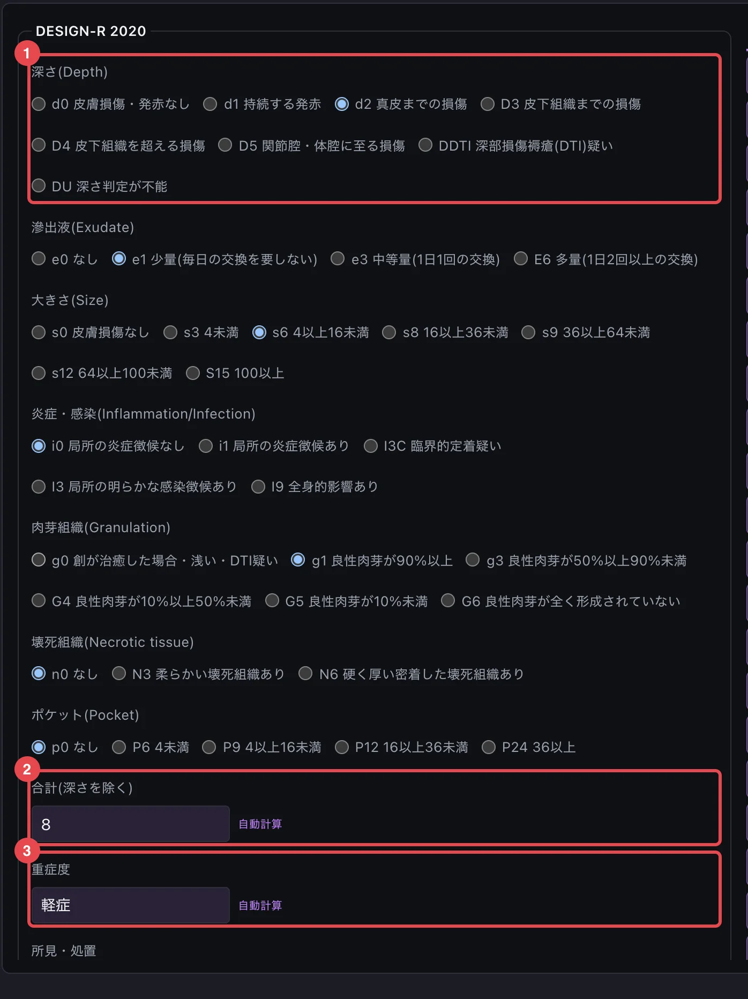
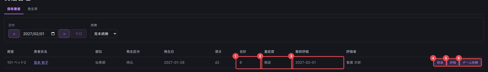
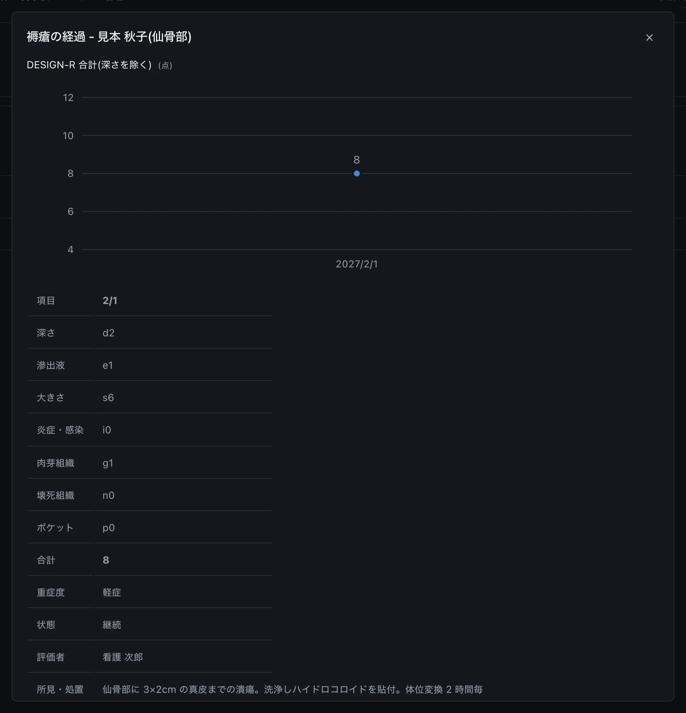
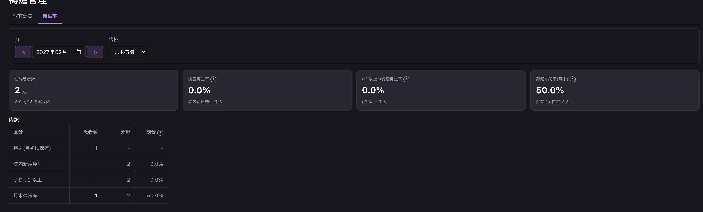

# 褥瘡管理

褥瘡を DESIGN-R 2020 で評価して記録し、病棟の「褥瘡管理」で保有している患者と経過、月ごとの発生率を見る操作です。
評価は 1 つの創につき 1 回の記録で、評価のたびに新しく書きます。

## DESIGN-R で評価する

患者のカルテを開き、右側に並ぶボタンから「テンプレート」を押します。

{ .screen width="704" }

1. テンプレートの選択を開きます。
2. 分類「褥瘡」を選びます。
3. 「褥瘡 DESIGN-R評価」を選びます。

前に同じ創を評価してあれば、「前回値複写」で前回の評価を写せます。

### 創の情報

{ .screen width="698" }

1. 「部位」を選びます。
2. 「発生区分」で、入院のときにあった褥瘡は「持込(入院時に保有)」、入院してからできた褥瘡は「院内発生」を選びます。
3. 「発生日」を入れます。
4. 「状態」を選びます。治ったときは「治癒」を選び、「治癒日」を入れます。

### DESIGN-R 2020

{ .screen width="698" }

1. 深さ・滲出液・大きさ・炎症/感染・肉芽組織・壊死組織・ポケットの 7 項目を、それぞれ記号で選びます。
2. 「合計(深さを除く)」は自動で計算されます。
3. 「重症度」も自動で決まります。大文字の記号が 1 つでもあると重症です。

下の「所見・処置」を書き、「登録」を押します。

## 褥瘡管理で見る

ヘッダーの「看護業務」から「褥瘡管理」を開き、「病棟」と「日付」を選びます。

{ .screen }

「保有患者」のタブに、その日に病棟にいた患者の治っていない創が、病室の順に並びます。

1. 「合計」に、最後の評価の DESIGN-R の合計が出ます。
2. 「重症度」が出ます。
3. 「最終評価」に、最後に評価した日が出ます。7 日以上評価していない創は赤く出ます。
4. 「経過」で、その創の評価の推移を見ます。
5. 「評価」で、カルテを開かずにこの画面で DESIGN-R の評価を書けます(テンプレートが選ばれた状態で開きます)。
6. 「チーム依頼」で、褥瘡対策のチームに介入を依頼できます([他科依頼・チーム依頼](consult-team.md))。

{ .screen width="954" }

上に合計の推移のグラフ、下に評価日ごとの 7 項目と合計・重症度・状態・評価者・所見が並びます。重い側の記号(大文字)は赤く出ます。

## 発生率を見る

「発生率」のタブでは、病棟ごと・月ごとに褥瘡の発生率と有病率を集計します。

{ .screen }

上のタイルに在院患者数・褥瘡発生率・d2 以上の発生率・褥瘡有病率が、下の「内訳」に持込・院内新規発生・うち d2 以上・月末の保有の患者数と分母・割合が出ます。
計算式は見出しの「?」で見られます。発生日は評価の「発生日」、治癒は「治癒日」で区切ります。
