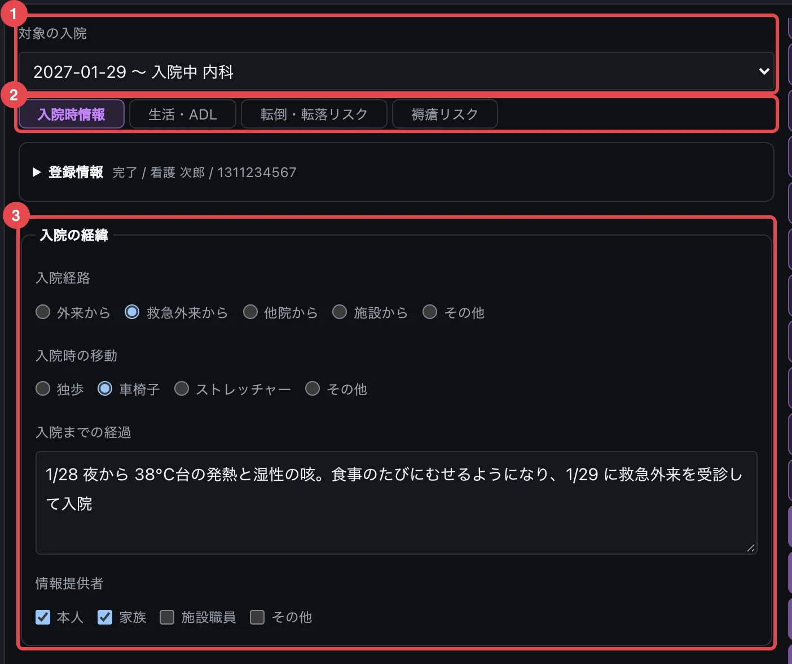
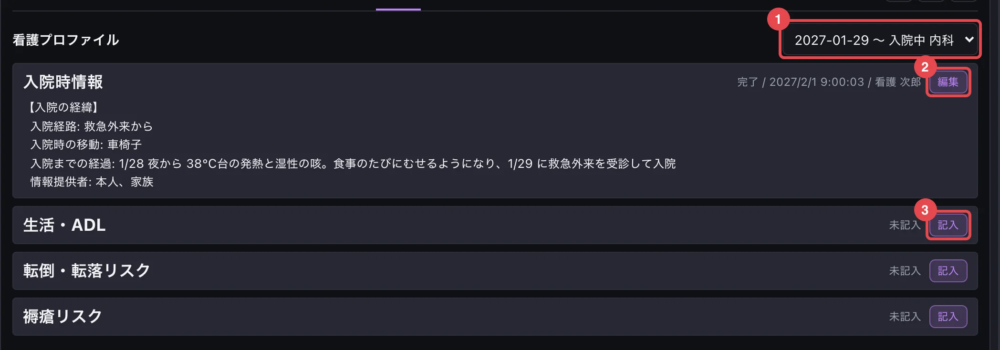
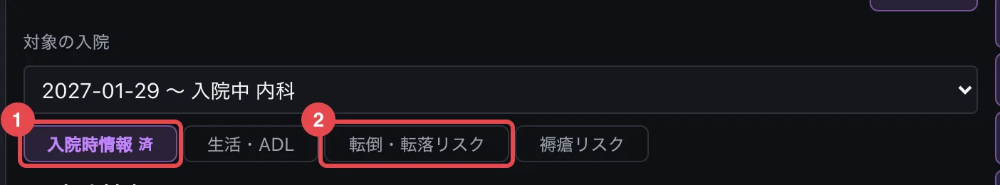

# 看護プロファイル

入院のときに看護師が聴き取る、患者の生活や看護上の状態(入院の経緯、病気の受け止め、ADL、転倒・褥瘡のリスクなど)を書く操作です。
項目は施設が決めた「区画」(入院時情報・生活・ADL など)に分かれていて、入院 1 回につき区画ごとに 1 つ書きます。書き直すと、同じ記録が更新されます。

看護プロファイルはカルテの時系列には出ず、カルテの「看護」タブの「看護プロファイル」で見ます。看護サマリーの「現在の状態」にも取り込まれます。

## 区画を書く

患者のカルテを開き、右側の登録のボタンの「看護」→「プロファイル」を押します。

{ .screen width="702" }

1. 「対象の入院」を確かめます。初期値はいまの入院です。
2. 書く区画のボタンを押します。区画ごとに項目が切り替わります。
3. 項目を入れます。選択肢は当てはまるものを選び、文の項目は書きます。

前の入院で同じ区画を書いてあれば、「前回値複写」で前回の回答を写せます。アレルギーや既往歴など、カルテに登録してある内容が初めから入る項目もあります。
点数を合計する項目(転倒リスクの点数など)は、自動で計算されます。

入れ終わったら、下の「登録」を押します。

## 看護プロファイルタブで見る

カルテの「看護」タブにマウスを乗せ、「看護プロファイル」を押します。

{ .screen width="1048" }

1. 入院を選びます。区画ごとに、最新の回答と、書いた人・日時が並びます。
2. 「編集」で、右側にその区画を開いて書き直します。
3. 「記入」で、まだ書いていない区画を右側に開きます。

## 書いた区画を確かめる

{ .screen width="702" }

1. 書いた区画のボタンには「済」が付きます。押すと、書いた回答を編集で開きます。
2. 「済」の無い区画はまだ書いていません。押すと新しく書けます。
