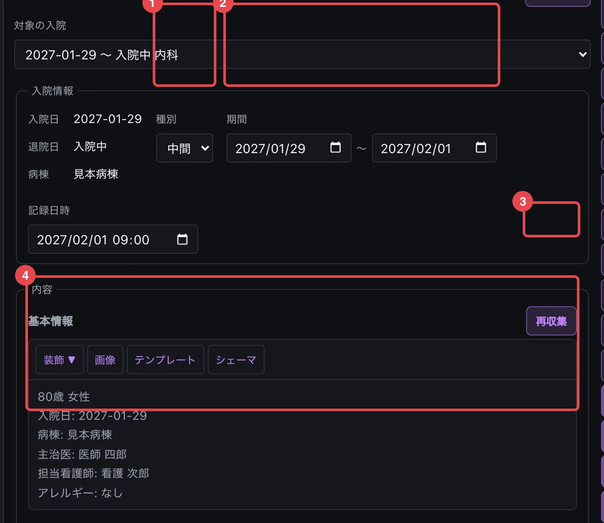
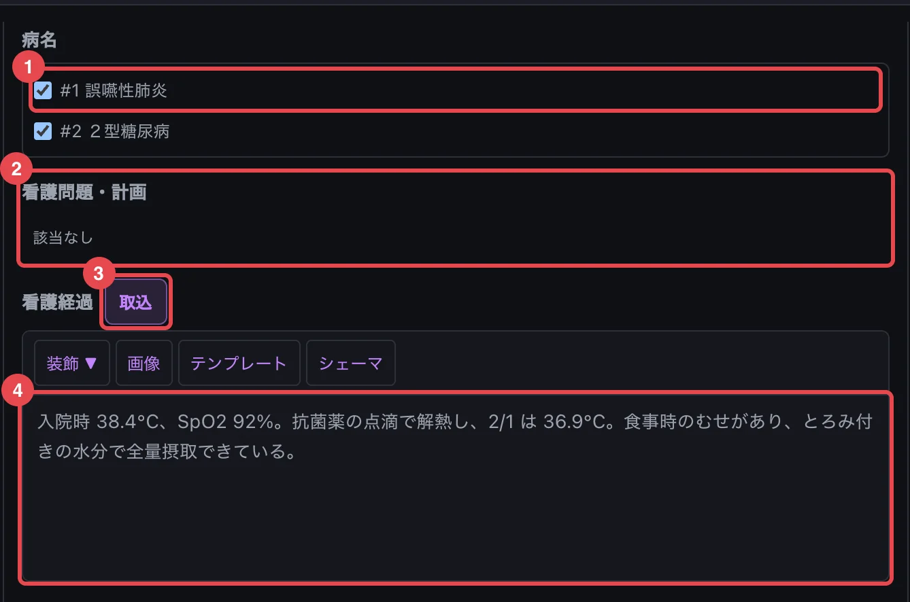
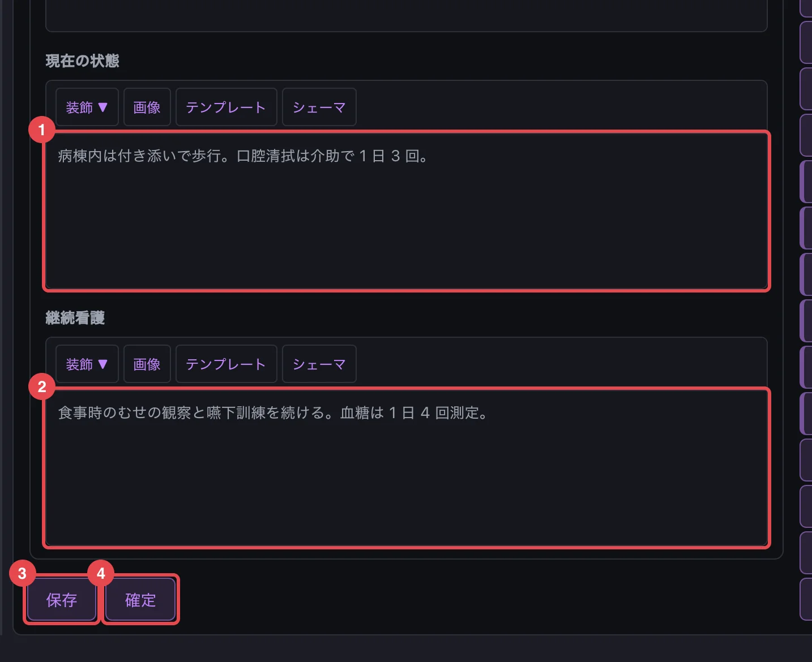
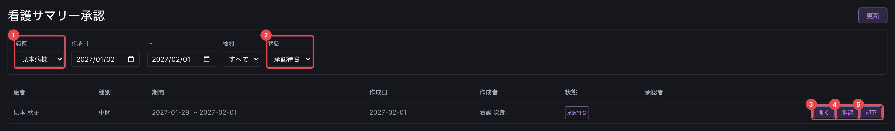

# 看護サマリー

入院中の患者の看護の経過と、引き継ぐ看護をまとめる「看護サマリー」を書き、別の看護師が承認する操作です。
種別は「中間」「転棟」「退院」の 3 つです。退院の看護サマリーは入院 1 回につき 1 つ、中間・転棟は何件でも書けます。

| 状態 | 意味 |
|---|---|
| 作成中 | 「保存」した。まだ書き足せる |
| 承認待ち | 「確定」した。承認する看護師の一覧に出る |
| 承認済 | 承認した |

## 看護サマリーを書く

患者のカルテを開き、右側の登録のボタンの「看護」→「看護サマリー」を押します。

{ .screen width="702" }

1. 「種別」を選びます。
2. 「期間」に、まとめる期間を入れます。初期値は入院日から今日までです。
3. 「再収集」を押すと、カルテの登録内容から基本情報・既往歴・現在の状態を入れ直します(空の欄にだけ入ります)。
4. 「基本情報」には、年齢・性別・入院日・病棟・主治医・担当看護師・アレルギーが初めから入っています。直してもかまいません。

{ .screen width="669" }

1. 「病名」に、この入院の病名が候補として並びます。サマリーに載せないものはチェックを外します。
2. 「看護問題・計画」に、看護計画の看護問題・目標・OP/TP/EP・最新の評価が、優先度の順に候補として並びます([看護計画・看護診断](nursing-care-plan.md))。
3. 「取込」を押すと、期間内の看護記録を選んで「看護経過」に足せます([看護記録](nursing-note.md))。
4. 「看護経過」に、入院中の経過を書きます。

{ .screen width="717" }

1. 「現在の状態」には、看護プロファイルを書いてあればその内容が初めから入ります([看護プロファイル](nursing-profile.md))。
2. 「継続看護」に、引き継ぐ看護を書きます。
3. 書きかけのときは「保存」を押します。作成中のまま残ります。
4. 書き終えたら「確定」を押します。承認待ちになります。

## 承認する(別の看護師)

ヘッダーの「看護業務」から「看護サマリー承認」を開きます。承認できるのは、書いた人とも確定した人とも違う看護師です。

{ .screen }

1. 「病棟」を選びます。「作成日」「種別」でも絞れます。
2. 「状態」の初期値は「承認待ち」です。
3. 「開く」で、内容を右側に開いて確かめます。直してから承認することもできます。
4. 「承認」を押します。
5. 書き直してもらうときは「却下」を押し、理由を入れます。看護サマリーは作成中に戻り、書いた人に差戻しの通知が届きます。

{ .screen }

「状態」を「すべて」にすると、承認済みの看護サマリーと承認した人が並びます。
