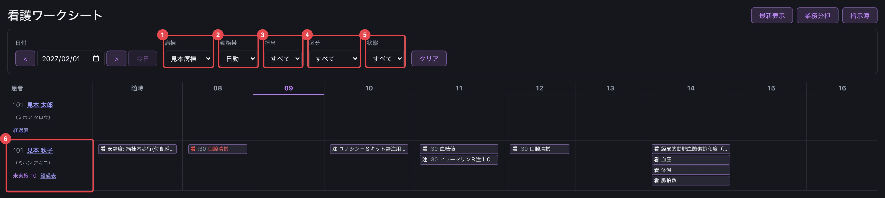
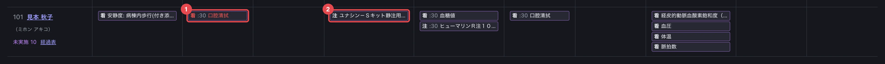
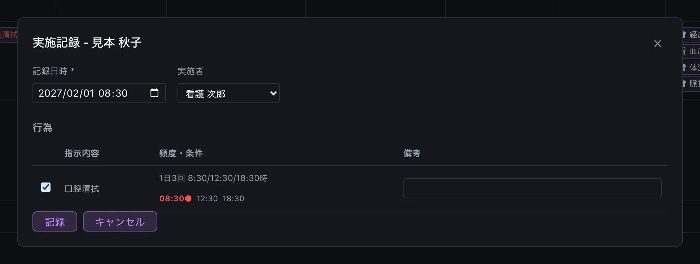
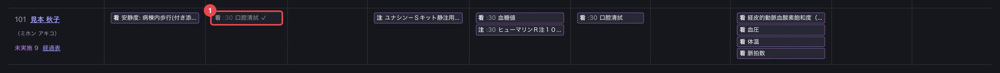
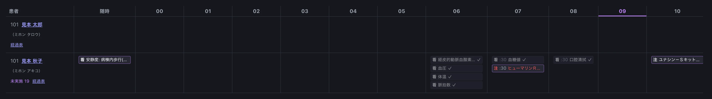

# ワークシート

病棟の 1 日の予定を、患者ごとに時刻の表で見る画面です。看護指示・注射・内服・検体の採取・検査や処置の予定が、
時刻の列に印で並びます。勤務の始めに受け持ちの予定を確かめ、印から実施を記録します。

## ワークシートを開く

ヘッダーの「看護業務」から「ワークシート」を開きます。指示簿の「⋮」、業務分担の画面、ホームの看護師のカードの病棟名からも開けます。

{ .screen }

1. 「病棟」を選びます。「日付」は今日が初期値です。
2. 「勤務帯」で時刻の列を選びます。今日を開くと、いまの勤務帯が初期値になります。

    | 勤務帯 | 並ぶ列 |
    |---|---|
    | 日勤 | 8〜16 時 |
    | 準夜 | 16〜23 時と 0 時 |
    | 深夜 | 0〜8 時 |
    | すべて | 0〜23 時(横に送って見ます) |

3. 「担当」で、[業務分担](nursing-assignment.md)で受け持ちにした患者だけに絞れます。
4. 「区分」で、看護指示・注射などの種類を絞れます。
5. 「状態」で、未実施の予定だけに絞れます。
6. 患者の欄に、病室・氏名・その日の未実施の件数が出ます。氏名でカルテを、「経過表」でカルテの経過表タブを開きます。

行には、その日に病棟のベッドに居た患者が病室の順に並びます。予定の無い患者も並びます。
いまの時刻の列は、見出しに色の線が付きます。

## 印の見方

{ .screen }

印 1 つが予定 1 件です。先頭の 1 文字が区分、続けてちょうどでない分(「:30」)、内容が出ます。

| 文字 | 区分 |
|---|---|
| 看 | 看護指示(頻度から決まった時刻) |
| 注 | 注射(開始時刻) |
| 内 | 内服(入院処方の用法の時刻) |
| 採 | 検体検査・細菌検査の採取 |
| 検 | 放射線・内視鏡・生理検査・処置・輸血・手術 |

1. 今日を見ているとき、時刻を過ぎて実施していない印は赤く出ます。
2. 時刻の無い予定(「適宜」の看護指示など)は「随時」の列に並びます。

印にマウスを乗せると、時刻・詳しい内容・状態が出ます。

## 印から実施を記録する

未実施の看護指示・注射・内服の印を押すと、それぞれの実施入力が開きます。看護指示の実施入力は[看護指示の実施](nursing-perform.md)と同じ画面です。

{ .screen width="970" }

実施を入れて「記録」を押すと、ワークシートに戻ります。

{ .screen }

1. 実施済の印は薄くなり、「✓」が付きます。患者の欄の未実施の件数も減ります。

採取・検査・処置は、それぞれの部門の画面で記録します(細菌検査の採取は印から採取の記録が開きます)。
済んだ予定を取り消すときは、経過表から行います。

## 1 日をまとめて見る

{ .screen }

「勤務帯」を「すべて」にすると、0 時から 23 時までの列が並びます。患者の列は固定で、時刻の列を横に送って見ます。
