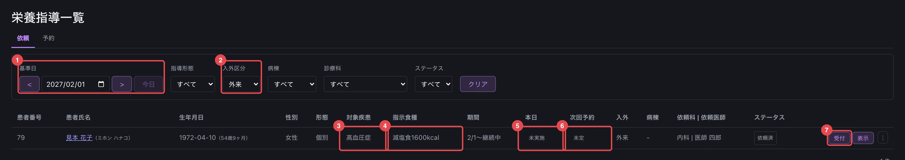
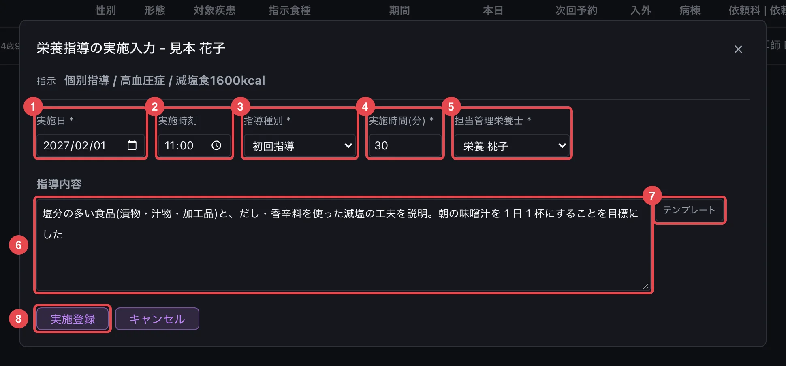
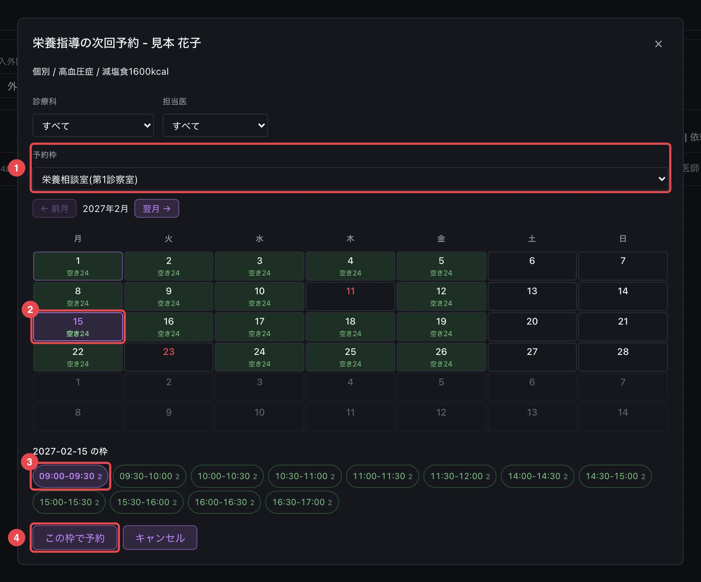
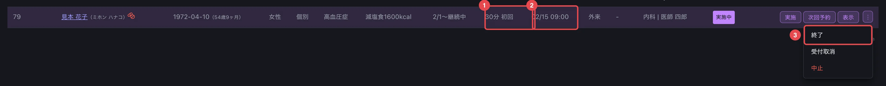

# 栄養指導一覧

管理栄養士が、医師の栄養指導の依頼を栄養指導一覧で受け付け、指導を記録し、次回を予約する操作です。
栄養指導の流れ全体は、業務フローの[栄養指導・服薬指導](../flows/guidance.md)を見てください。依頼は[栄養指導・服薬指導](guidance.md)のページです。

- 栄養指導一覧は、画面の上の「部門業務」>「栄養部門」>「栄養指導一覧」で開きます。ホームの「栄養指導」のカードからも開けます。
- 栄養指導の依頼は、1 件に初回と継続の指導が積み上がる期間の依頼です。一覧には、基準日に期間の入っている依頼が並びます。
- 依頼は「依頼済」→(受付)→「実施中」→(終了)→「終了」と進みます。指導を記録しても状態は実施中のままです。
- 操作は[リハビリ一覧](rehab-worklist.md)と同じ形です。

## 栄養指導一覧の見方

{ .screen }

1. 「基準日」を選びます。
2. 「指導形態」「入外区分」「病棟」「診療科」「ステータス」で絞り込めます。写真は外来に絞っています。
3. 「対象疾患」に、医師が依頼した対象の病名が出ます。
4. 「指示食種」に、医師が指示した食種が出ます。
5. 「本日」に、その日の指導の時間と種別が出ます。まだなら「未実施」です。
6. 「次回予約」に、次の予約の日時が出ます。
7. 新しい依頼は「受付」で受け付けます。受付すると「実施中」になり、「実施」「次回予約」が出ます。

「予約」のタブでは、日ごとの予約を時刻の順に見ます。

## 指導を記録する

指導が済んだら、行の「実施」を押します。

{ .screen width="970" }

1. 「実施日」を確かめます。
2. 「実施時刻」を入れます。予約の行から開いたときは予約の時刻が入っています。
3. 「指導種別」で、「初回指導」か「2 回目以降」を選びます。
4. 「実施時間(分)」を入れます。
5. 「担当管理栄養士」を確かめます。ログインしている人が入っています。
6. 「指導内容」を書きます。
7. 「テンプレート」から、決まった項目に沿って記入することもできます。
8. 「実施登録」を押します。

## 次回を予約する

行の「次回予約」を押すと、予約の画面が開きます。「予約枠」で栄養相談室などの「栄養指導予約」の枠表を選び、日と時刻の枠を選んで「この枠で予約」を押します。

{ .screen width="970" }

1. 「予約枠」で枠表を選びます。
2. 暦で日を選びます。日ごとに空きの数が出ます。
3. 時刻の枠を選びます。集団指導では、1 枠に複数の患者が入ります。
4. 「この枠で予約」を押します。

{ .screen }

1. 「本日」に、指導の時間と種別が出ます。
2. 「次回予約」に、予約した日時が出ます。
3. 指導を終えるときは「⋮」の「終了」で終了日を入れます。終了日より後の予約は取り消され、枠が空きます。

- 取りやめるときは「⋮」の「中止」、押し間違いは「受付取消」「終了取消」「中止取消」で戻します。
- 予約は、「予約」のタブの行の「⋮」と、カルテの予約タブで日時変更・取消ができます。
- 入院中の依頼は、退院の画面の「栄養指導オーダーを退院日で終了する」で、退院日に終了日を付けられます。
