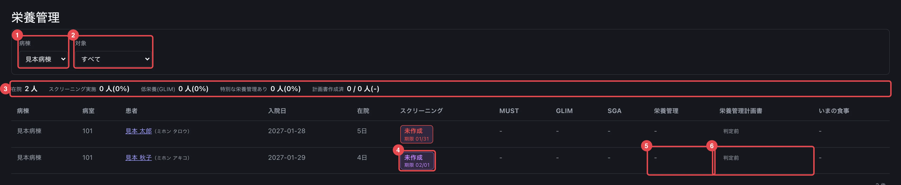
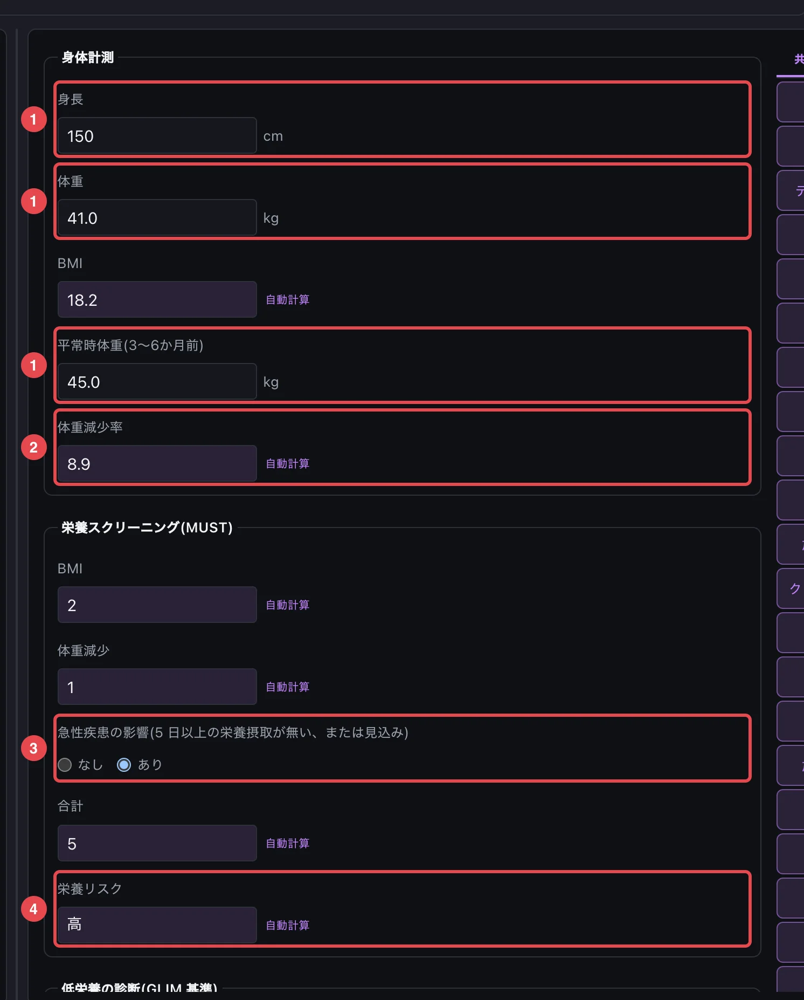
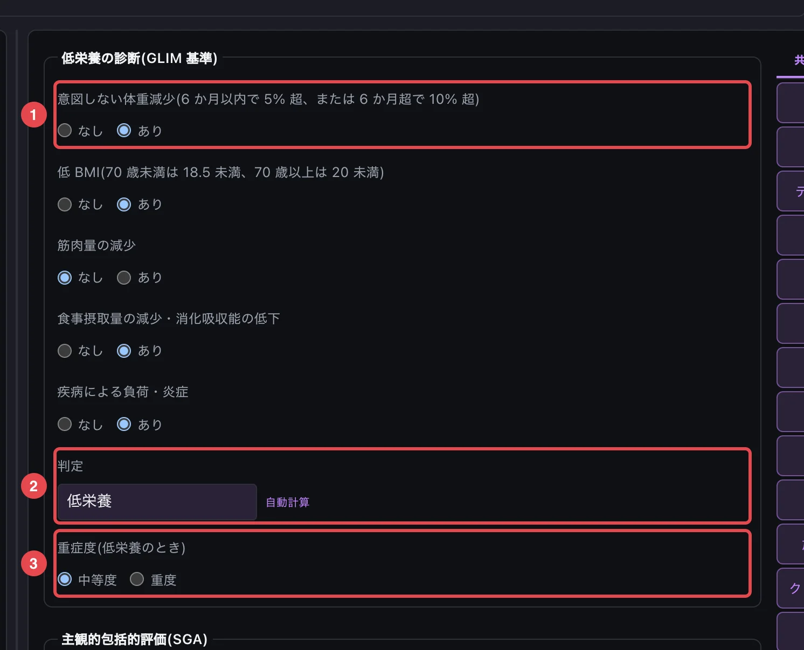
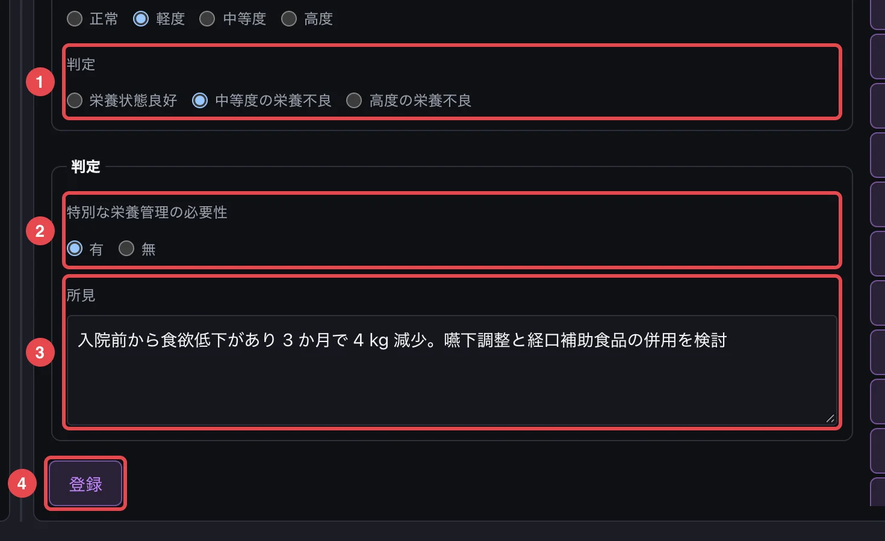

# 栄養管理

管理栄養士が、入院患者ごとに栄養スクリーニングと栄養管理計画書の状況を見て、期限までに書く操作です。

- 栄養管理は、画面の上の「部門業務」>「栄養部門」>「栄養管理」で開きます。
- 入院すると、入院日から決まった日数(既定は栄養スクリーニングが 3 日、栄養管理計画書が 7 日)の期限が付きます。
- 栄養管理計画書が要るのは、栄養スクリーニング(か入院診療計画書)で「特別な栄養管理の必要性」が「有」の入院だけです。
- 同じ状況は、「診療業務」>「入退院文書」の栄養の列にも出ます。

## 栄養管理の見方

{ .screen }

1. 「病棟」で絞り込みます。
2. 「対象」で、「特別な栄養管理あり」「低栄養(GLIM)」「未対応あり」に絞れます。
3. 在院の人数と、スクリーニング実施・低栄養(GLIM)・特別な栄養管理ありの人数と割合、計画書を作った人数が出ます。
4. 「スクリーニング」に、作成の状況と期限が出ます。期限を過ぎて作成していないものは赤で出ます。押すとカルテが開き、右ペインで栄養スクリーニングを書き始めます。
5. 「栄養管理」に、特別な栄養管理の必要性(有・無)が出ます。
6. 「栄養管理計画書」に、計画書の状況が出ます。スクリーニングがまだなら「判定前」、必要性が無なら「不要」です。

MUST・GLIM・SGA の列に、スクリーニングの結果が出ます。患者名を押すとカルテが開きます。

## 栄養スクリーニングを書く

身長・体重などから、MUST・GLIM 基準・SGA で栄養状態を評価します。「自動計算」の欄は入れた値から計算されます。

{ .screen width="746" }

1. 「身長」「体重」「平常時体重(3〜6 か月前)」を入れます。
2. BMI と体重減少率が計算されます。
3. MUST の「急性疾患の影響」を選びます。BMI と体重減少の点数は計算されます。
4. 合計点と「栄養リスク」が計算されます。

{ .screen width="746" }

1. 体重減少・低 BMI・筋肉量の減少(表現型)と、食事摂取量の減少・疾病による負荷(病因)を、それぞれ「なし」「あり」で選びます。
2. 「判定」が計算されます。表現型と病因の両方に「あり」があると低栄養です。
3. 低栄養のときは「重症度」を選びます。

{ .screen width="735" }

1. SGA の項目を選び、「判定」(栄養状態良好・中等度の栄養不良・高度の栄養不良)を選びます。
2. 「特別な栄養管理の必要性」の「有」「無」を選びます。「有」にすると、栄養管理計画書が要るものとして一覧に出ます。
3. 「所見」を書きます。
4. 「登録」を押します。

{ .screen }

1. 「スクリーニング」が「作成済」になります。
2. GLIM の判定と重症度が出ます。低栄養は赤で出ます。
3. 「栄養管理」に、特別な栄養管理の必要性が出ます。
4. 必要性が「有」なので、「栄養管理計画書」が「未作成」と期限になります。押すと、計画書を書き始めます。

- 計画書を作ったあとも、計画書の「栄養状態の再評価の時期」を過ぎて在院していると「再評価」と期限が赤で出ます。押すと新しい計画書を書き始めます。
- スクリーニングと計画書の雛形と期限は、施設設定の「文書作成の督促」で決めます。
