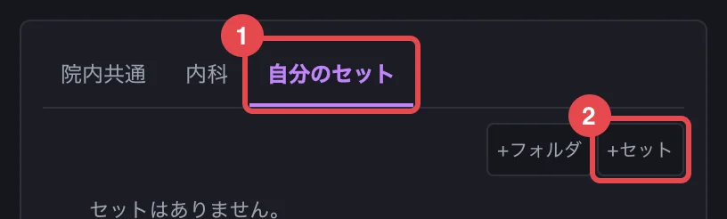
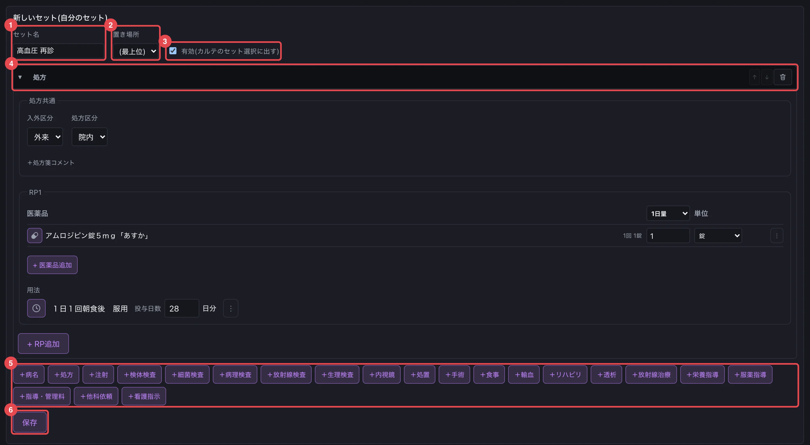
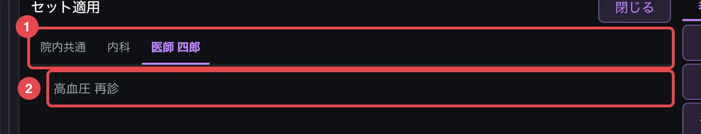
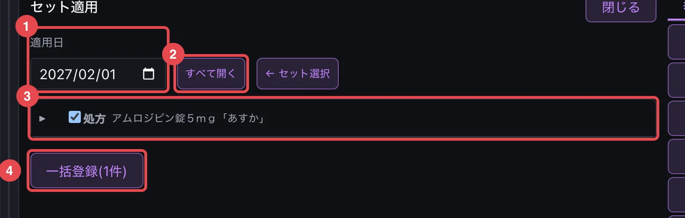
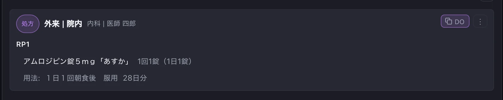

# オーダーセット

よく一緒に出す病名やオーダー(処方・検査など)をセットとして登録しておき、カルテからまとめて出す操作です。

セットの持ち主は 3 段階です。

| 持ち主 | 使える人 | 直せる人 |
|---|---|---|
| 院内共通 | 全員 | 医師 |
| 診療科 | 全員 | その診療科の医師 |
| 自分のセット | 全員(カルテでは持ち主の医師の名前で出ます) | 本人 |

## セットを登録する

ヘッダーの「診療業務」から「セット登録」を開きます。

{ .screen width="408" }

1. 登録する持ち主のタブを選びます。
2. 「+セット」を押します。セットを分類するときは、先に「+フォルダ」でフォルダを作ります。

{ .screen width="1492" }

1. 「セット名」を入れます。
2. フォルダに入れるときは「置き場所」でフォルダを選びます。
3. カルテのセット選択に出すときは「有効」に印を付けたままにします。
4. 下の「＋処方」などで足したオーダーが、種類ごとに積まれます。入力は通常のオーダーの登録と同じです。患者や日付によって決まる項目(対象プロブレム・投与開始日など)は出ません。見出しの「↑」「↓」で並べ替え、ゴミ箱で消します。
5. 足すオーダーの種類のボタンを押します。病名と、処方・注射・検査・食事・看護指示など 19 種のオーダーを入れられます。
6. 「保存」を押します。

セットの一覧の行の「複製」で、セットを別の持ち主に写せます(自分のセットを診療科のセットにする、など)。「削除」で、確認のあとセットを削除します。

## カルテでセットを使う

患者のカルテを開き、右側の登録のボタンから「セット」を押します。右側に「セット適用」が開きます。

{ .screen width="734" }

1. 持ち主のタブを選びます。
2. 使うセットを押します。セットのオーダーが並びます。

{ .screen width="733" }

1. 「適用日」を選びます。各オーダーの開始日(投与開始日・検査日など)にまとめて入ります。初期値は今日です。予約の要る検査は、予約した枠の日時になります。
2. 「すべて開く」で、すべてのオーダーの入力を開きます。1 つだけ開くときは、行の左の「▶」を押します。開いたオーダーは、この患者に合わせて直せます。
3. 出さないオーダーは、行の印を外します。
4. 「一括登録」を押します。印の付いたオーダーがまとめて登録され、カルテにカードが出ます。

{ .screen width="841" }

- 1 つでも入力に足りないところがあると、どれも登録されません。足りない項目を直してから、もう一度「一括登録」を押します。
- 入外区分は、患者が入院中かどうかに合わせて入ります。セットと違うときは注意が出ます。
- 登録したオーダーは、1 件ずつ登録したものと同じように、カードから直したり削除したりできます。
