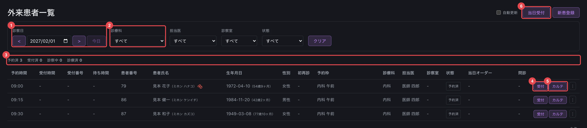
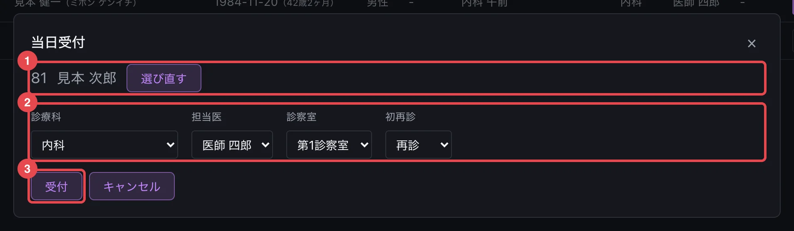
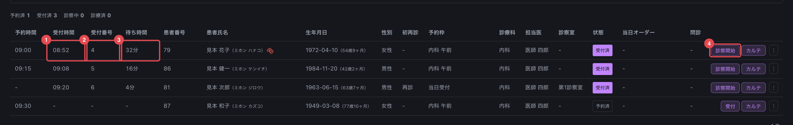
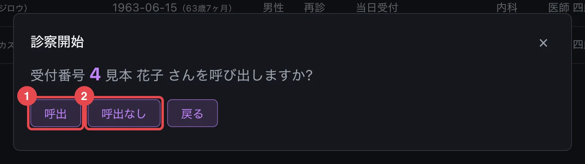
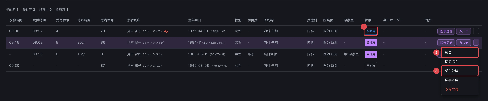
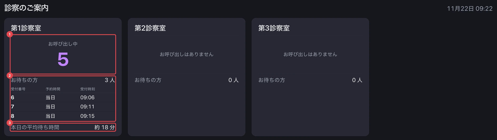

# 外来患者一覧

その日の外来の予約と受付を時間の順に並べ、受付から診察開始・診察終了までを進める一覧です。
外来の流れ全体と、それぞれの状態の意味は、業務フローの[外来の受付から会計まで](../flows/outpatient.md)を見てください。予約の取り方は[予約](appointment.md)のページです。

- 外来患者一覧は、画面の上の「患者一覧」>「外来患者一覧」で開きます。
- 1 行が 1 件の予約か受付です。検査の予約(放射線・生理検査などのオーダーに付く予約)は出ません。

## 一覧の見方

{ .screen }

1. 「診察日」を選びます。「<」「>」で 1 日ずつ動かし、「今日」で今日に戻ります。
2. 「診療科」「担当医」「診察室」「状態」で絞り込みます。医師がメニューから開くと、「担当医」に自分が選ばれた状態で開きます。「クリア」で絞り込みを外します。
3. 状態ごとの件数が出ます。
4. 予約の患者が来院したら、その行の「受付」を押します。
5. 「カルテ」で、その患者のカルテを開きます。カルテの「← 戻る」で、同じ日・同じ絞り込みの一覧に戻ります。
6. 予約の無い再診の患者は「当日受付」で、初めての患者は「新患登録」で受け付けます。

- 「自動更新」にチェックを入れると、一覧を 1 分ごとに読み直します。受付の端末と診察室の端末で同じ一覧を見るときに使います。

## 当日受付

{ .screen width="800" }

1. 「当日受付」を押し、患者番号か氏名で患者を探して選びます。選び直すときは「選び直す」を押します。
2. 「診療科」「担当医」「診察室」「初再診」を選びます。
3. 「受付」を押すと、受付済の行として一覧に加わります。予約時間は「-」、予約枠は「当日受付」と出ます。

「新患登録」は、患者の基本情報を入れて患者を登録し、そのまま受け付けます。

## 受付を済ませた行

{ .screen }

1. 「受付時間」に、受付をした時刻が入ります。
2. 「受付番号」に、その日の受付の連番が入ります。待合表示板の呼出番号になるので、患者に伝えます。
3. 「待ち時間」に、受付からの経過が出ます。今日の一覧の、受付済で診察を始める前の行だけに出ます。
4. 診察を始めるときは「診察開始」を押します。

受付番号は、受付を取り消して受け付け直したときなどに飛ぶことがあります。

## 診察開始と呼出

{ .screen width="700" }

待合表示板を使っていて受付番号があるときは、「診察開始」を押すと呼び出すかどうかを聞かれます。

1. 「呼出」を押すと、待合表示板の「お呼び出し中」に受付番号が出て、その患者のカルテが開きます。
2. 「呼出なし」を押すと、待合表示板に出さずに診察を始めます。検査から戻った患者の続きを診るときなどに使います。

- 来ない患者をもう一度呼ぶときは、カルテの右ペインの「患者呼出」を押します。番号が 10 分間「お呼び出し中」に出ます。
- カルテの見出しの「診察開始」でも、同じように聞かれます。

## 診察終了と行の操作

{ .screen }

1. 「状態」が、予約済 → 受付済 → 診察中 → 診療済と進みます。診察中の行の「診察終了」を押すと診療済になります。
2. 行の「⋮」の「編集」で、診療科・担当医・診察室・初再診を直します。当日に担当医が替わる、別の診察室に回すときに使います。
3. 受付を誤ったときは「受付取消」で予約済に戻します。診察を始める前だけできます。

- 行の「診察終了」は、その場で診療済にします。未実施の検査を確かめてから終えるときや、検査に回すため一時終了にするときは、カルテの見出しの「診察終了」を押します。一時終了の行には「診察再開」が出ます。
- 「⋮」には、ほかに「問診 QR」(Web 問診の QR を出す)、「未来院」(予約の日に来なかった)、「診察開始取消」「診察終了取消」「予約取消」が、その行でできるものだけ出ます。
- レセコン連携を使う施設では、診療済の行に「医事送信」が出ます。

## 待合表示板

{ .screen }

待合表示板は、待合室のモニターに出す画面です。ログインせずに開き、30 秒ごとに読み直します。患者番号と氏名は出ません。

1. 「お呼び出し中」に、診察室ごとに最後に呼び出した受付番号が出ます。
2. 「お待ちの方」に、受付済で診察を待っている人数と、受付番号・予約時間(当日受付は「当日」)・受付時刻が並びます。
3. 検査などで離席中の人数と、本日の平均待ち時間(受付から診察開始まで)が出ます。

- 診察室が決まっていない受付は、診療科ごとの区画に出ます。
- 待合表示板のリンクは、管理者が「施設設定」の「待合表示板」で発行します。
