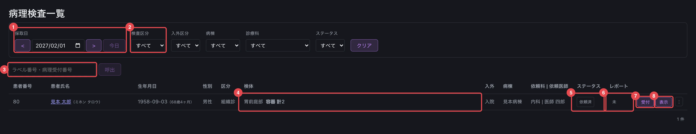
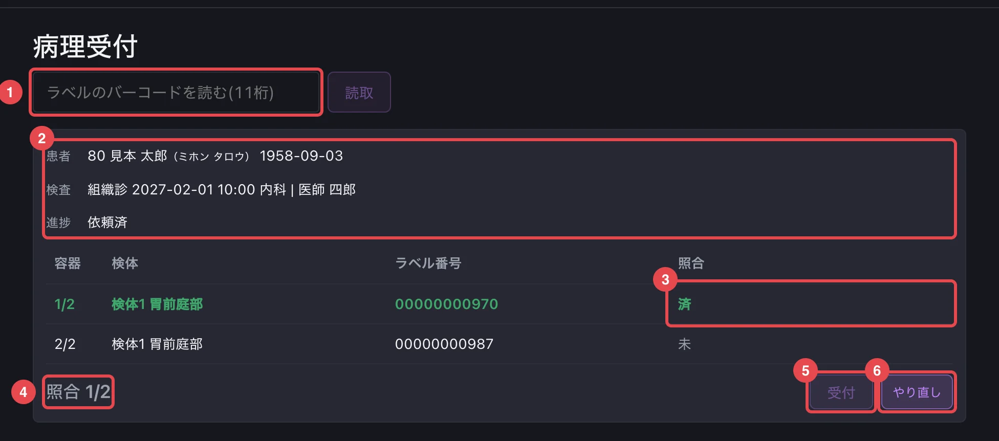
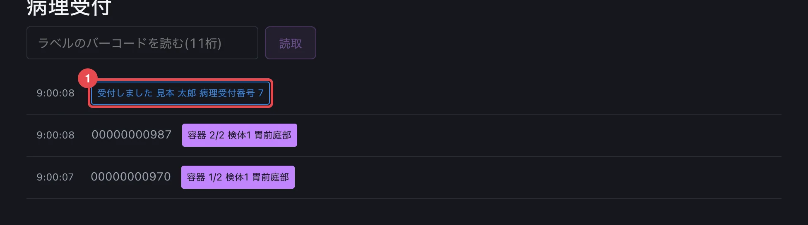
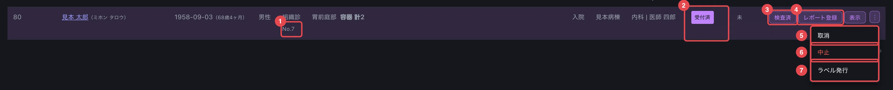
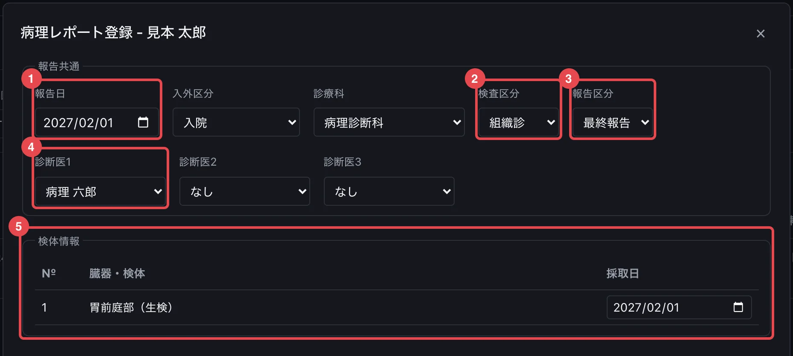
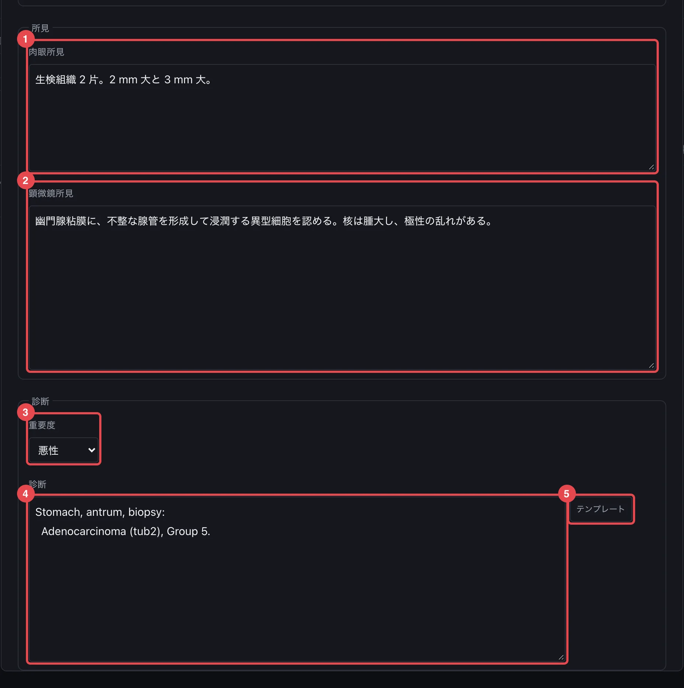
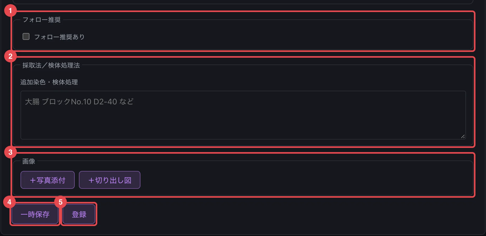
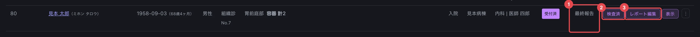

# 病理検査一覧

病理部門が、医師の出した病理検査の検体を受け付け、病理医が病理診断レポートを書く操作です。
病理検査の流れ全体は、業務フローの[病理検査オーダー](../flows/patho.md)を見てください。

- 病理検査一覧は、画面の上の「部門業務」>「病理部門」>「病理検査一覧」で開きます。ホームの「病理検査」のカードからも開けます。
- 作業は「依頼済」→(病理受付で容器を照合)→「受付済」→(標本の作製と検鏡が済む)→「検査済」と進みます。
  レポートは状態とは別に書きます。最終報告を保存しても、状態は変わりません。
- 検体の採取とラベルの発行は、病棟・外来がカルテで行います。操作は[病理検査](patho.md)を見てください。

## 病理検査一覧の見方

{ .screen }

1. 「採取日」で、検体を採る(採った)日を選びます。「<」「>」で 1 日ずつ動かし、「今日」で今日に戻ります。
2. 「検査区分」(組織診・細胞診・術中迅速)「入外区分」「病棟」「診療科」「ステータス」で絞り込めます。
3. 「ラベル番号・病理受付番号」に番号を入れて「呼出」を押すと、そのオーダーの日に移って内容が開きます。前の日のオーダーを探すときに使います。
4. 「検体」に、臓器と容器の数が出ます。受付の前で採取が記録されていなければ「未採取」が出ます。
5. 「ステータス」に作業の状態が出ます。
6. 「レポート」に、レポートの状態(「未」「下書き」「中間報告」「最終報告」「訂正報告」「追加報告」)が出ます。
7. 依頼済の行の「受付」を押すと、そのオーダーを開いた状態で病理受付が開きます。
8. 「表示」を押すと、依頼の内容が開きます。レポートがあれば、レポートも続けて出ます。

## 容器を照合して受け付ける

病理受付では、届いた容器のラベルを全部読んでから受け付けます。病理受付は「部門業務」>「病理部門」>「病理受付」でも開けます。

{ .screen }

1. 容器のラベルをバーコードリーダーで読みます。手で打つときは 11 桁の番号を入れて「読取」を押します。
2. 1 本目を読むと、そのオーダーの患者・検査・状態が出ます。
3. 読んだ容器の「照合」が「済」になります。
4. 照合した容器の数と、オーダーの容器の数が出ます。
5. 容器が全部揃うと「受付」を押せるようになります。
6. 読み直すときは「やり直し」を押します。

別の患者・別のオーダーのラベル、刷り直す前の古いラベル、検体検査のラベルを読むと、赤い警告が出て照合に入りません。

{ .screen }

1. 「受付」を押すと、受付済になり、病理受付番号が振られます。読んだ容器には到着が記録されます。

## 受付済の行

{ .screen }

1. 「区分」の下に、病理受付番号が出ます。
2. ステータスが「受付済」になります。
3. 標本の作製と検鏡が済んだら「検査済」を押します。レポートが無くても押せます。
4. 「レポート登録」で、病理診断レポートを書きます。
5. 「⋮」の「取消」で 1 つ前の状態に戻します(受付済 → 依頼済、検査済 → 受付済)。病理受付番号と容器の到着の記録は残り、受け付け直しても番号は変わりません。
6. 「⋮」の「中止」で検査を取りやめます。中止した検査は「中止取消」で依頼済に戻せます。
7. 「⋮」の「ラベル発行」で、容器のラベルを刷り直せます。同じ容器は同じ番号で刷られます。

ラベルの無い古いオーダーは、依頼済の行の「⋮」の「受付済にする」で受け付けます。病理受付番号は振られますが、容器の到着は記録されません。

## 病理診断レポートを書く

病理医が、受付済・検査済の行の「レポート登録」を押します。

{ .screen width="1002" }

1. 「報告日」は今日が入っています。
2. 「検査区分」はオーダーのとおりです。
3. 「報告区分」で「中間報告」か「最終報告」を選びます。
4. 「診断医1」〜「診断医3」に、診断に関わった病理医を 3 人まで選びます。1 人目にはログインしている医師が入っています。最終報告には 1 人以上が必要です。
5. 「検体情報」に、オーダーの検体が並びます。「採取日」には、採取の記録の日(無ければ採取予定日)が入っています。

{ .screen width="1002" }

1. 「肉眼所見」を書きます。
2. 「顕微鏡所見」を書きます。
3. 「重要度」で、悪性を疑うときは「悪性疑い」、悪性なら「悪性」を選びます。依頼医への結果の通知が、目立つ印のアラートになります。
4. 「診断」を書きます。
5. 「テンプレート」で、取扱い規約・TNM の項目を選んで診断を書くこともできます。テンプレートで書いた診断は、「テンプレート編集」で直すか「解除」で紐付けを外してから直します。

細胞診では、判定を選ぶと同じ重要度が入ります(あとから直せます)。

{ .screen width="1002" }

1. 再生検・追加検査・他科受診などを勧めるときは「フォロー推奨あり」にチェックを付け、内容と期限を入れます。確定すると、依頼医の検査結果フォローに載ります。
2. 「追加染色・検体処理」に、追加した染色やブロックの番号などを書きます。
3. 「+写真添付」で肉眼写真・鏡検写真を、「+切り出し図」で切り出し図を描いて添えます。
4. 書きかけのときは「一時保存」を押します。下書きは依頼医には見えません。中間報告・最終報告で保存したあとは一時保存できません。
5. 「登録」を押します。

## レポートを登録したあと

{ .screen }

1. 「レポート」に報告区分が出ます。
2. 標本の作製と検鏡が済んでいれば「検査済」を押します。
3. レポートを直すときは「レポート編集」を押します。

- 最終報告で保存すると、依頼医に結果の通知が届き、依頼医が患者に説明したかを記録する「患者説明」の台帳ができます。
- 確定したレポートを直すときは、報告区分を毎回「訂正報告」か「追加報告」から選びます。免疫染色の結果を足すなら追加報告、診断を改めるなら訂正報告です。
  どちらも依頼医の結果の確認が未確認に戻り、患者説明も未説明に戻ります。
