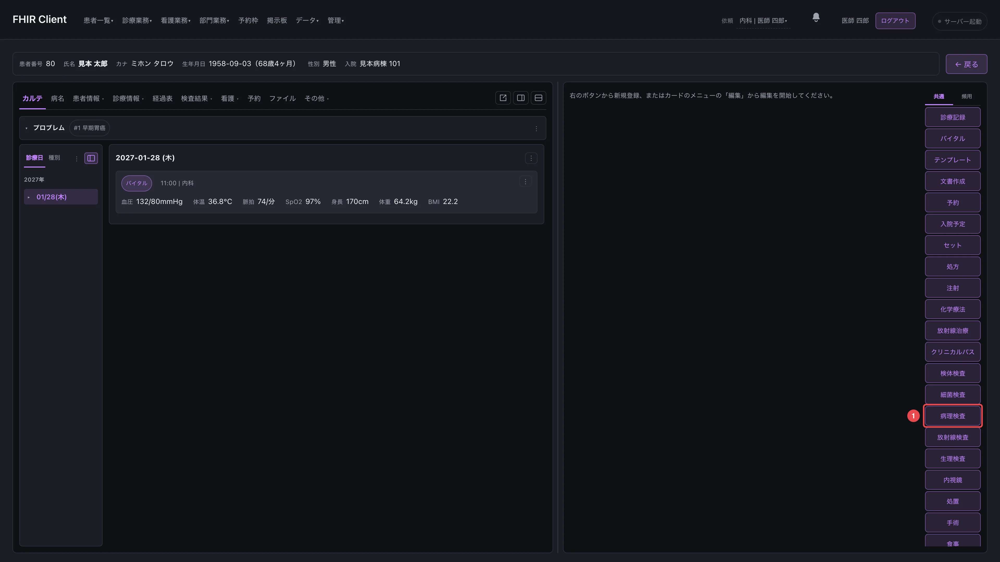
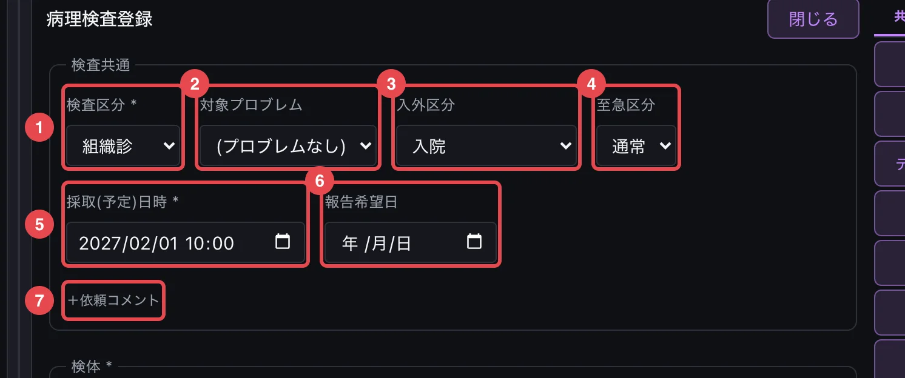
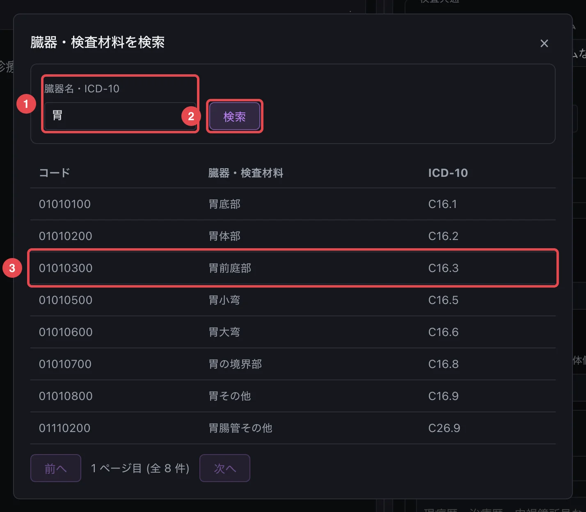
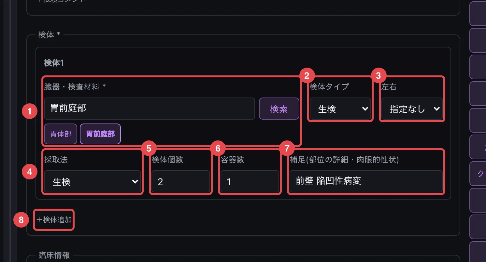
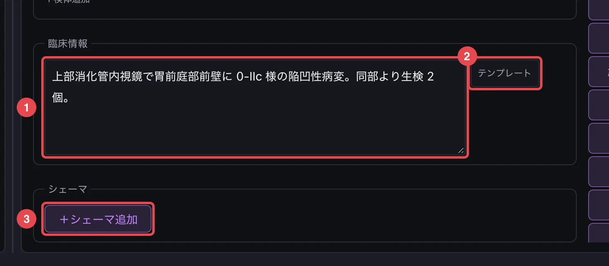
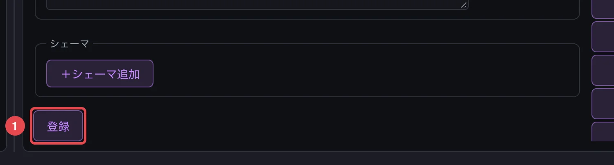
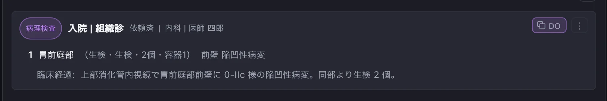
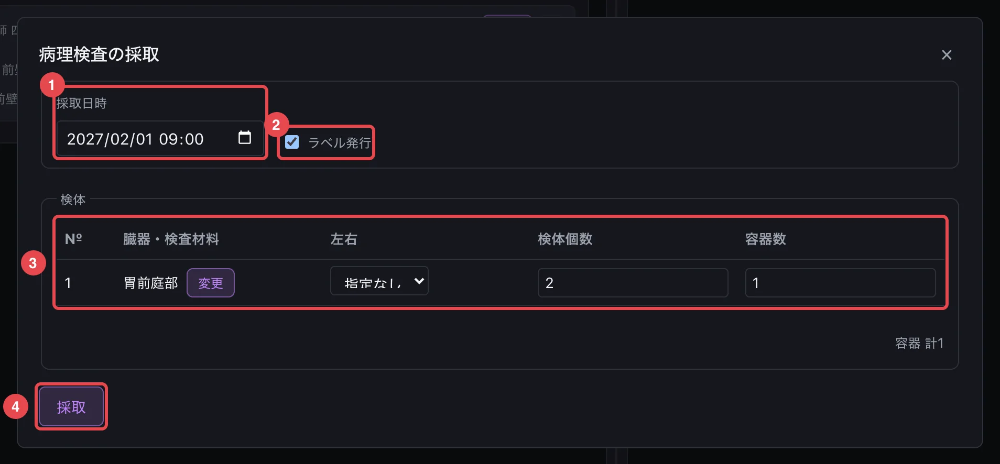
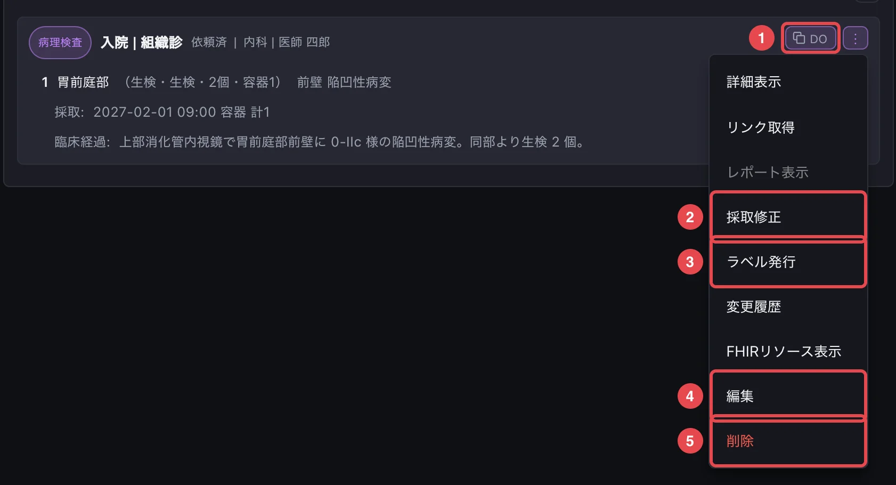

# 病理検査

医師がカルテから病理検査(組織診・細胞診・術中迅速)を登録し、採取を記録する操作です。
ラベル発行・病理受付・診断レポート・結果の確認と患者への説明までの流れは、業務フローの[病理検査オーダー](../flows/patho.md)を見てください。

このページで使う呼び名です。

- **検体**: 臓器・検査材料ごとの 1 まとまりです。1 つの病理検査に、検体をいくつも入れられます。
- **容器**: 検体を入れる入れ物です。ラベルは容器 1 つに 1 枚刷ります。

## 病理検査登録を開く

患者のカルテを開いておきます。

{ .screen }

1. カルテの右側に並ぶボタンから「病理検査」を押します。右側に「病理検査登録」が開きます。

## 検査共通を入れる

項目名に「*」が付いたものは必ず入れます。

{ .screen width="746" }

1. 「検査区分」で「組織診」「細胞診」「術中迅速」から選びます。区分を変えると、検体タイプの選択肢が変わります。
2. 「対象プロブレム」で、この検査の対象の病名を選びます。
3. 「入外区分」で「入院」か「外来」を選びます。
4. 「至急区分」で「通常」か「至急」を選びます。
5. 「採取(予定)日時」に、検体を採る日時を入れます。
6. 報告の希望日があれば「報告希望日」に入れます。
7. 病理部門へ伝えることがあれば「＋依頼コメント」を押して入れます。

## 検体を入れる

### 臓器・検査材料を選ぶ

よく使う臓器・検査材料は、入力欄の下にボタンで並びます。押すと入ります。ほかの臓器は「検索」で探します。

{ .screen width="714" }

1. 「臓器名・ICD-10」に、臓器の名前の一部か ICD-10 のコードを入れます。
2. 「検索」を押します。
3. 使う臓器の行を押します。

### 検体の内容を入れる

{ .screen width="746" }

1. 「臓器・検査材料」に、選んだ臓器が入ります。選び直すときは、下のボタンか「検索」で選びます。
2. 「検体タイプ」を選びます。組織診は「生検」か「手術材料」です。
3. 必要なら「左右」を選びます。
4. 「採取法」を選びます。
5. 分かっていれば「検体個数」を入れます。採るまで分からないときは空でかまいません。
6. 「容器数」を入れます。初期値は 1 です。ラベルは容器の数だけ刷られます。
7. 必要なら「補足(部位の詳細・肉眼的性状)」を入れます。
8. 別の臓器・部位の検体を足すときは「＋検体追加」を押し、同じように入れます。

検体が 2 つ以上あるときは、検体の右上のゴミ箱で検体を消せます。

## 臨床情報とシェーマを入れる

{ .screen width="746" }

1. 「臨床情報」に、現病歴・治療歴・内視鏡所見など、診断に関わる情報を入れます。
2. 「テンプレート」を押すと、施設で用意したテンプレートを選んで、項目に沿って入れられます。
3. 部位を図で示すときは「＋シェーマ追加」を押し、施設で登録した臓器の図の上に描きます。何枚でも付けられます。

## 登録する

{ .screen width="750" }

1. 「登録」を押します。

採取(予定)日時や臓器・検査材料が足りないときは、上に内容が出て、その項目に印が付きます。直してからもう一度「登録」を押します。

登録すると右側が閉じ、カルテに病理検査のカードが出ます。検体ごとに、臓器・検体タイプ・採取法・個数・容器数が並びます。

{ .screen width="841" }

## 採取を記録する

検体を採ったら、カードの「⋮」の「採取」で記録します。「病理検査の採取」が開きます。

{ .screen width="954" }

1. 「採取日時」を確かめます。初期値はいまの日時です。
2. その場でラベルを刷るときは「ラベル発行」にチェックを付けたままにします。後で刷るときは外します。
3. 検体ごとに、実際に採った臓器(「変更」で選び直し)・左右・検体個数・容器数を直します。右下に容器の合計が出ます。
4. 「採取」を押します。

採取を記録すると、カードに採取の日時と容器の数が出ます。容器数を減らすと、余った容器のラベルは使えなくなります。

## 登録した病理検査を使う・直す

カルテの病理検査のカードから操作します。

{ .screen width="841" }

1. 「DO」を押すと、同じ内容が右側の「病理検査登録」に入ります。採取の記録・ラベル・レポート・シェーマは写りません。採取日時などを直して「登録」を押します。
2. 採取を記録したあとは「⋮」の「採取修正」で直せます。
3. 「⋮」の「ラベル発行」で、容器のラベルを刷ります。刷り直しても、同じ容器は同じ番号です。
4. 「⋮」の「編集」を押すと、右側に編集が開きます。直して「更新」を押します。検体や容器数を変えたら、ラベルを刷り直します。
5. 「⋮」の「削除」を押すと、理由を入れて病理検査を削除します。レポートがあるときは、先にレポートを削除します。

- 採取の記録と修正は、病理部門が受け付けるまで(依頼済のあいだ)にできます。
- 診断レポートが登録されると、「⋮」の「レポート表示」でレポートを開けます。レポートが無いあいだは押せません。
- 検査をやめるときの「中止」は、カルテのカードではなく、病理検査一覧の行のメニューで行います。

レポートが確定すると依頼医に通知が届きます。レポートを読んだ確認と、患者への説明の記録は、業務フローの[結果の確認と患者説明](../flows/patho.md#結果の確認と患者説明)を見てください。
