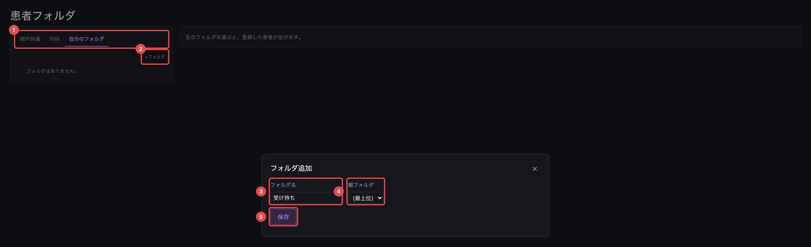
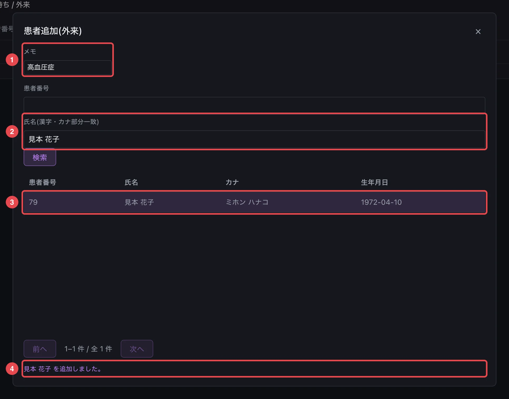
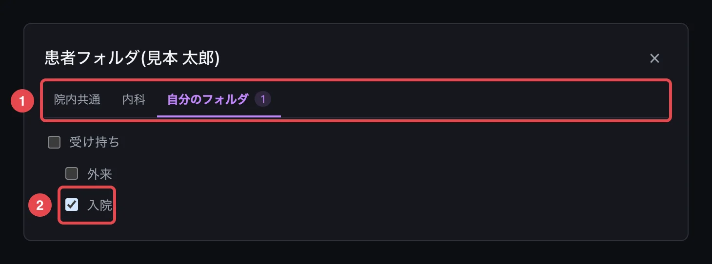
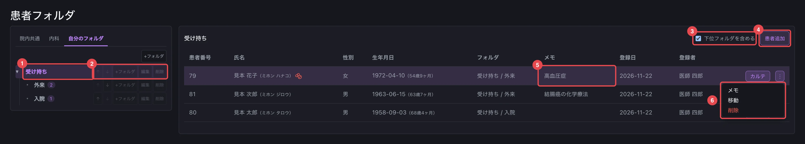

# 患者フォルダ

受け持ちや研究の対象などの患者を、フォルダに仕分けて見直す操作です。フォルダは階層にでき、患者ごとにメモを付けられます。
フォルダに入れても、カルテの記録は変わりません。

- 患者フォルダは、画面の上の「患者一覧」>「患者フォルダ」で開きます。
- フォルダは、院内共通・診療科・自分のフォルダの 3 つに分かれます。自分のフォルダは本人だけが見られます。診療科のフォルダは、その科の職員だけが書き換えられます。
- 患者を入れる入口は、患者フォルダの「患者追加」、患者検索の行の「⋮」の「フォルダ」、[データ抽出](data-extract.md)の結果の「フォルダ登録」の 3 つです。

## フォルダを作る

{ .screen }

1. 「院内共通」「(診療科)」「自分のフォルダ」から、フォルダを置く場所を選びます。
2. 「+フォルダ」を押します。フォルダの行の「+フォルダ」を押すと、そのフォルダの中に作ります。
3. 「フォルダ名」を入れます。
4. 「親フォルダ」を選びます。いちばん上に作るときは「(最上位)」のままにします。
5. 「保存」を押します。

## 患者を入れる

フォルダを選び、右上の「患者追加」を押します。

{ .screen width="970" }

1. 患者に付ける「メモ」を入れます(入れなくてもかまいません)。
2. 患者番号か氏名を入れて「検索」を押します。
3. 患者の行を押すと、フォルダに入ります。
4. 入れた患者が下に出ます。モーダルは閉じないので、続けてほかの患者を入れられます。終わったら「×」で閉じます。

- すでに入っている患者を選ぶと、「すでに登録されています」と出ます。

## 患者検索から入れる

患者検索の行の「⋮」の「フォルダ」を押すと、その患者を入れるフォルダを選べます。

{ .screen width="730" }

1. 「院内共通」「(診療科)」「自分のフォルダ」を切り替えます。その患者が入っているフォルダの数が、横に出ます。
2. 入れるフォルダに印を付けます。印を外すと、フォルダから外します。付け外しはその場で保存されます。

## フォルダの患者を見る

{ .screen }

1. 左のフォルダを選ぶと、右にフォルダの患者が並びます。フォルダ名の横の数は、入っている患者の数です。
2. フォルダの行のボタンで、並べ替え(「↑」「↓」)・中にフォルダを作る(「+フォルダ」)・名前と親フォルダを変える(「編集」)・削除をします。
3. 「下位フォルダを含める」に印を付けると、中のフォルダの患者もまとめて並びます。「フォルダ」の列に、入っているフォルダが出ます。
4. 「患者追加」で、選んでいるフォルダに患者を入れます。
5. 入れたときのメモが出ます。
6. 行の「⋮」で、メモを直す(「メモ」)・ほかのフォルダに移す(「移動」)・フォルダから外す(「削除」)をします。

- 行の「カルテ」で、その患者のカルテが開きます。
- 中にフォルダが残っているフォルダは削除できません。フォルダを削除すると、入っていた患者もフォルダから外れます。
- フォルダは、データ抽出の記録のタブの「患者フォルダ」で、その患者の記録だけに絞るのにも使えます。
