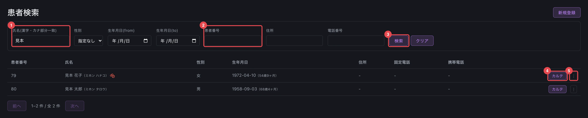
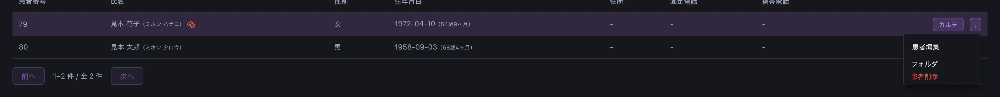
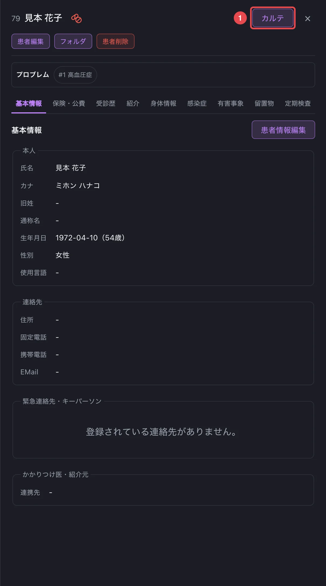

# 患者検索とカルテを開く

患者を探して、その患者のカルテを開く操作です。

その日に受診する外来の患者は「患者一覧」の「外来患者一覧」から、入院中の患者は「入院患者一覧」から、
ホームのカードに並ぶ患者はその行から、カルテを開くこともできます。

## 患者を探す

上の帯の「患者一覧」から「患者検索」を開きます。開いた直後は、条件を入れずに探した患者が並んでいます。

{ .screen }

1. 「氏名(漢字・カナ部分一致)」に、氏名の一部を漢字かカナで入れます。
2. 患者番号が分かるときは「患者番号」に入れます。性別・生年月日・住所・電話番号でも絞り込めます。
3. 「検索」を押します。条件に合う患者が並びます。条件を消すときは「クリア」を押します。
4. 「カルテ」を押すと、その患者のカルテが開きます。
5. 「⋮」から、患者の情報を直すなどの操作をします(下の「患者の操作」)。

多いときは一覧の下の「前へ」「次へ」でページを移ります。新しい患者を登録するときは、右上の「新規登録」を押します。

## 患者の操作

{ .screen }

行の「⋮」を押すと、次の操作が並びます。

| 操作 | 内容 |
|---|---|
| 患者編集 | 氏名・生年月日・連絡先などを直します |
| フォルダ | 患者フォルダに入れる・外します |
| 患者削除 | 患者を削除します。確認が出るので、よければ「OK」を押します |

## カルテを開く前に患者の情報を見る

行の「カルテ」と「⋮」以外のところを押すと、右から患者の情報が開きます。カルテを開かずに、プロブレム・基本情報・保険・受診歴などを確かめられます。

{ .screen width="601" }

1. 「カルテ」を押すと、その患者のカルテが開きます。

患者の情報は、右上の「×」で閉じます。上の「患者編集」「フォルダ」「患者削除」は、行の「⋮」と同じ操作です。

## カルテから一覧に戻る

{ .screen }

カルテの上には、患者番号・氏名・生年月日・性別と、アレルギーなどの注意の印が出ます。

1. 「← 戻る」を押すと、カルテを開いた元の一覧に戻ります。患者検索に戻ったときは、探したときの条件が消えているので、もう一度入れて探します。

カルテの画面の見方は、操作マニュアルの[カルテ画面の見方](karte.md)を見てください。
