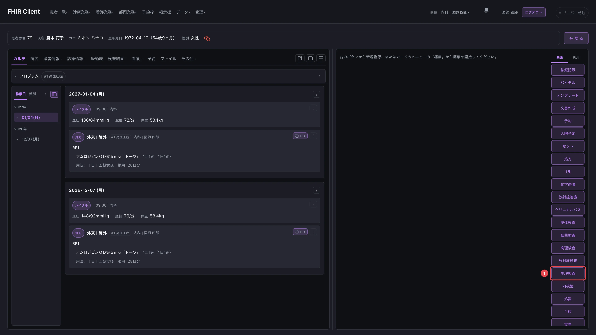
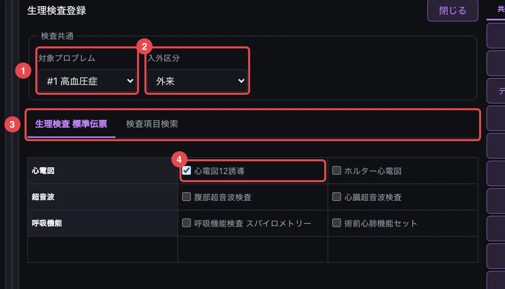
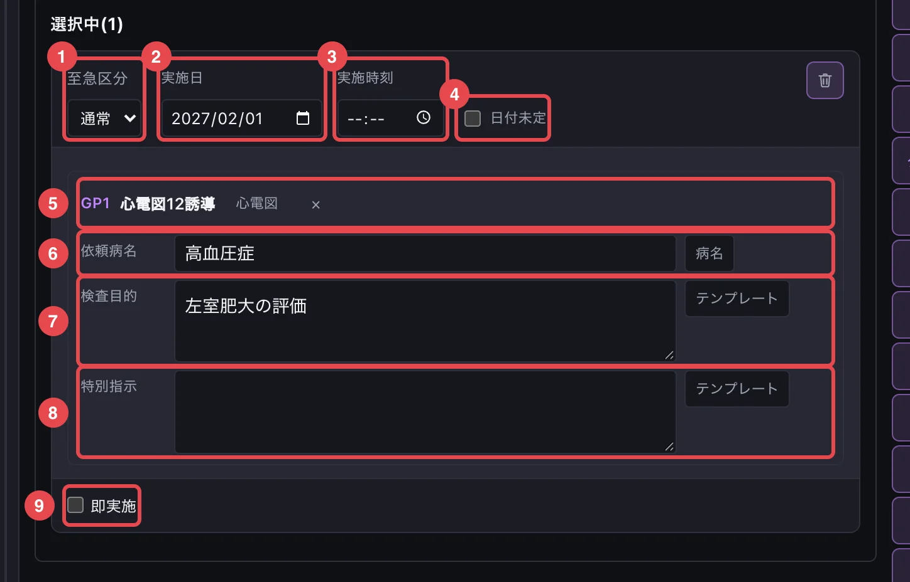
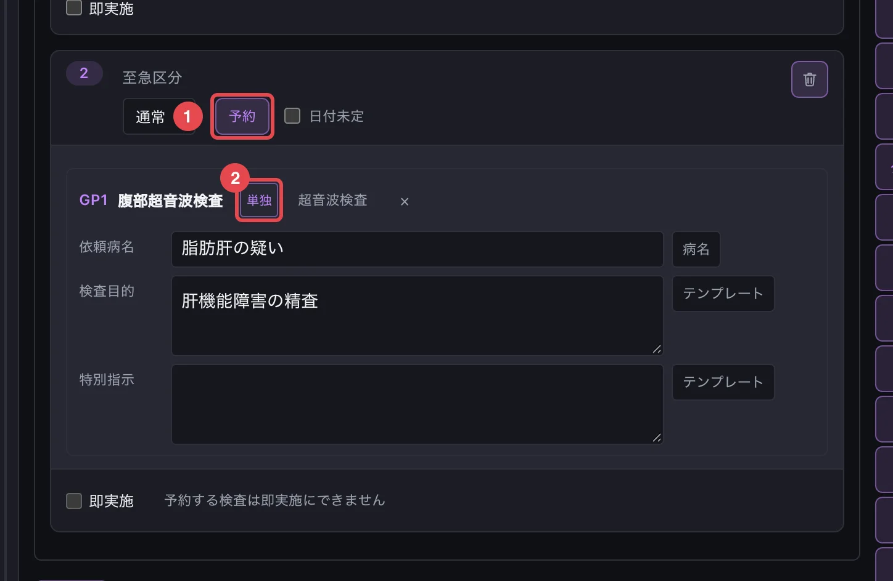
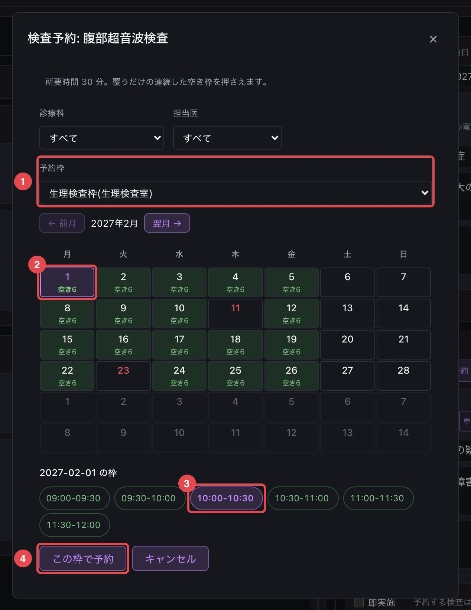
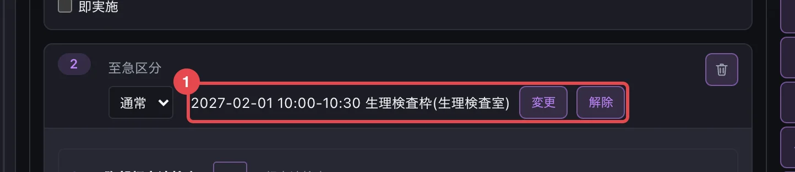
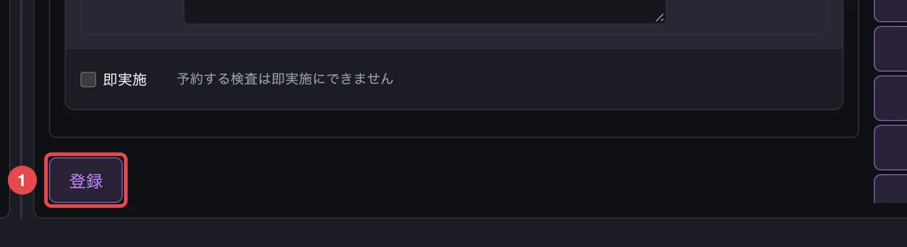
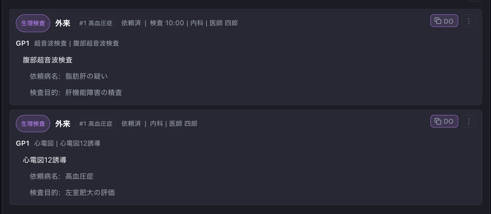
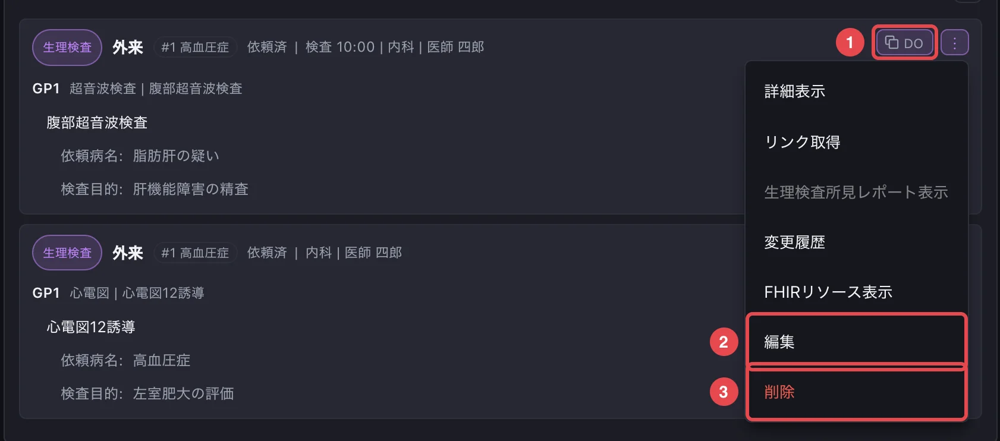

# 生理検査

医師がカルテから生理検査(心電図・超音波・呼吸機能など)の項目を選び、必要なら検査室の予約を取って登録する操作です。
受付・実施・所見レポート・結果の確認までの流れは、業務フローの[生理検査・内視鏡・処置オーダー](../flows/physio-endoscopy-treatment.md)を見てください。

入力の形は放射線検査と同じです。項目ごとの「単独」「予約必須」の考え方は、[放射線検査](rad.md)の冒頭の呼び名を見てください。

## 生理検査登録を開く

患者のカルテを開いておきます。

{ .screen }

1. カルテの右側に並ぶボタンから「生理検査」を押します。右側に「生理検査登録」が開きます。

## 検査項目を選ぶ

{ .screen width="750" }

1. 「対象プロブレム」で、この検査の対象の病名を選びます。
2. 「入外区分」で「入院」か「外来」を選びます。
3. 伝票のタブを切り替えます。伝票に無い項目は「検査項目検索」で名前から探します。
4. 行う検査にチェックを付けます。

## 実施日と依頼内容を入れる

選んだ項目は、下の「選択中」に、オーダーごとの枠にまとまって並びます。

{ .screen width="724" }

1. 「至急区分」を「通常」「至急」「事後」から選びます。至急は今日、事後は今日か、それより前の日に行う検査です。
2. 「実施日」を入れます。初期値は今日です。
3. 時刻を決めるときは「実施時刻」に入れます。
4. 実施日がまだ決まらないときは「日付未定」にチェックを付けます。至急区分が「通常」のときだけ選べます。
5. 検査項目が出ます。「×」を押すと、その項目を外します。
6. 「依頼病名」を入れます。「病名」を押すと、患者に登録された病名から選べます。
7. 「検査目的」を入れます。「テンプレート」を押すと、施設で用意したテンプレートで記入できます。
8. 検査室へ伝えることがあれば「特別指示」に入れます。
9. 検査してすぐ実施を記録するときは「即実施」にチェックを付けます。

## 予約する

予約必須の項目は、別の枠に分かれ、実施日の代わりに「予約」が出ます。

{ .screen width="724" }

1. 「予約」を押します。予約を後で取るときは「日付未定」にチェックを付けます。
2. 1 項目で 1 つのオーダーになる項目には「単独」と出ます。

{ .screen width="634" }

1. 「予約枠」に、その項目の検査室の枠が選ばれています。
2. 暦で検査する日を押します。空いている枠の数が出ます。
3. 時刻の枠を押します。項目の所要時間ぶん、続いた空き枠を押さえます。
4. 「この枠で予約」を押します。

{ .screen width="722" }

1. 予約の日時と検査室が出ます。「変更」で選び直し、「解除」で予約を外します。

予約は、オーダーを登録したときに一緒に保存されます。予約する検査は「即実施」にできません。

## 登録する

{ .screen width="750" }

1. 「登録」を押します。

施設で決めた規則や感染症の警告が出ることがあります。確かめが要る警告は、理由を選んで登録します。

登録すると右側が閉じ、カルテに生理検査のカードが出ます。予約した検査は、見出しに検査の時刻が出ます。

{ .screen width="841" }

日付未定で登録した検査は、カルテの時系列の一番上の「日付未定」に出ます。予約は、カードの編集か、検査室の生理検査一覧の「日付未定」タブで取ります。

## 登録した生理検査を使う・直す

カルテの生理検査のカードから操作します。

{ .screen width="841" }

1. 「DO」を押すと、同じ検査項目が右側の「生理検査登録」に入ります。予約・実施記録・所見レポートは写りません。
2. 「⋮」の「編集」を押すと、右側に編集が開きます。予約の日時を変えるときも、ここで枠を選び直します。直して「更新」を押します。
3. 「⋮」の「削除」を押すと、理由を入れて生理検査を削除します。予約の枠は空きに戻ります。

- 実施を記録した検査や、所見レポートのある検査は削除できません。
- 所見レポートができると、「⋮」の「生理検査所見レポート表示」でレポートを開けます。
- 検査をやめるときの「中止」は、カルテのカードではなく、生理検査一覧の行のメニューで行います。
