# 処方

医師がカルテから処方を入力して登録する操作です。登録した処方が薬剤部で調剤され、患者に渡るまでの流れは
業務フローの[処方オーダー](../flows/prescription.md)を見てください。

このページで使う呼び名です。

- **RP**: 1 つの用法でまとめた薬剤の組です。用法と日数(頓用は回数)は RP ごとに入れます。

## 処方登録を開く

患者のカルテを開いておきます。

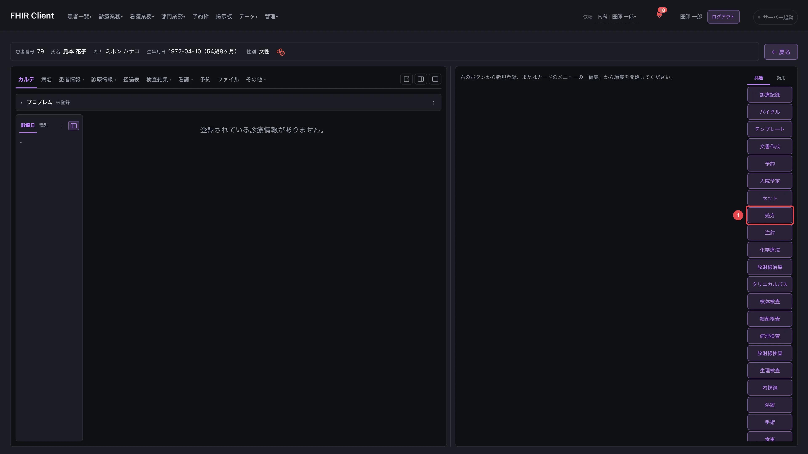{ .screen }

1. カルテの右側に並ぶボタンから「処方」を押します。右側に「処方登録」が開きます。

## 処方共通を入れる

処方全体にかかる項目です。

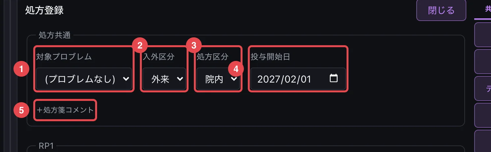{ .screen width="746" }

1. 「対象プロブレム」で、この処方の対象の病名を選びます。プロブレムを選ばないときは「(プロブレムなし)」のままにします。
2. 「入外区分」で「入院」か「外来」を選びます。
3. 「処方区分」を選びます。入院は「定期」「継続」「臨時」「退院」「緊急」、外来は「院内」「院外」から選びます。
4. 「投与開始日」を確かめます。初期値は今日です。
5. 処方箋に書き添えることがあれば「＋処方箋コメント」を押して入れます。

入外区分と処方区分の初期値は施設の設定で決まります。初期値が入っていないときは、その都度選びます。

## 医薬品を選ぶ

RP の医薬品の行にある薬のアイコン(「医薬品を選択」)を押すと、「医薬品を選択」が開きます。

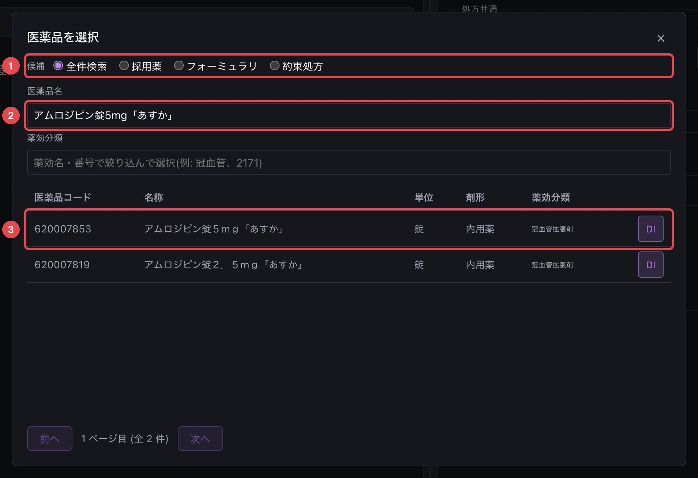{ .screen width="954" }

1. 「候補」で探し方を選びます。

    | 候補 | 並ぶもの |
    |---|---|
    | 全件検索 | すべての医薬品 |
    | 採用薬 | 院内で採用している医薬品(院外処方は院外専用の医薬品も) |
    | フォーミュラリ | 院内で定めた推奨薬の一覧 |
    | 約束処方 | あらかじめ登録した組み合わせ(軟膏の混合など) |

2. 「医薬品名」に名前の一部を入れます。かなと全角・半角の違いは区別しません。「薬効分類」で絞り込むこともできます。
3. 使う医薬品の行を押します。

外来の院外処方では、「処方名」で「銘柄」と「一般名」を選べます。「一般名」を選ぶと一般名処方になります。

## 用量を入れる

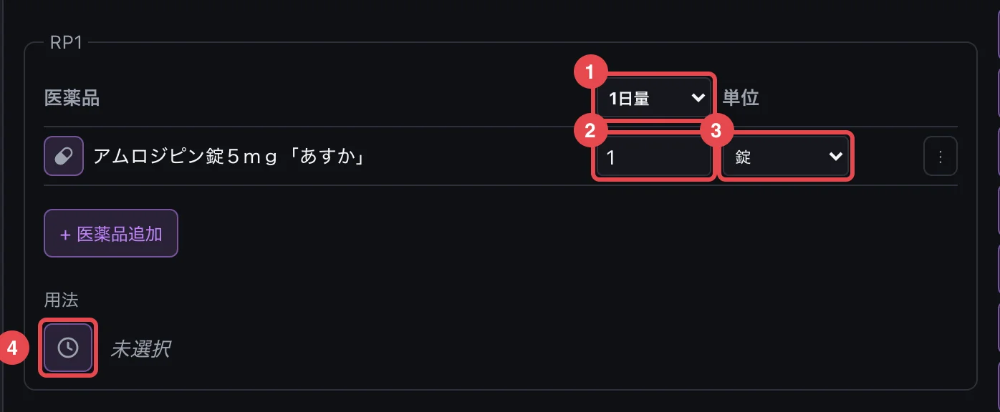{ .screen width="698" }

1. 見出しの「1日量」「1回量」で、用量を 1 日量で入れるか 1 回量で入れるかを選びます。処方全体で 1 つの設定で、切り替えると入れた量も換算されます。
2. 用量を入れます。医薬品名の横に、もう一方の量(「1回 1錠」など)が出ます。
3. 単位を確かめます。力価(mg など)や包装単位(枚・本など)で入れられる医薬品は、ここで単位を切り替えます。
4. 用法の時計のアイコン(「用法を選択」)を押します。

頓用と外用薬は、見出しが「1回量」や「用量」の文字になり、切り替えはありません。

## 用法を選ぶ

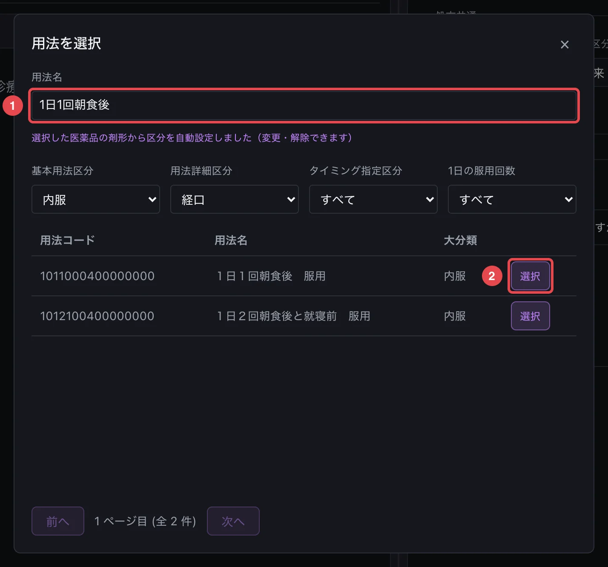{ .screen width="714" }

1. 「用法名」に用法の一部を入れます。選んだ医薬品の剤形に合わせて、区分の絞り込みが初めから入っています。
2. 使う用法の行を押します。

## 日数を入れる

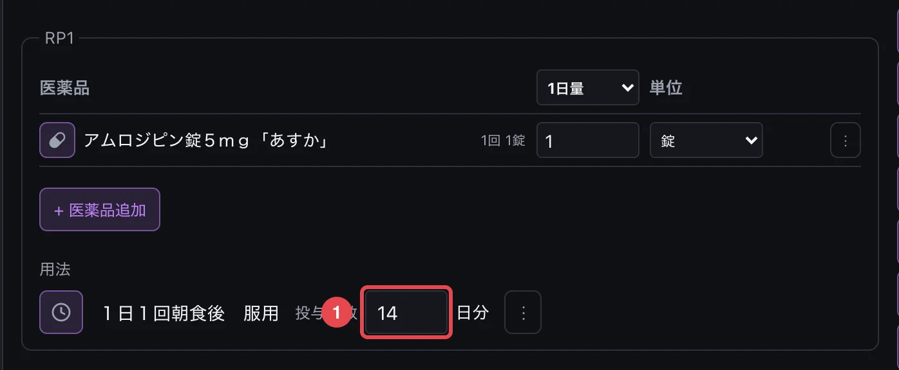{ .screen width="698" }

1. 「投与日数」に日数を入れます。

頓用の用法を選んだときは、「投与日数」の代わりに「投与回数」を入れます。外用薬など日数を持たない用法では、どちらも出ません。

## 医薬品や RP を足す・補足を入れる

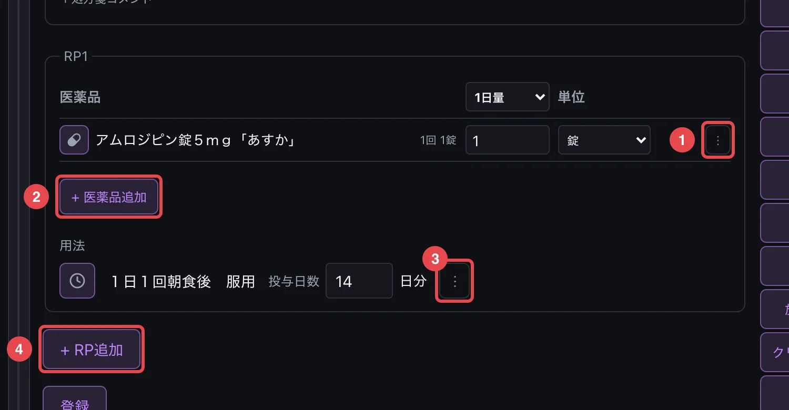{ .screen width="750" }

1. 医薬品の行の「⋮」から、その医薬品に補足を付けます(下の表)。
2. 同じ用法で飲む医薬品を足すときは「+ 医薬品追加」を押し、医薬品を選びます。「+ 医薬品追加」は、RP に医薬品を 1 つ選ぶと出ます。
3. 用法の「⋮」から、RP に補足を付けます(下の表)。
4. 別の用法の薬を足すときは「+ RP追加」を押し、新しい RP に医薬品と用法を入れます。

| メニュー | 場所 | 入れるもの |
|---|---|---|
| 薬剤コメント | 医薬品の行の「⋮」 | その医薬品へのコメント |
| 不均等投与 | 医薬品の行の「⋮」 | 朝・昼・夕などで量を変えるときの、回ごとの量 |
| 後発品変更不可 | 医薬品の行の「⋮」 | 後発品への変更を認めないときの理由(「医療上必要」か「患者希望」)。外来の銘柄処方だけ |
| 補足用法 | 用法の「⋮」 | 隔日・曜日指定など(「日数間隔」「曜日」「日付」「期間内回数」) |
| 用法コメント | 用法の「⋮」 | 用法へのコメント |
| 調剤指示 | 用法の「⋮」 | 「一包化」「粉砕」「別包化」「混合」(複数選べる) |

付けた補足は、行の下に入力欄が出ます。消すときは、その欄の横のゴミ箱を押します。医薬品の行と RP も、2 つ以上あるときはゴミ箱で消せます。

## 登録する

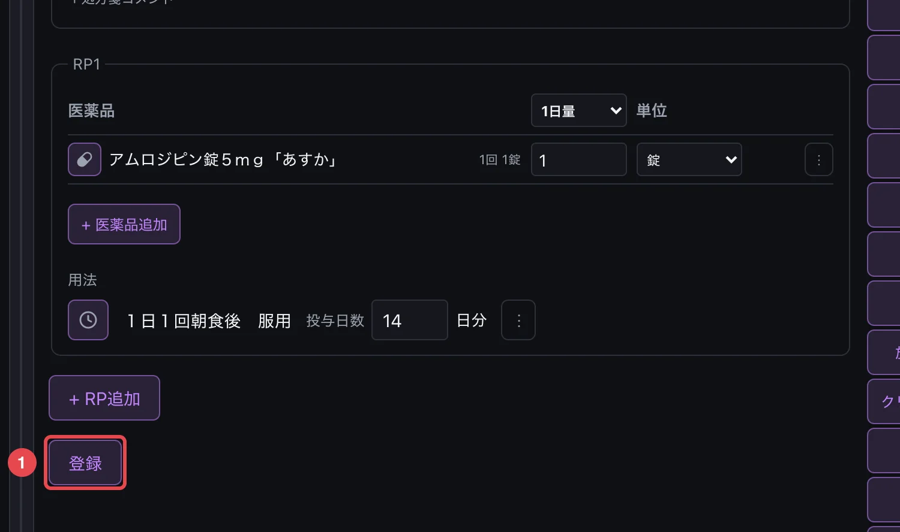{ .screen width="750" }

1. 「登録」を押します。

入力に足りないところがあると、上に内容が出て、その項目に印が付きます。直してからもう一度「登録」を押します。

登録すると右側が閉じ、カルテに処方のカードが出ます。

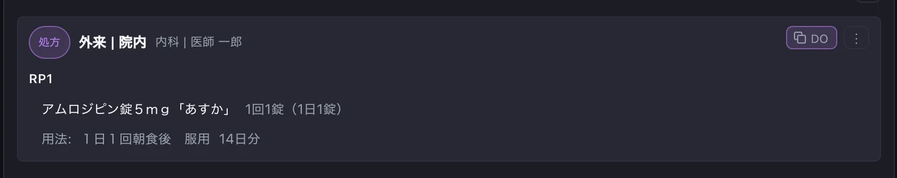{ .screen width="841" }

## 警告が出たとき

医薬品を選ぶと、アレルギー・重複投与・相互作用・用量の上限などに当たるとき、その医薬品の行に警告が出ます。

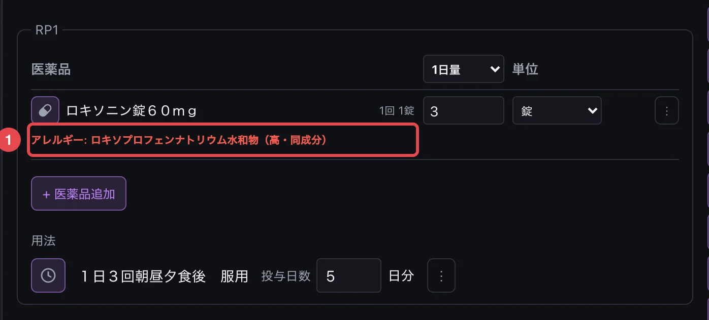{ .screen width="698" }

1. 警告の内容を確かめます。

警告は 2 段階です。

| 色 | 例 | 登録のとき |
|---|---|---|
| 橙 | 同じ成分の薬を投与中(重複投与)など | そのまま登録できる |
| 赤 | アレルギーの一致、併用禁忌、用量の上限超過、許可制の抗菌薬、病名禁忌、採用外の薬 | 「警告の確認」で理由を選ぶ |

赤の警告が残ったまま「登録」を押すと、「警告の確認」が開きます。

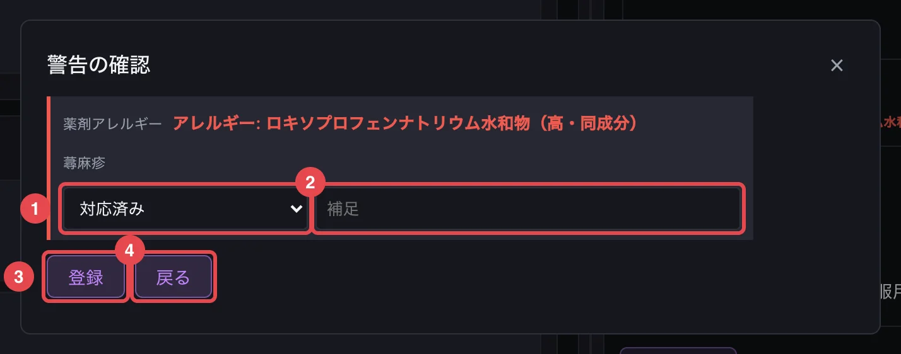{ .screen width="714" }

1. 警告ごとに、そのまま処方する理由を選びます。
2. 必要なら「補足」に入れます。
3. 処方を直さずに登録するときは「登録」を押します。すべての警告に理由を選ぶまで押せません。
4. 処方を直すときは「戻る」を押し、医薬品や量を変えます。

選んだ理由は、処方の「詳細表示」の「警告の確認」に残ります。

## 登録した処方を使う・直す

カルテの処方のカードから操作します。

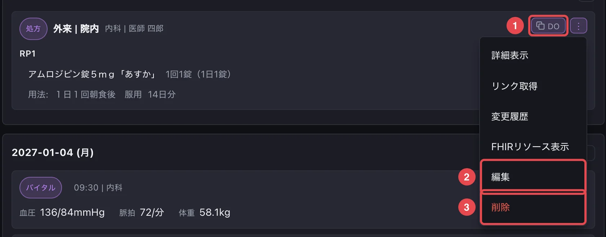{ .screen width="841" }

1. 「DO」を押すと、同じ内容が右側の「処方登録」に入ります。必要なところを直して「登録」を押します。
2. 「⋮」の「編集」を押すと、右側に「処方編集」が開きます。直して「更新」を押します。
3. 「⋮」の「削除」を押すと、処方を削除します(下の「削除する」)。

「⋮」の「詳細表示」では、処方の内容と、登録日時・警告の確認などの記録を見られます。

- 薬剤部が監査を済ませた処方を編集すると、監査をやり直すことになります。
- 中止した処方は、編集しても中止のままです。中止は薬剤部の処方一覧から行います(業務フローの[変更・中止・削除](../flows/prescription.md#変更中止削除))。

### 削除する

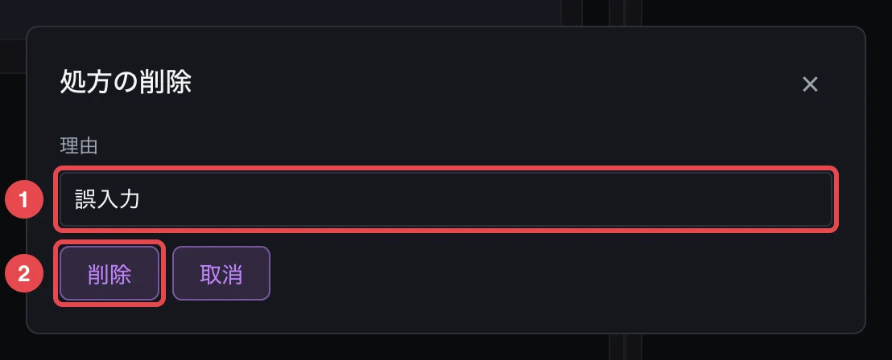{ .screen width="554" }

1. 「理由」を入れます。「誤入力」「患者間違い」「重複登録」から選ぶか、文字で入れます。
2. 「削除」を押します。

病棟で与薬を記録した処方は削除できません。先に経過表で与薬の記録を取り消します。
