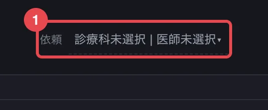
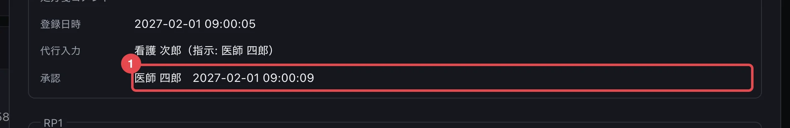
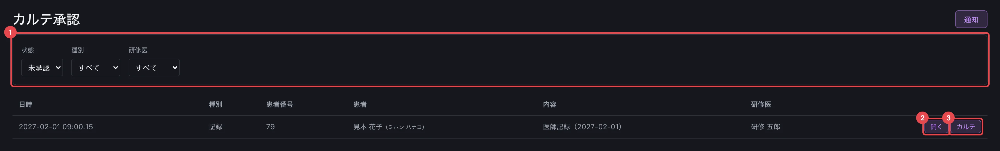

# 代行入力とカルテ承認

医師の指示で医師以外の職員がオーダーを入力する「代行入力」と、医師がそれを確かめる「承認」の操作です。
あわせて、研修医が書いた診療記録を指導医が承認する「カルテ承認」の操作も説明します。

承認の前でも、代行入力したオーダーは部門に届き、研修医の記録はカルテで読めます。承認は、入力した内容を医師が確かめた記録を残すためのものです。

## 代行入力する(医師以外)

医師以外の職員がカルテでオーダーを入力するときは、先に指示を出した医師を選びます。

{ .screen width="198" }

1. 画面の上の帯の「依頼」を押し、診療科を押して、その下に並ぶ医師から指示を出した医師を選びます。

{ .screen width="212" }

1. 選んだ診療科と医師が出ます。このあとに登録したオーダーは、この医師の指示として登録され、入力した職員の名前が記録に残ります。

オーダーの入力は、医師が入力するときと同じです(操作マニュアルの[処方オーダー](prescription.md)など)。
登録すると、指示を出した医師に「オーダー承認」の通知が届きます。

## 代行入力を承認する(医師)

届いた通知の「カルテ」からカルテを開くか、患者のカルテを開いて、オーダーのカードの「⋮」の「詳細表示」を押します。

{ .screen width="943" }

1. 「代行入力」に、入力した職員と指示を出した医師が出ます。
2. 内容を確かめて「承認」を押します。「承認」は、指示を出した医師本人にだけ出ます。

{ .screen width="943" }

1. 「承認」に、承認した医師と日時が出ます。

- 通知の一覧から、内容を確かめずにまとめて承認することもできます(操作マニュアルの[通知](notifications.md))。
- 承認したあとに職員がオーダーを編集すると、その編集がまた承認待ちになります。

## 研修医の記録を承認する(カルテ承認)

研修医が診療記録を「確定」で登録すると、カードに「承認待ち」が付き、指導医に「カルテ承認」の通知が届きます。
どの指導医が承認するかは、施設で決めた指導医のグループで決まり、グループの指導医なら誰でも承認できます。

{ .screen width="841" }

1. 承認されるまで「承認待ち」が付きます。承認されると「承認済」になります。

指導医は、ヘッダーの「診療業務」から「カルテ承認」を開きます。

{ .screen }

1. 「状態」「種別」「研修医」で絞り込みます。初めは未承認の記録とオーダーがすべて並びます。
2. 記録は「開く」で、その場で内容を確かめます。
3. 「カルテ」で、その患者のカルテを開きます。

研修医が出したオーダーは、行の「承認」で承認します。

{ .screen width="924" }

1. 内容を確かめて「承認」を押します。
2. 書き直しが要るときは「差戻し」を押し、理由を入れます。記録は下書きに戻り、研修医に「カルテ差戻し」の通知が届きます。研修医が直して確定し直すと、また承認待ちになります。
3. 研修医に伝えることがあれば「コメント」に入れ、右の「コメント」を押します。コメントは記録の詳細に残ります。

指導医が記録を直して保存すると、直した内容で承認済みになります。
