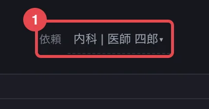
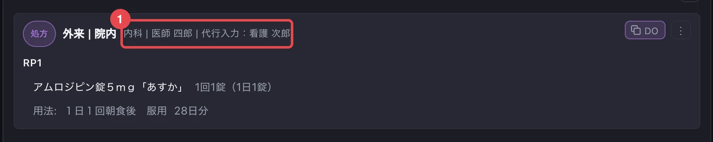
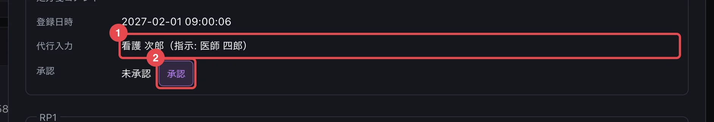
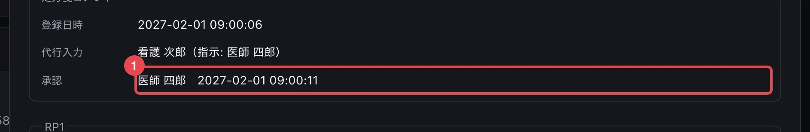
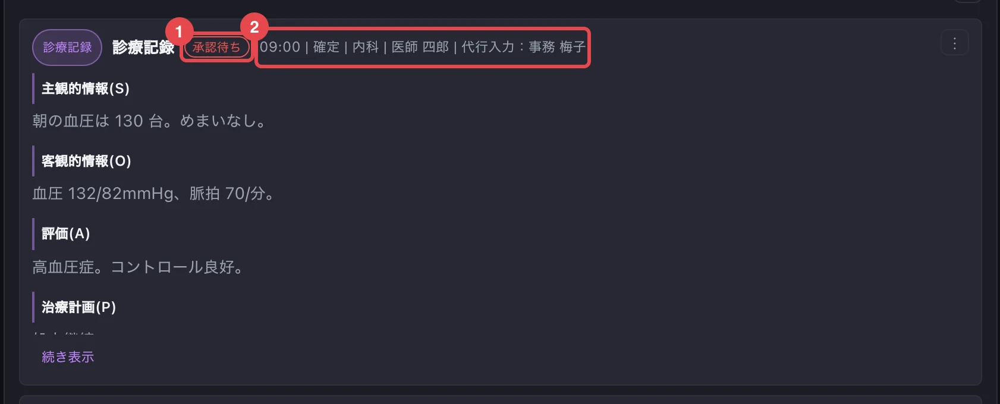
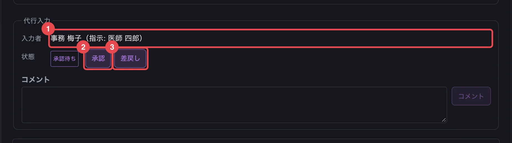
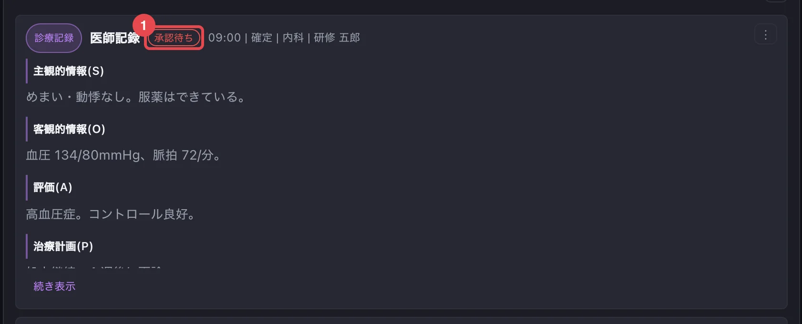
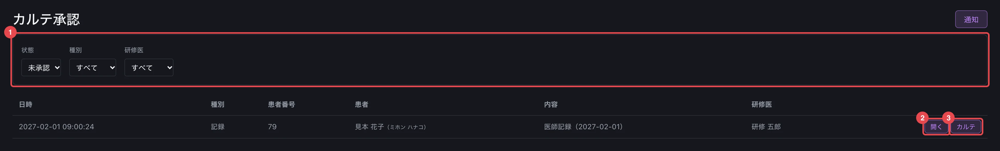
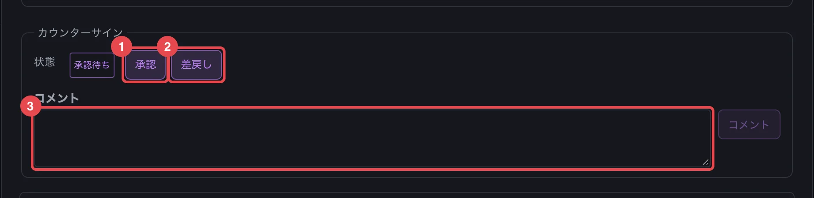

# 代行入力とカルテ承認

医師の指示で医師以外の職員がオーダーや診療記録を入力する「代行入力」と、医師がそれを確かめる「承認」の操作です。
あわせて、研修医が書いた診療記録を指導医が承認する「カルテ承認」の操作も説明します。

承認の前でも、代行入力したオーダーは部門に届き、代行入力や研修医の記録はカルテで読めます。承認は、入力した内容を医師が確かめた記録を残すためのものです。

## 代行入力する(医師以外)

医師以外の職員がカルテでオーダーを入力するときは、先に指示を出した医師を選びます。

{ .screen width="269" }

1. 画面の上の帯の「依頼」を押します。医師を選ぶまでは「医師未選択」と出ます。開いたメニューの左の「診療科」の列で指示を出した医師の診療科を押し、右の「医師」の列に並ぶその科の医師から、指示を出した医師を押します。

{ .screen width="212" }

1. 選んだ診療科と医師が出ます。このあとに登録したオーダーは、この医師の指示として登録され、入力した職員の名前が記録に残ります。

オーダーの入力は、医師が入力するときと同じです(操作マニュアルの[処方](prescription.md)など)。
医師を選んでいないと、「登録」を押したときに「カルテ画面のヘッダーで依頼医師を選んでください。」と出て登録できません。

{ .screen width="841" }

1. 登録したオーダーのカードには、指示を出した医師と並んで「代行入力：」に入力した職員の名前が出ます。

登録すると、指示を出した医師に「オーダー承認」の通知が届きます。

## 代行入力を承認する(医師)

届いた通知の「カルテ」からカルテを開くか、患者のカルテを開いて、オーダーのカードの「⋮」の「詳細表示」を押します。

{ .screen width="943" }

1. 「代行入力」に、入力した職員と指示を出した医師が出ます。
2. 内容を確かめて「承認」を押します。「承認」は、指示を出した医師本人にだけ出ます。

{ .screen width="943" }

1. 「承認」に、承認した医師と日時が出ます。

- 通知の一覧から、内容を確かめずにまとめて承認することもできます(操作マニュアルの[通知](notifications.md))。
- 承認したあとに職員がオーダーを編集すると、その編集がまた承認待ちになります。

## 診療記録を代行入力する(医師事務作業補助者)

医師事務作業補助者と事務職員が書く診療記録は、医師の記録の代行入力になります。看護師など、ほかの職種が書く記録は本人の記録のままです。

先に、オーダーの代行入力と同じく画面の上の帯の「依頼」で指示を出した医師を選びます。選んでいないと登録できません。
記録の書き方は、医師が書くときと同じです(操作マニュアルの[診療記録](clinical-note.md))。

{ .screen width="841" }

1. 「確定」で登録すると「承認待ち」が付き、指示を出した医師に「カルテ承認」の通知が届きます。
2. 記録は、選んだ医師の記録になります。「代行入力：」に入力した職員の名前が出ます。

## 代行入力の記録を承認する(医師)

届いた通知の「カルテ」からカルテを開くか、患者のカルテを開いて、記録のカードの「⋮」の「詳細表示」を押します。

{ .screen width="924" }

1. 「入力者」に、入力した職員と指示を出した医師が出ます。
2. 内容を確かめて「承認」を押します。「承認」は、指示を出した医師本人にだけ出ます。承認すると「確定者」と「承認者」に医師の名前が出て、カードは「承認済」になります。
3. 書き直しが要るときは「差戻し」を押し、理由を入れます。記録は下書きに戻り、入力した職員に「カルテ差戻し」の通知が届きます。

- 通知の一覧から承認することもできます(操作マニュアルの[通知](notifications.md))。
- 医師が自分で記録を直して保存すると、直した内容で承認済になります。
- 承認したあとに職員が記録を直すと、また承認待ちになります。

## 研修医の記録を承認する(カルテ承認)

研修医が診療記録を「確定」で登録すると、カードに「承認待ち」が付き、指導医に「カルテ承認」の通知が届きます。
どの指導医が承認するかは、施設で決めた指導医のグループで決まり、グループの指導医なら誰でも承認できます。

{ .screen width="841" }

1. 承認されるまで「承認待ち」が付きます。承認されると「承認済」になります。

指導医は、ヘッダーの「診療業務」から「カルテ承認」を開きます。

{ .screen }

1. 「状態」「種別」「研修医」で絞り込みます。初めは未承認の記録とオーダーがすべて並びます。
2. 記録は「開く」で、その場で内容を確かめます。
3. 「カルテ」で、その患者のカルテを開きます。

研修医が出したオーダーは、行の「承認」で承認します。

{ .screen width="924" }

1. 内容を確かめて「承認」を押します。
2. 書き直しが要るときは「差戻し」を押し、理由を入れます。記録は下書きに戻り、研修医に「カルテ差戻し」の通知が届きます。研修医が直して確定し直すと、また承認待ちになります。
3. 研修医に伝えることがあれば「コメント」に入れ、右の「コメント」を押します。コメントは記録の詳細に残ります。

指導医が記録を直して保存すると、直した内容で承認済になります。
