# 放射線検査一覧

放射線部が、医師の出した放射線検査を放射線検査一覧で受け付けて実施を記録し、読影医が読影レポートを書く操作です。
検査の件数と線量の集計、照射録の印刷も、この一覧から行います。
放射線検査の流れ全体は、業務フローの[放射線検査オーダー](../flows/rad.md)を見てください。

- 放射線検査一覧は、画面の上の「部門業務」>「放射線部門」>「放射線検査一覧」で開きます。ホームの「放射線検査」のカードからも開けます。
- 作業は「依頼済」→(受付)→「受付済」→(実施入力)→「実施済」と進みます。読影レポートは実施済の検査に書きます。
- 至急の検査が登録されたときと、受付済の検査が変更されたときは、放射線部のチームに「放射線オーダー連絡」の通知が届きます。チームの誰か 1 人が「確認」を押すと片付きます。通常の検査の登録では通知は出ないので、撮影日の一覧で確かめます。

## 放射線検査一覧の見方

{ .screen }

1. 「撮影日」で、撮影する日を選びます。「<」「>」で 1 日ずつ動かし、「今日」で今日に戻ります。
2. 「種別(モダリティ)」「入外区分」「病棟」「診療科」「ステータス」で絞り込めます。「クリア」で絞り込みを外します。
3. 撮影時刻の順に並びます。時刻の決まっていない検査は「-」で、後ろに並びます。
4. 「ステータス」に作業の状態が出ます。至急の検査は「区分」に「至急」が付き、行の色が変わります。
5. 「読影」に読影レポートの状態が出ます。まだ書いていなければ「未」、書いてあれば報告区分(暫定報告・最終報告・訂正報告)が出ます。読影しない検査は「不要」です。
6. 行のボタンで作業を進めます。依頼済の行は「受付」、受付済の行は「実施」、実施済の行は「読影」です。
7. タブで一覧を切り替えます。

    | タブ | 中身 |
    |---|---|
    | 撮影日別 | 選んだ撮影日の検査 |
    | 日付未定 | 撮影日を決めずに出された検査。タブ名に件数が出ます |
    | 読影待ち | 実施済で、読影レポートが確定していない検査。[読影待ちの検査を見る](#読影待ちの検査を見る) |
    | 件数集計 | 期間の検査の件数。[検査の件数を集計する](#検査の件数を集計する) |
    | 線量集計 | 期間の被曝線量と再撮影。[線量を集計する](#線量を集計する) |

8. 造影する検査で、オーダーの「造影同意書取得済」にチェックが付いていないものには「同意書未取得」と出ます。撮影の前に確かめます。

- 患者氏名を押すとカルテが開きます。
- 患者氏名の後ろに、注意区分・アレルギー・感染症の印が出ます。

## 依頼の内容を確かめる

行を押すと、右に検査の内容と患者プロファイルが開きます。カルテを開かずに、撮影の前に確かめることを読めます。

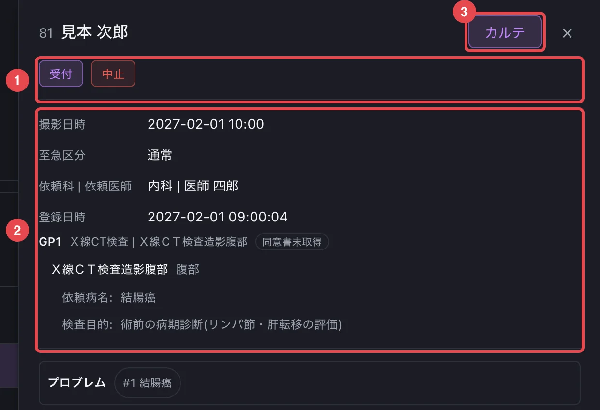{ .screen width="620" }

1. 行と同じボタン(「受付」「実施」「読影」、「取消」「中止」など)が並びます。
2. 撮影日時・至急区分・依頼科と依頼医師・登録日時と、撮影項目ごとの依頼病名・検査目的・特別指示が出ます。
3. 「カルテ」を押すと、患者のカルテが開きます。

- 患者に造影・MRI・妊娠・感染症の注意があると、検査の内容の上に出ます。同じ注意は実施入力の上にも出ます。
- 医師が登録のときに確かめた警告と、その理由も出ます。
- 実施済の検査は、実施した内容(撮影室・造影剤・被曝線量など)も出ます。
- 中止・中止取消・実施の取消は、誰がいつ行ったかが残り、ここで読めます。
- 下に患者プロファイルが続きます。「×」で閉じます。

## 受け付ける

患者が放射線部に来たら、行の「受付」を押します。

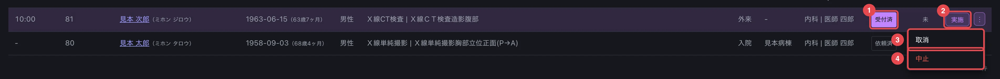{ .screen }

1. ステータスが「受付済」になります。
2. 撮影が済んだら「実施」を押して、実施入力を開きます。
3. 「⋮」の「取消」で、依頼済に戻せます。押し間違いを直すときに使います。
4. 「⋮」の「中止」で検査を取りやめます。予約していた枠は空きに戻ります。中止した検査は「中止取消」で依頼済に戻せます。

## 実施を記録する

「実施」を押すと実施入力が開きます。手技・造影剤・器材は、撮影項目ごとに決めてある初期の行が並んでいます。

{ .screen width="1168" }

1. 「実施時刻」は今の時刻が入っています。撮った時刻が違うときは直します。
2. 「実施者」は、ログインしている人です。
3. 「撮影室」は、予約した撮影室が入っています。予約の無い検査は選びます。
4. 撮り直したときは、「再撮影」で理由(体動・ポジショニング不良・撮影条件不良・アーチファクト・装置不良・その他)を選びます。
5. 手技料の行は初期の行のままでよければ触りません。足すときは「診療行為追加」、使わなかったものは行のゴミ箱のボタンで外します。
6. 造影剤の「使用量」を確かめます。
7. 「経路」を選びます。
8. 初期の行に無い造影剤は「造影剤追加」で足します。

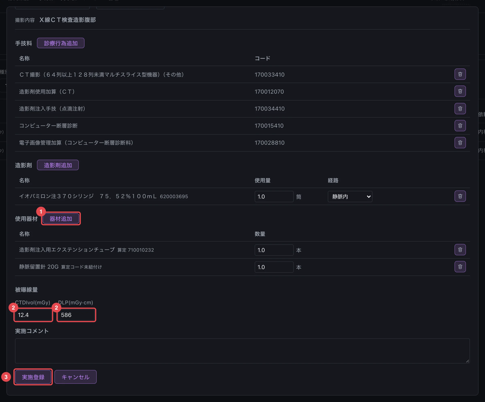{ .screen width="1194" }

1. 使用した器材を確かめます。足すときは「器材追加」を押します。
2. 「被曝線量」を入れます。CT は CTDIvol と DLP、血管撮影と透視は DAP と透視時間、核医学は実投与量です。単純撮影には欄が出ません。
3. 「実施登録」を押すと、行が「実施済」になります。

- 造影剤のロット番号の列は、ロット番号を記録する薬のときだけ出ます。
- 造影剤も器材も使わない単純撮影は、そのまま「実施登録」を押します。実施入力の無い撮影項目だけの検査は、「実施」を押すとすぐに実施済になります。
- 撮影を途中でやめたときは、記録を残す操作はありません。撮らなかった検査は中止にします。
- 実施済の検査は、カルテのカードから編集できません。医師が内容を直すときは、行の「⋮」の「取消」で受付済に戻します。

## 副作用を記録する

造影剤の副作用などが出たときは、実施済の行から記録します。カルテの放射線検査のカードの「⋮」からも開けます。

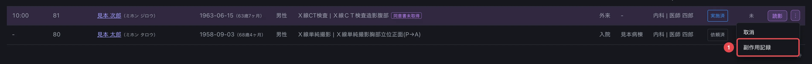{ .screen }

1. 実施済の行の「⋮」の「副作用記録」を押します。

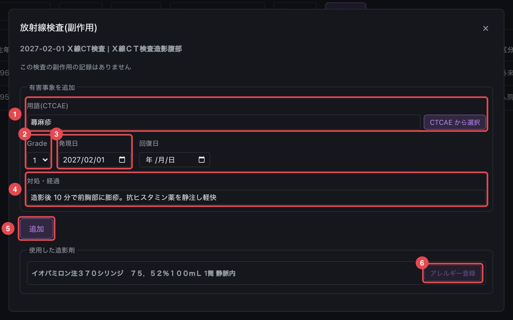{ .screen width="954" }

1. 「用語(CTCAE)」に副作用の名前を入れます。造影剤でよくある副作用(悪心・蕁麻疹など)は、欄を押すと候補から選べます。「CTCAE から選択」を押すと、用語の一覧から Grade の説明を読みながら選べます。
2. 「Grade」を選びます。
3. 「発現日」を確かめます。初期値は今日です。回復していれば「回復日」も入れます。
4. 「対処・経過」に、行った対処と経過を書きます。
5. 「追加」を押すと記録されます。続けて別の副作用も記録できます。
6. 「使用した造影剤」に、実施入力で記録した造影剤が出ます。「アレルギー登録」を押すと、その造影剤を患者のアレルギーに登録します。副作用を 1 件記録すると押せます。

- 記録した副作用は、カルテの発現日に有害事象のカードで出ます。
- 造影剤をアレルギーに登録すると、次に造影検査を出すときに警告が出ます。
- 記録した副作用は、上の一覧の「編集」「削除」で直せます。

## 読影レポートを書く

読影医は、実施済の行の「読影」から読影レポートを書きます。カルテの放射線検査のカードの「⋮」からも開けます。

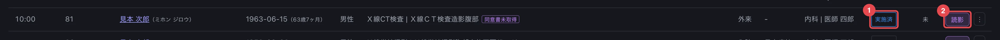{ .screen }

1. ステータスが「実施済」の行が読影の対象です。
2. 「読影」を押すと、読影レポートの入力画面が開きます。

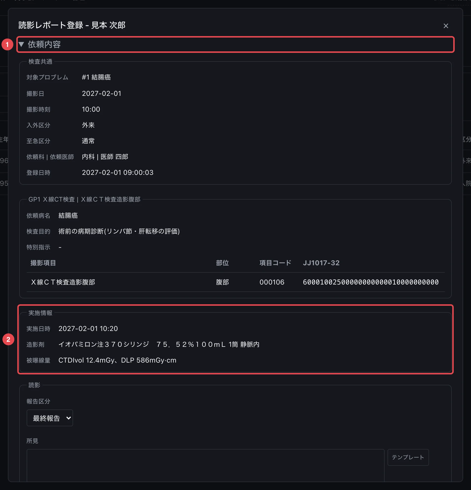{ .screen width="954" }

1. 「依頼内容」に、医師の依頼病名・検査目的・特別指示と撮影項目が出ます。見出しを押すと畳めます。
2. 「実施情報」に、実施日時・撮影室・造影剤・被曝線量が出ます。再撮影のあった検査は、その理由も出ます。

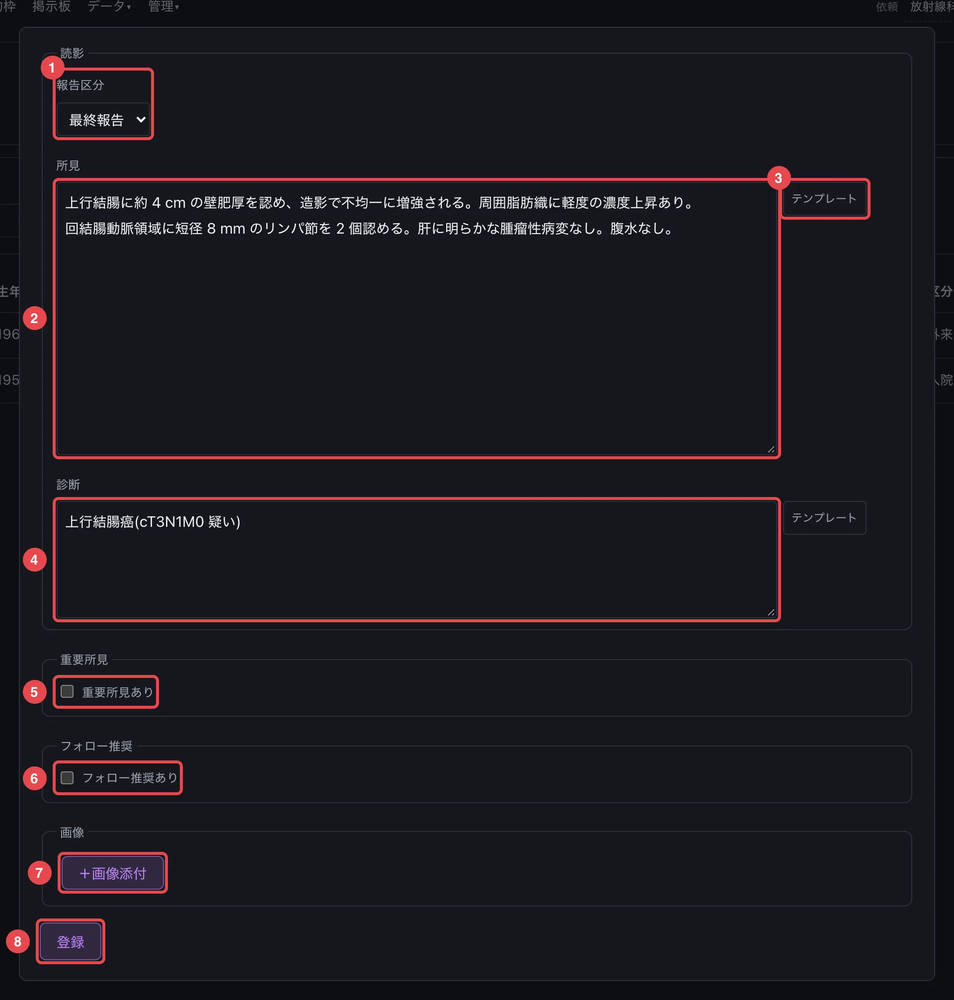{ .screen width="960" }

1. 「報告区分」を選びます。当直帯の速報などで先に所見だけ返すときは「暫定報告」にします。
2. 「所見」を書きます。
3. 「テンプレート」から、決まった項目に沿って所見を記入することもできます。
4. 「診断」を書きます。最終報告には診断が必要です。
5. 依頼医にすぐ伝えたい所見があるときは「重要所見あり」にチェックを付け、要点を 1 行書きます。依頼医に重要所見の通知が届きます。
6. 再検査などを勧めるときは「フォロー推奨あり」にチェックを付け、内容と期限を書きます。検査結果フォローの一覧に載ります。
7. 画像を添えるときは「+画像添付」を押します。画像は画像欄へのドラッグ&ドロップや貼り付けでも足せ、矢印などを描き込めます。
8. 「登録」を押します。

- 最終報告で登録すると、依頼医に検査結果確認の通知が届きます。重要所見の通知が確認されていない間は、検査結果確認の通知は出ません。
- 読影医と発行した施設は、登録したときにログインしている人と自院が入ります。
- 画像は 1 回に送れる量に上限があります。超えたときは、いったん登録してから続きを足します。

{ .screen }

1. 「読影」に報告区分が出ます。
2. 書き直すときは「読影編集」を押します。最終報告を書き直して登録すると、訂正報告になります。

- 読影レポートのある検査は、実施の取消ができません。取り消すときは、先に読影レポートの編集からレポートを削除します。

## 読影待ちの検査を見る

読影レポートがまだ確定していない検査を、撮影日をまたいで見ます。

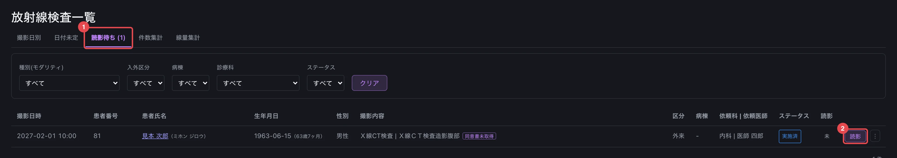{ .screen }

1. 「読影待ち」のタブを押します。タブ名に件数が出ます。
2. 行の「読影」から読影レポートを書きます。

- 並ぶのは、実施済で読影する検査のうち、読影レポートが無いものと暫定報告のものです。過去 60 日ぶんが、撮影日の古い順に並びます。
- オーダーの「読影」のチェックを外した検査は並びません。
- 読影の担当を割り当てる操作はありません。

## 検査の件数を集計する

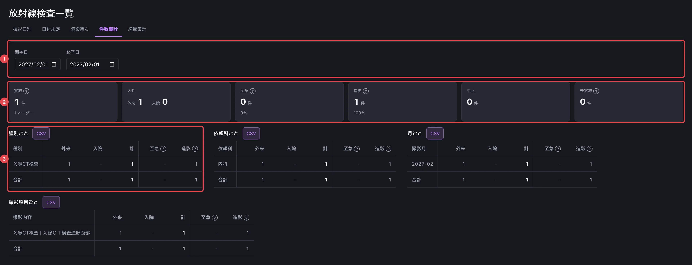{ .screen }

1. 「件数集計」のタブで、「開始日」と「終了日」を選びます。撮影日がこの期間に入る検査を数えます。
2. 上に、実施済の撮影の件数、外来と入院の内訳、至急と造影の件数と割合、中止の件数が出ます。「未実施」は、撮影日を過ぎても依頼済・受付済のままの撮影の件数です。
3. 下に、種別ごと・依頼科ごと・月ごと・撮影項目ごとの表が出ます。外来・入院・計と、そのうちの至急・造影の件数です。見出しの「CSV」で、その表をファイルに保存します。

- 項目のまとまり(「胸部2方向」など)は 1 件と数えます。
- 見出しの「?」にマウスを載せると、数え方が出ます。

## 線量を集計する

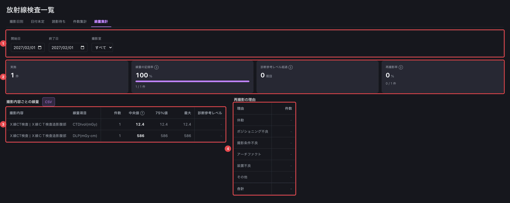{ .screen }

1. 「線量集計」のタブで、「開始日」と「終了日」を選びます。「撮影室」で撮影室を絞れます。
2. 上に、実施の件数、線量の記録率、診断参考レベルを超えた項目の数、再撮影率が出ます。
3. 「撮影内容ごとの線量」に、撮影内容と線量項目ごとの件数・中央値・75%値・最大が出ます。中央値が診断参考レベルを超えた行は色が変わります。「CSV」でファイルに保存します。
4. 「再撮影の理由」に、理由ごとの件数が出ます。

- 線量の記録率は、線量の欄が出る検査(CT・血管撮影・透視・核医学)のうち、線量を記録した実施の割合です。
- 診断参考レベルは、撮影項目のマスタで項目ごとに設定します。設定していない項目は「-」です。

患者ごとの線量は、カルテの「検査結果」の「被曝線量」で見ます。線量を記録する検査の実施が新しい順に並び、期間の合計が出ます。

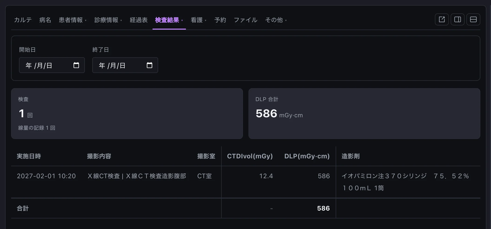{ .screen width="1059" }

## 照射録を印刷する

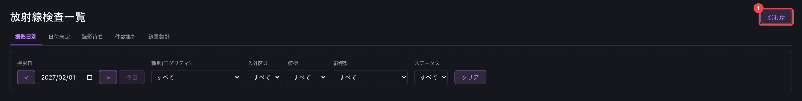{ .screen }

1. 「撮影日別」のタブで撮影日を選び、「照射録」を押します。その日に実施した検査の照射録が、別のタブに開きます。

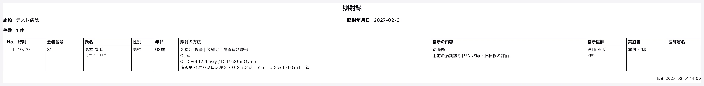{ .screen }

- 実施 1 回が 1 行で、患者の氏名・性別・年齢、照射の方法(撮影内容・撮影室・線量・造影剤)、指示の内容、指示医師、実施者が並びます。
- 「印刷」を押して紙に出し、「医師署名」の欄に署名を受けます。
- 実施入力の無い撮影項目だけの検査は、照射録に載りません。
