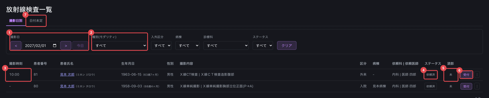
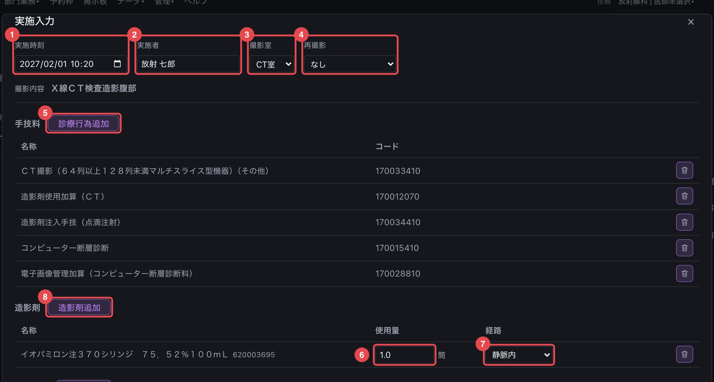
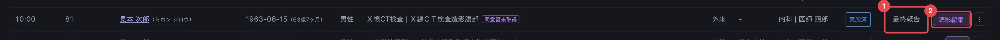

# 放射線検査(実施入力・読影レポート)

放射線部が、医師の出した放射線検査を放射線検査一覧で受け付けて実施を記録し、読影医が読影レポートを書く操作です。
放射線検査の流れ全体は、業務フローの[放射線検査オーダー](../flows/rad.md)を見てください。

- 放射線検査一覧は、画面の上の「部門業務」>「放射線部門」>「放射線検査一覧」で開きます。ホームの「放射線検査」のカードからも開けます。
- 作業は「依頼済」→(受付)→「受付済」→(実施入力)→「実施済」と進みます。読影レポートは実施済の検査に書きます。
- 医師がオーダーを登録しても、放射線部への通知は出ません。撮影日の一覧で確かめます。

## 放射線検査一覧の見方

{ .screen }

1. 「撮影日」で、撮影する日を選びます。「<」「>」で 1 日ずつ動かし、「今日」で今日に戻ります。
2. 「種別(モダリティ)」「入外区分」「病棟」「診療科」「ステータス」で絞り込めます。「クリア」で絞り込みを外します。
3. 撮影時刻の順に並びます。時刻の決まっていない検査は「-」で、後ろに並びます。
4. 「ステータス」に作業の状態が出ます。至急の検査は「区分」に「至急」が付き、行の色が変わります。
5. 「読影」に読影レポートの状態が出ます。まだ書いていなければ「未」、書いてあれば報告区分(暫定報告・最終報告・訂正報告)が出ます。
6. 行のボタンで作業を進めます。依頼済の行は「受付」、受付済の行は「実施」、実施済の行は「読影」です。
7. 撮影日を決めずに出された検査は「日付未定」のタブに並びます。タブ名に件数が出ます。

- 行を押すと、右に患者プロファイルが開きます。患者氏名を押すとカルテが開きます。
- 患者氏名の後ろに、注意区分・アレルギー・感染症の印が出ます。

## 受け付ける

患者が放射線部に来たら、行の「受付」を押します。

{ .screen }

1. ステータスが「受付済」になります。
2. 撮影が済んだら「実施」を押して、実施入力を開きます。
3. 「⋮」の「取消」で、依頼済に戻せます。押し間違いを直すときに使います。
4. 「⋮」の「中止」で検査を取りやめます。予約していた枠は空きに戻ります。中止した検査は「中止取消」で依頼済に戻せます。

## 実施を記録する

「実施」を押すと実施入力が開きます。手技・造影剤・器材は、撮影項目ごとに決めてある初期の行が並んでいます。

{ .screen width="1168" }

1. 「実施時刻」は今の時刻が入っています。撮った時刻が違うときは直します。
2. 「実施者」は、ログインしている人です。
3. 手技料の行は初期の行のままでよければ触りません。足すときは「診療行為追加」、使わなかったものは行のゴミ箱のボタンで外します。
4. 造影剤の「使用量」を確かめます。
5. 「経路」を選びます。
6. 初期の行に無い造影剤は「造影剤追加」で足します。

{ .screen width="1194" }

1. 使用した器材を確かめます。足すときは「器材追加」を押します。
2. 「被曝線量」を入れます。CT は CTDIvol と DLP、血管撮影と透視は DAP と透視時間です。単純撮影には欄が出ません。
3. 「実施登録」を押すと、行が「実施済」になります。

- 造影剤のロット番号の列は、ロット番号を記録する薬のときだけ出ます。
- 造影剤も器材も使わない単純撮影は、そのまま「実施登録」を押します。実施入力の無い撮影項目だけの検査は、「実施」を押すとすぐに実施済になります。
- 撮影を途中でやめたときは、記録を残す操作はありません。撮らなかった検査は中止にします。

## 読影レポートを書く

読影医は、実施済の行の「読影」から読影レポートを書きます。カルテの放射線検査のカードの「⋮」からも開けます。

{ .screen }

1. ステータスが「実施済」の行が読影の対象です。
2. 「読影」を押すと、読影レポートの入力画面が開きます。

{ .screen width="954" }

1. 「依頼内容」に、医師の依頼病名・検査目的・特別指示と撮影項目が出ます。見出しを押すと畳めます。
2. 「実施情報」に、実施日時・造影剤・被曝線量が出ます。

{ .screen width="960" }

1. 「報告区分」を選びます。当直帯の速報などで先に所見だけ返すときは「暫定報告」にします。
2. 「所見」を書きます。
3. 「テンプレート」から、決まった項目に沿って所見を記入することもできます。
4. 「診断」を書きます。最終報告には診断が必要です。
5. 依頼医にすぐ伝えたい所見があるときは「重要所見あり」にチェックを付け、要点を 1 行書きます。依頼医に重要所見の通知が届きます。
6. 再検査などを勧めるときは「フォロー推奨あり」にチェックを付け、内容と期限を書きます。検査結果フォローの一覧に載ります。
7. 画像を添えるときは「+画像添付」を押します。画像は画像欄へのドラッグ&ドロップや貼り付けでも足せ、矢印などを描き込めます。
8. 「登録」を押します。

- 最終報告で登録すると、依頼医に検査結果確認の通知が届きます。重要所見の通知が確認されていない間は、検査結果確認の通知は出ません。
- 読影医と発行した施設は、登録したときにログインしている人と自院が入ります。
- 画像は 1 回に送れる量に上限があります。超えたときは、いったん登録してから続きを足します。

{ .screen }

1. 「読影」に報告区分が出ます。
2. 書き直すときは「読影編集」を押します。最終報告を書き直して登録すると、訂正報告になります。

- 読影レポートのある検査は、実施の取消ができません。取り消すときは、先に読影レポートの編集からレポートを削除します。
