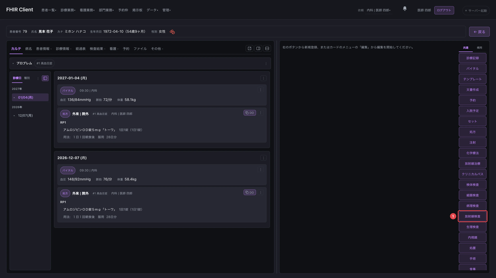
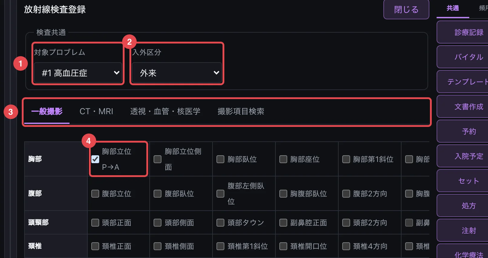
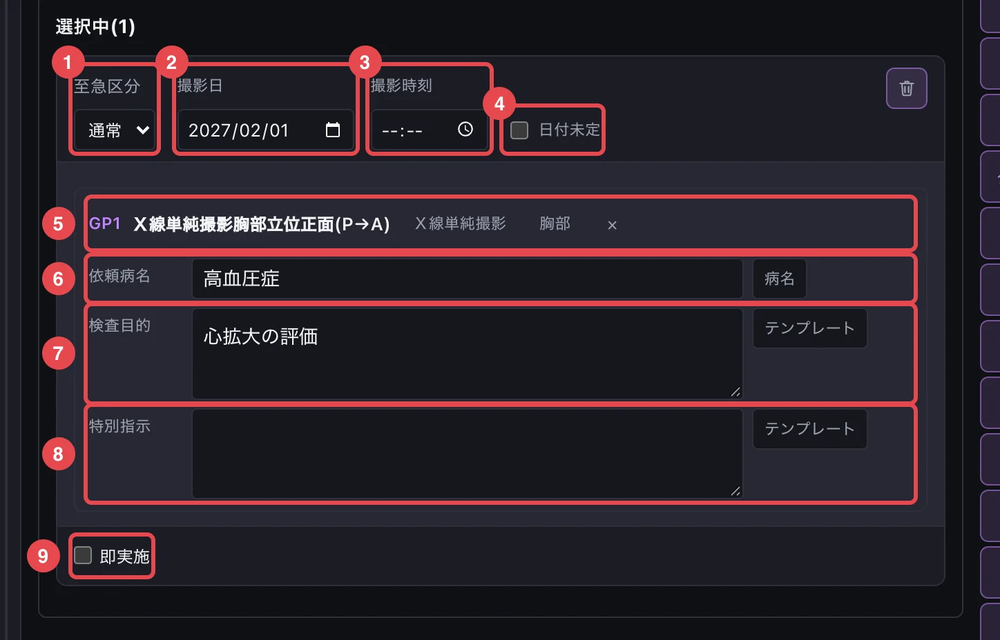
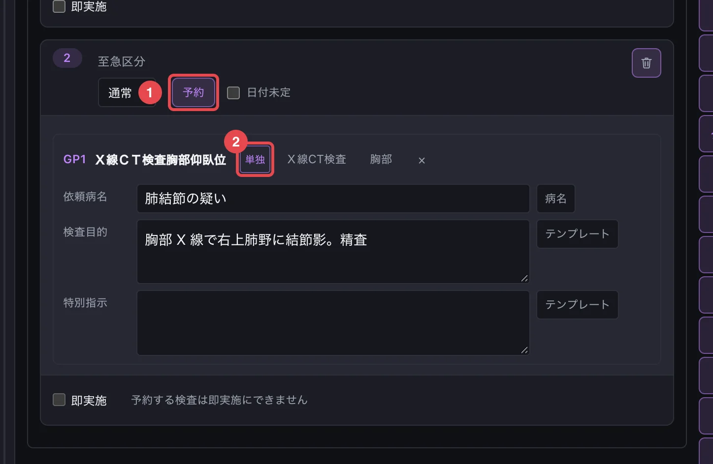
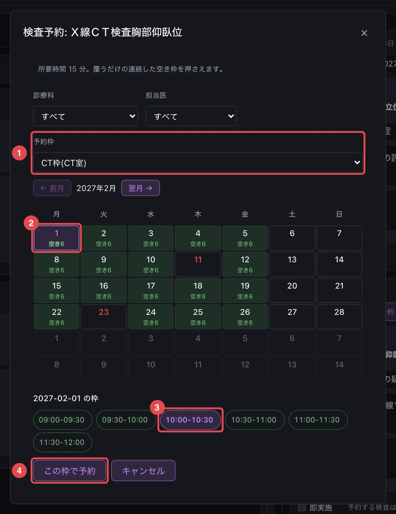
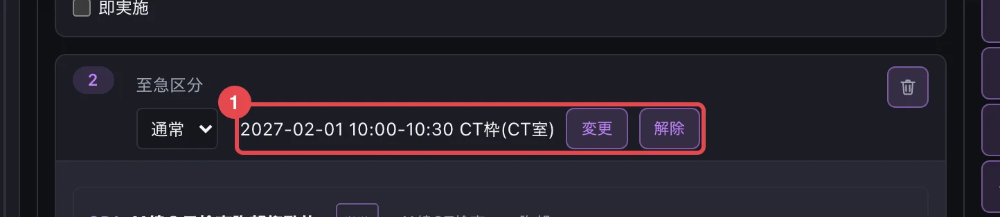
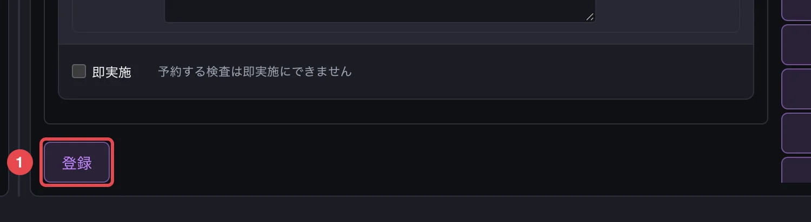
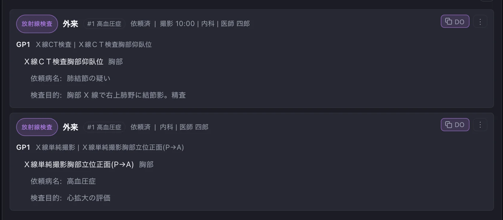
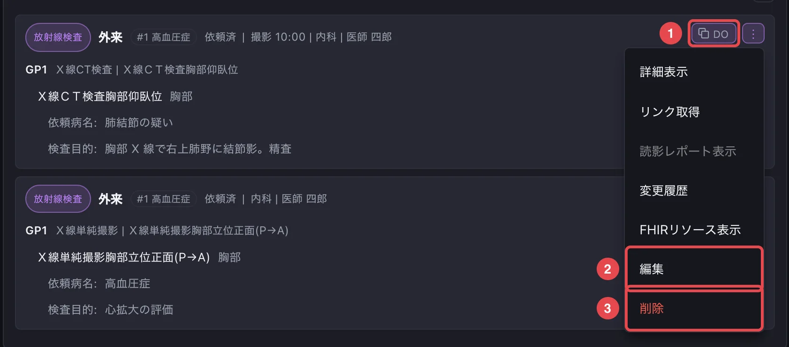

# 放射線検査

医師がカルテから放射線検査(一般撮影・CT・MRI・透視など)の撮影項目を選び、必要なら撮影室の予約を取って登録する操作です。
受付・実施・読影・結果の確認までの流れは、業務フローの[放射線検査オーダー](../flows/rad.md)を見てください。

このページで使う呼び名です。

- **撮影項目**: 撮影の種類と部位の組です(「胸部立位P→A」「胸部CT」など)。
- **単独の項目**: CT・MRI のように、1 項目で 1 つのオーダーになる項目です。ほかの項目と一緒に選んでも、別のオーダーに分かれます。
- **予約必須の項目**: 撮影室の枠を予約してから撮る項目です。予約の日時がそのまま撮影日時になります。

## 放射線検査登録を開く

患者のカルテを開いておきます。

{ .screen }

1. カルテの右側に並ぶボタンから「放射線検査」を押します。右側に「放射線検査登録」が開きます。

## 撮影項目を選ぶ

{ .screen width="807" }

1. 「対象プロブレム」で、この検査の対象の病名を選びます。
2. 「入外区分」で「入院」か「外来」を選びます。
3. 伝票のタブ(「一般撮影」「CT・MRI」「透視・血管・核医学」)を切り替えます。伝票に無い項目は「撮影項目検索」で名前から探します。
4. 撮影する項目にチェックを付けます。

「胸部2方向」のような項目のまとまりを選ぶと、中の項目にもまとめてチェックが付きます。
伝票の表が右側に収まらないときは、表を横に送って見ます。

## 撮影日と依頼内容を入れる

選んだ項目は、下の「選択中」に、オーダーごとの枠にまとまって並びます。

{ .screen width="724" }

1. 「至急区分」を選びます。

    | 至急区分 | 撮影日 | 予約 |
    |---|---|---|
    | 通常 | 撮影日を入れる | 予約必須の項目は、予約か日付未定を選ぶ |
    | 至急 | 今日 | 取らない |
    | 事後 | 今日か、それより前の日(撮影したあとに出す。必ず即実施) | 取らない |

2. 「撮影日」を入れます。初期値は今日です。
3. 時刻を決めるときは「撮影時刻」に入れます。
4. 撮影日がまだ決まらないときは「日付未定」にチェックを付けます。至急区分が「通常」のときだけ選べます。
5. 撮影項目が出ます。「×」を押すと、その項目を外します。まとまりの中の項目を 1 つずつ外すこともできます。
6. 「依頼病名」を入れます。「病名」を押すと、患者に登録された病名から選べます。
7. 「検査目的」を入れます。「テンプレート」を押すと、施設で用意したテンプレートで記入できます。
8. 放射線部へ伝えることがあれば「特別指示」に入れます。CT の造影や MRI の安全確認は、「テンプレート」で記入できます。
9. 撮影してすぐ実施を記録するときは「即実施」にチェックを付けます。

オーダーの枠の右上のゴミ箱で、そのオーダーをまとめて外せます。

## 予約する

CT・MRI など予約必須の項目は、別の枠に分かれ、撮影日の代わりに「予約」が出ます。

{ .screen width="724" }

1. 「予約」を押します。予約を後で取るときは「日付未定」にチェックを付けます。
2. 単独の項目には「単独」と出ます。

予約する検査は、「即実施」にできません。

{ .screen width="634" }

1. 「予約枠」に、その項目の撮影室の枠が選ばれています。別の撮影室にするときは選び直します。
2. 暦で撮影する日を押します。空いている枠の数が出ます。
3. 時刻の枠を押します。項目の所要時間ぶん、続いた空き枠を押さえます。
4. 「この枠で予約」を押します。

予約は、オーダーを登録したときに一緒に保存されます。登録をやめると、予約も残りません。

{ .screen width="722" }

1. 予約の日時と撮影室が出ます。「変更」で選び直し、「解除」で予約を外します。

## 登録する

{ .screen width="750" }

1. 「登録」を押します。

確かめが要る警告(造影する項目での造影剤アレルギーや腎機能の低下、MRI での体内金属など)があると、確認の画面が出ます。
警告ごとに理由を選んで登録します。警告の一覧は、業務フローの[登録の判定](../flows/rad.md#登録の判定)を見てください。

登録すると右側が閉じ、カルテに放射線検査のカードが出ます。単独の項目は、別のカードに分かれます。予約した検査は、見出しに撮影の時刻が出ます。

{ .screen width="841" }

日付未定で登録した検査は、カルテの時系列の一番上の「日付未定」に出ます。予約は、カードの編集か、放射線部の放射線検査一覧の「日付未定」タブで取ります。

## 登録した放射線検査を使う・直す

カルテの放射線検査のカードから操作します。

{ .screen width="841" }

1. 「DO」を押すと、同じ撮影項目が右側の「放射線検査登録」に入ります。予約・実施記録・読影レポートは写りません。
2. 「⋮」の「編集」を押すと、右側に編集が開きます。予約の日時を変えるときも、ここで枠を選び直します。直して「更新」を押します。
3. 「⋮」の「削除」を押すと、理由を入れて放射線検査を削除します。予約の枠は空きに戻ります。

- 編集は、受付や実施のあとでもできます。
- 実施を記録した検査や、読影レポートのある検査は削除できません。
- 読影レポートができると、「⋮」の「読影レポート表示」でレポートを開けます。レポートが無いあいだは押せません。
- 検査をやめるときの「中止」は、カルテのカードではなく、放射線検査一覧の行のメニューで行います。中止すると予約の枠は空きに戻ります。
- カルテの「予約」タブにも検査の予約が並びますが、そこからは日時の変更も取り消しもできません。
