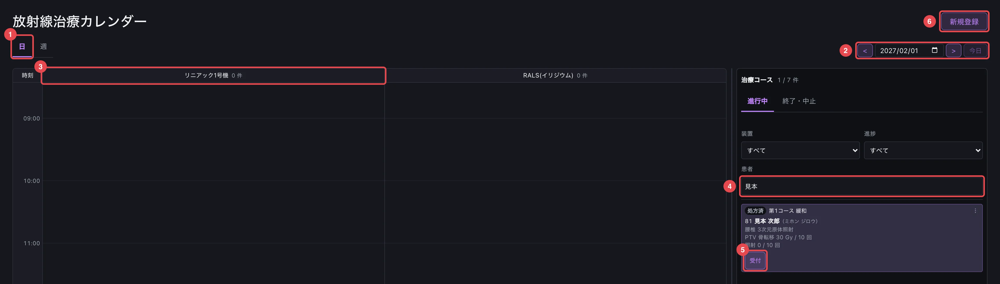
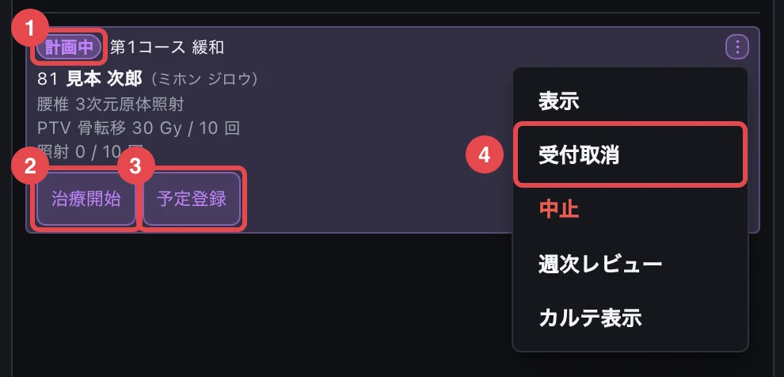
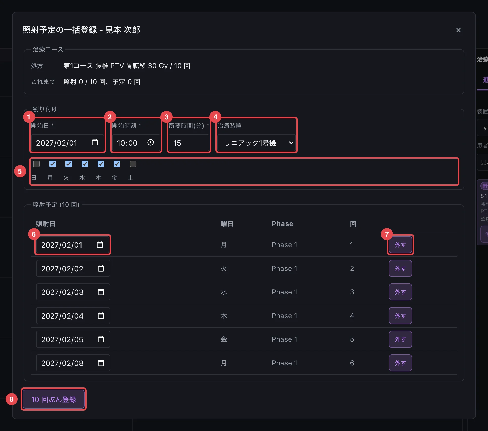
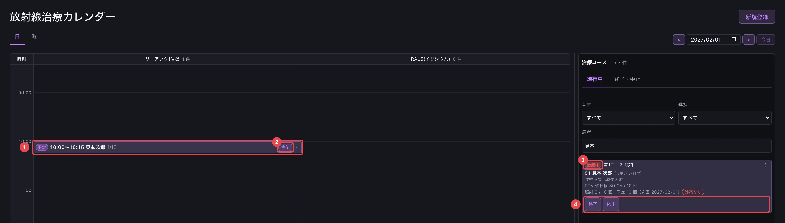
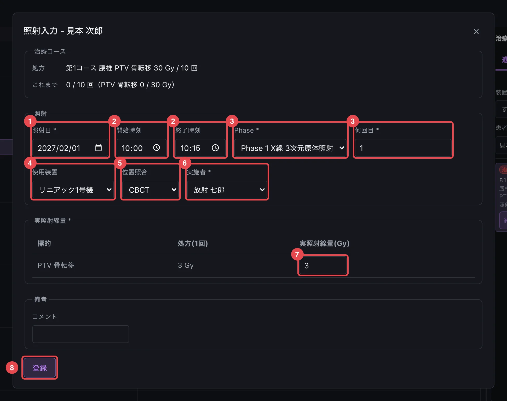
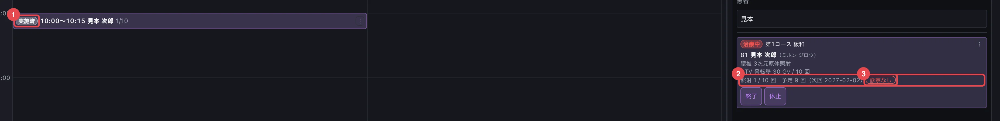
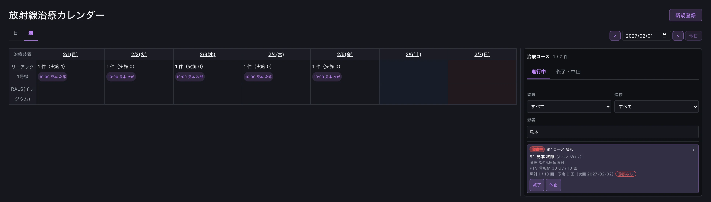

# 放射線治療カレンダー

放射線治療部門が、医師の治療処方(治療コース)を受け付け、照射の予定を組み、毎回の照射を記録する操作です。
放射線治療の流れ全体は、業務フローの[放射線治療](../flows/radiotherapy.md)を見てください。治療処方の登録は[放射線治療](radiotherapy.md)のページです。

- 放射線治療カレンダーは、画面の上の「部門業務」>「放射線部門」>「放射線治療カレンダー」で開きます。ホームの「放射線治療」のカードからも開けます。
- コースは「処方済」→(受付)→「計画中」→(治療開始)→「治療中」→(終了)→「終了」と進みます。途中で「休止」「中止」にもできます。
- 照射の回数が治療処方の回数に達しても、コースは自動では終わりません。終えるときは部門が「終了」を押します。

## 放射線治療カレンダーの見方

{ .screen }

1. 「日」は 1 日の照射を時刻 × 装置の格子で、「週」は 1 週間を日 × 装置の表で見ます。
2. 日付を選びます。「<」「>」で前後へ動かし、「今日」で今日に戻ります。
3. 治療装置ごとの列に、その日の照射が並びます。列の見出しに件数が出ます。
4. 右の「治療コース」に、コースのカードが並びます。「進行中」には処方済・計画中・治療中・休止のコースが、「終了・中止」には終わったコースが並びます。「装置」「進捗」と、患者の氏名・患者番号で絞り込めます。
5. カードのボタンで、コースの状態を進めます。処方済のコースは「受付」です。
6. 部門で治療処方を代わりに起こすときは「新規登録」を押します。

## 受け付ける

コースの「受付」を押すと、計画中になります。計画 CT・治療計画・検証の間は計画中のままにします。

{ .screen width="495" }

1. コースの状態が「計画中」になります。
2. 初回の照射を始めるときに「治療開始」を押します。
3. 照射の予定は「予定登録」で組みます。
4. 押し間違えたときは、「⋮」の「受付取消」で処方済に戻します。

「⋮」の「表示」でコースの詳細、「週次レビュー」で治療中の診察の記録、「カルテ表示」でカルテが開きます。

## 照射予定を組む

「予定登録」を押すと、残りの回をまとめて割り付ける画面が開きます。

{ .screen width="970" }

1. 「開始日」は、予定も照射の記録も無ければ今日、あればその最後の日の翌日が入っています。
2. 「開始時刻」を入れます。
3. 「所要時間(分)」は 15 分が入っています。
4. 「治療装置」を選びます。
5. 照射する曜日にチェックを付けます。月〜金が選ばれています。
6. 下の表に、残りの回が 1 日 1 回ずつ割り付けられます。祝日と休診日は飛ばします。装置の点検日などは、行の日付を直します。
7. 照射しない日の行は「外す」で外します。
8. 「〜回ぶん登録」を押します。

- 割り付けの条件(開始日・曜日など)を変えると、表は割り付け直されて、行で直した日付は消えます。
- 同じ装置・同じ時刻の重なりは止めません。格子で横に並んで見えます。
- 右の一覧のコースのカードを格子に掴んで落としても、その枠の時刻と装置で予定を組めます。格子の空いた枠を掴むと、その枠に 1 回だけ足すこともできます。
- 予定の照射のカードは、掴んで日時や装置を動かせます。日の表示では、カードの上下の縁を掴むと時刻の長さを変えられます。

## 治療を始める

初回の照射の日に、コースの「治療開始」を押します。

{ .screen }

1. 格子に、その日の照射のカードが出ます。時刻・患者・何回目が出ます。
2. 照射が済んだら、カードの「実施」を押します。
3. コースの状態が「治療中」になります。
4. 治療中のコースは「終了」「休止」で状態を進めます。

## 照射を記録する

照射のカードの「実施」を押すと、照射入力が開きます。予定の内容が入った状態で開きます。

{ .screen width="970" }

1. 「照射日」を確かめます。
2. 「開始時刻」「終了時刻」を確かめます。終了は開始より後にします。
3. 「Phase」と「何回目」を確かめます。
4. 「使用装置」を確かめます。
5. 「位置照合」で、照合の方法を選びます。
6. 「実施者」を確かめます。ログインしている人が入っています。
7. 標的ごとの「実照射線量(Gy)」を確かめます。処方の 1 回線量が入っています。
8. 「登録」を押します。

{ .screen }

1. 照射のカードが「実施済」になります。
2. コースのカードの照射の回数が進みます。予定の残りと、次回の日付も出ます。
3. 治療中のコースには、最後の診察(週次レビュー)の日と経過日数が出ます。まだ診察の記録が無いときは「診察なし」です。間隔を超えると強調されます。

- 照射の記録で、前回の週次レビューから間隔(既定は 7 日)を超えていると、指示した医師に督促の通知が届きます。
- 予定を作っていない日に照射したときは、治療中のコースの「⋮」の「照射入力」で 1 回ぶんを入れます。
- 照射しなかった回は、照射のカードの「⋮」の「この回中止」で理由を選んで残します。その回は回数に数えず、次に予定を組むときに振替として埋まります。
- 誤って記録した照射は、コースの「⋮」の「表示」で詳細を開き、照射記録の「取消」で取り消します。取り消した記録は消えずに残り、回数と線量から外れます。

## 週の表示

「週」を押すと、1 週間の照射が装置ごとに並びます。

{ .screen }

日ごとに、照射の件数と実施済の件数、時刻と患者が出ます。

## 休止・終了・中止

| ボタン | 使うとき | 入れるもの |
|---|---|---|
| 「休止」 | 体調不良・装置の故障などで照射を中断する | 休止日・理由・補足 |
| 「再開」 | 休止していたコースを治療中に戻す | なし |
| 「終了」 | 照射を終えた | 終了日 |
| 「中止」 | 途中でやめる | 中止日・理由・補足 |

- 休止で残りの予定をずらすときは、「⋮」の「予定全削除」で予定を消してから、もう一度「予定登録」で組みます。
- 終了・中止したコースは「サマリー」で治療終了サマリーを書きます。
- 押し間違いは「受付取消」「治療開始取消」「終了取消」「中止取消」で戻します。
