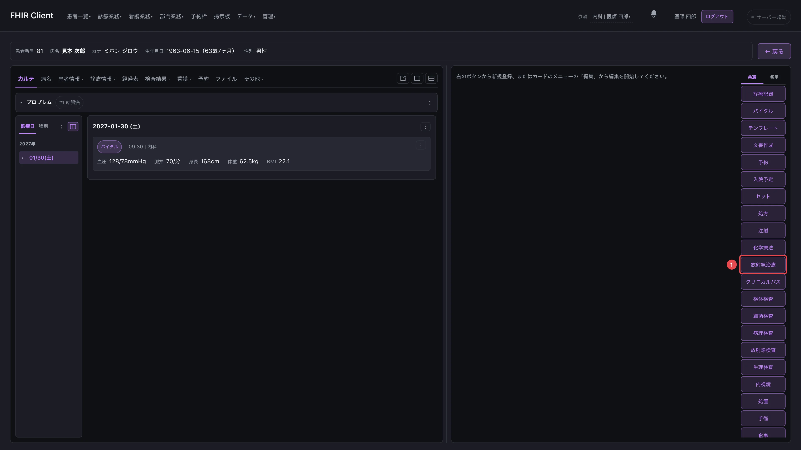
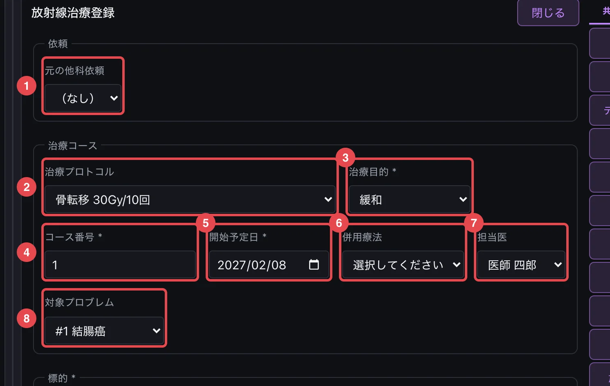
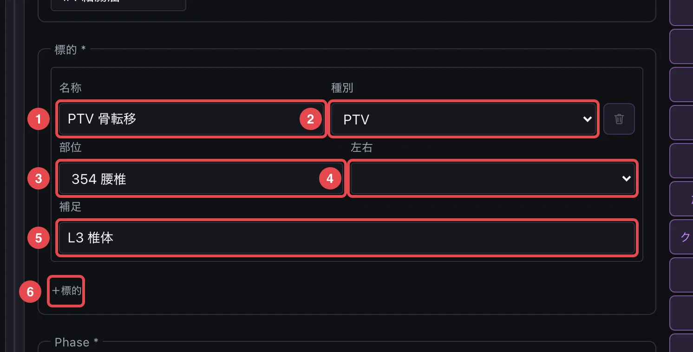
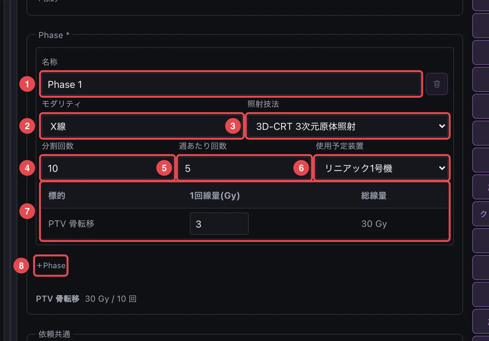
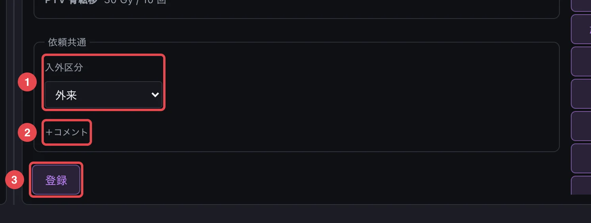
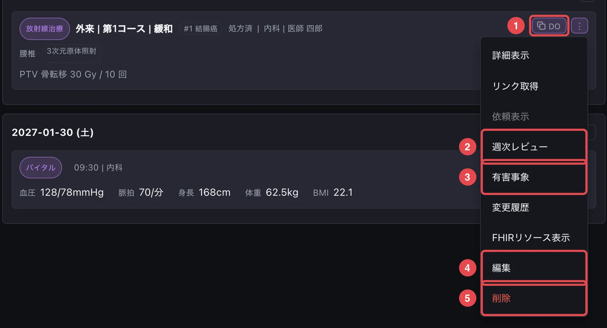

# 放射線治療

放射線治療医が、カルテから放射線治療の治療処方(治療コース)を登録する操作です。
臨床医からの依頼(他科依頼)から、放射線治療部門の受付・照射予定・毎回の照射・治療中の診察・終了サマリーまでの流れは、
業務フローの[放射線治療](../flows/radiotherapy.md)を見てください。

このページで使う呼び名です。

- **治療コース**: 1 回の放射線治療の全体です。治療処方 1 件が、治療コース 1 件に当たります。
- **標的**: 照射する範囲です(PTV など)。
- **Phase**: 同じ条件で照射するひと区切りです。途中で照射野や線量を変えるときは、Phase を分けます。

治療計画の中身(輪郭・ビーム・線量分布)は治療計画装置で扱います。このシステムでは扱いません。

## 放射線治療登録を開く

患者のカルテを開いておきます。

{ .screen }

1. カルテの右側に並ぶボタンから「放射線治療」を押します。右側に「放射線治療登録」が開きます。

## 依頼と治療コースを入れる

項目名に「*」が付いたものは必ず入れます。

{ .screen width="746" }

1. 依頼を受けて登録するときは、「元の他科依頼」で、その患者に来ている放射線治療科への依頼を選びます。
2. 「治療プロトコル」で、施設で用意した処方の雛形を選ぶと、治療目的・標的・Phase がまとめて入ります。
3. 「治療目的」を「根治」「術前」「術後」「緩和」「予防」から選びます。
4. 「コース番号」を確かめます。その患者の何回目の治療コースかが入っています。
5. 「開始予定日」を入れます。
6. 化学療法などを併せて行うときは「併用療法」を選びます。
7. 「担当医」を選びます。選ばないときは、登録した医師(処方医)になります。
8. 「対象プロブレム」で、対象の病名を選びます。

## 標的を入れる

{ .screen width="746" }

1. 「名称」に標的の名前を入れます。
2. 「種別」(GTV・CTV・ITV・PTV など)を選びます。
3. 「部位」を選びます。
4. 必要なら「左右」を選びます。
5. 部位の補足があれば「補足」に入れます。
6. 標的を足すときは「＋標的」を押します。2 つ目からは、標的の右のゴミ箱で消せます。

## Phase を入れる

{ .screen width="746" }

1. 「名称」に Phase の名前を入れます。
2. 「モダリティ」(X 線・電子線・陽子線など)を選びます。
3. 「照射技法」(3D-CRT・IMRT・VMAT・SBRT など)を選びます。
4. 「分割回数」を入れます。
5. 「週あたり回数」を入れます。
6. 使う装置が決まっていれば「使用予定装置」を選びます。
7. 標的ごとに「1回線量(Gy)」を入れます。分割回数との積が「総線量」に出ます。
8. Phase を足すときは「＋Phase」を押します。

下に、標的ごとの総線量と回数の合計が出ます。

## 登録する

{ .screen width="748" }

1. 「入外区分」で「入院」か「外来」を選びます。
2. 伝えることがあれば「＋コメント」を押して入れます。
3. 「登録」を押します。

フォームの先頭には、この患者の過去の放射線治療(今回の標的と同じ部位のコースは強調)、妊娠・授乳、体内金属・ペースメーカーの注意が出ます。
どれも登録は止めません。

登録すると右側が閉じ、カルテに治療処方のカードが出ます。見出しにコース番号と治療目的、状態「処方済」が出ます。

## 登録した治療処方を使う・直す

カルテの治療処方のカードから操作します。

{ .screen width="841" }

1. 「DO」を押すと、同じ内容が新しい治療コースとして右側に入ります。コース番号は振り直され、開始予定日は今日になります。
2. 治療中は「⋮」の「週次レビュー」で、照射の進み具合を見ながら診察の記録を書きます。
3. 「⋮」の「有害事象」で、CTCAE の用語と Grade で有害事象を記録します。
4. 「⋮」の「編集」を押すと、右側に編集が開きます。直して「更新」を押します。
5. 「⋮」の「削除」を押すと、理由を入れて治療処方を削除します。

- 削除できるのは、放射線治療部門が受け付ける前(処方済)だけです。受け付けたあとは、放射線治療カレンダーで治療コースを中止します。
- 治療中・終了した治療処方では、照射の記録がある標的と Phase は消せません。
