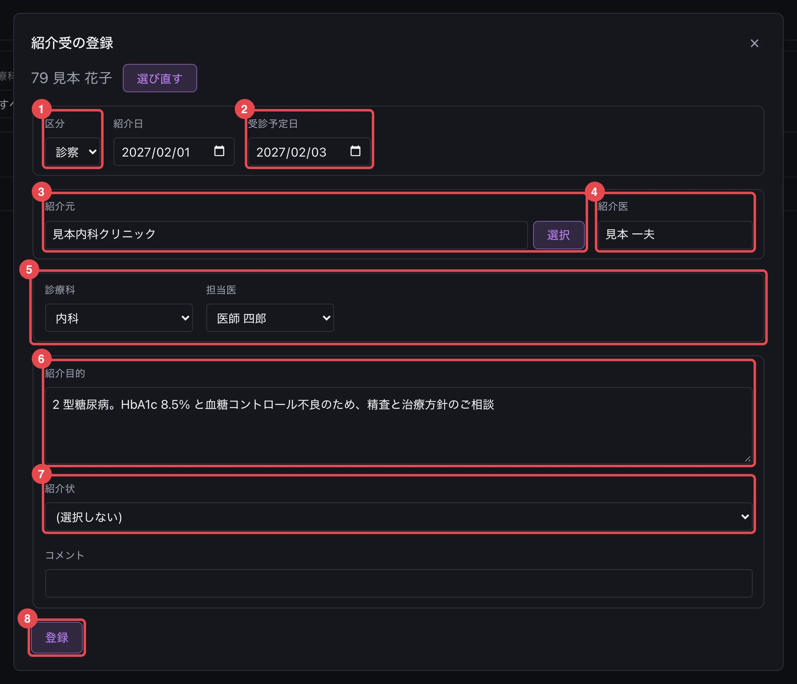
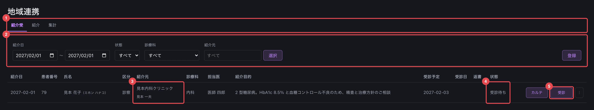
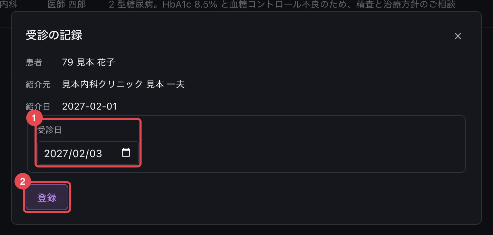
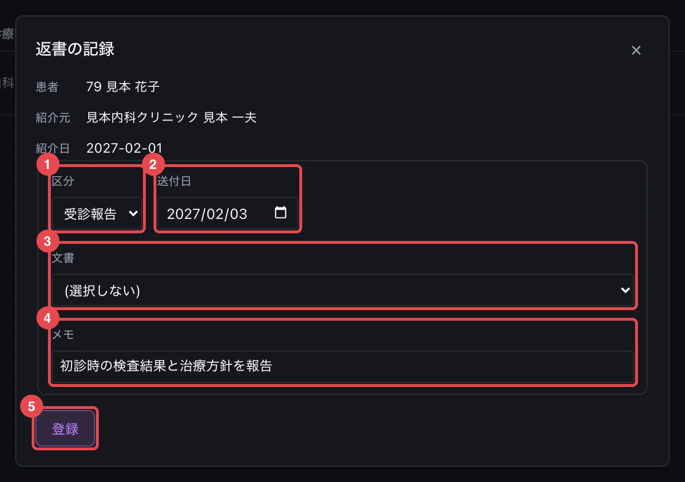
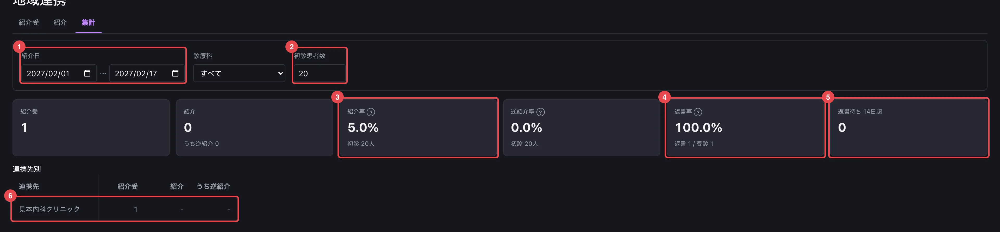

# 地域連携

地域医療連携部が、他院から受けた紹介(紹介受)と、他院へ出した紹介(紹介・逆紹介・転院)を 1 件ずつ台帳に載せ、受診と返書を記録する操作です。

- 地域連携は、画面の上の「部門業務」>「地域連携部門」>「地域連携」で開きます。
- 紹介元・紹介先に選べるのは、「連携先医療機関」に登録した医療機関です。
- 紹介状・返書の文書は、患者のファイルに取り込んだものから選んで結び付けます。
- 紹介の状態は「受診待ち」→「返書待ち」→「完了」と進みます。取り消した紹介は「取消」です。
- 患者のカルテでも、タブの「患者情報」の「プロファイル」を開き、「紹介」を押すと、その患者の紹介が並びます。

## 紹介受を登録する

「紹介受」のタブの右上の「登録」を押し、患者を検索して選びます。

{ .screen width="954" }

1. 「区分」(診察・入院・検査)を選びます。紹介日は今日が入ります。
2. 「受診予定日」を入れます。
3. 「紹介元」の「選択」を押し、連携先の医療機関を選びます。
4. 「紹介医」に、紹介元の医師の名前を入れます。
5. 受ける「診療科」と「担当医」を選びます。
6. 「紹介目的」を書きます。
7. 紹介状を取り込んであれば、「紹介状」で選びます。
8. 「登録」を押します。

## 紹介受の見方

{ .screen }

1. 「紹介受」「紹介」「集計」のタブを切り替えます。
2. 「紹介日」の期間・「状態」(進行中・完了・取消・すべて)・「診療科」・「紹介元」で絞り込みます。
3. 「紹介元」に、医療機関と紹介医が出ます。
4. 「状態」に、紹介の進み具合が出ます。返書待ちが 14 日を超えると、日数が赤で出ます。
5. 受診待ちの行には「受診」、返書待ちの行には「返書」のボタンが出ます。「カルテ」で患者のカルテを開きます。

行の右端の「⋮」から、編集・受診日変更・返書取消・完了・取消・進行中に戻すができます。

## 受診を記録する

患者が受診したら、行の「受診」を押します。

{ .screen width="714" }

1. 「受診日」を確かめます。受診予定日が入っています。
2. 「登録」を押します。状態が「返書待ち」になります。

## 返書を記録する

紹介元へ報告を送ったら、行の「返書」を押します。

{ .screen width="714" }

1. 「区分」(受診報告・中間報告・最終報告)を選びます。1 通目は受診報告、2 通目からは最終報告が入っています。
2. 「送付日」を入れます。
3. 返書を取り込んであれば、「文書」で選びます。
4. 「メモ」を書きます。
5. 「登録」を押します。

最終報告を記録すると、紹介は「完了」になります。

{ .screen }

1. 「受診日」が出ます。
2. 「返書」に、送った日と区分が順に並びます。
3. 状態が「完了」になります。

返書を出さずに終えるときは、「⋮」の「完了」を押します。

## 他院へ紹介する

「紹介」のタブで同じように登録します。区分は紹介・逆紹介・転院、相手は「紹介先」、結び付ける文書は「診療情報提供書」です。
受診の記録は無く、登録すると「返書待ち」になります。紹介先から返書を受け取ったら「返書」を押し、区分(経過報告受領・返書受領)を選んで記録します。返書受領で「完了」になります。

## 集計を見る

「集計」のタブで、期間内の紹介の件数と率を見ます。

{ .screen }

1. 「紹介日」の期間と「診療科」を選びます。
2. 「初診患者数」を入れると、紹介率と逆紹介率が出ます。
3. 「紹介率」は、紹介受の件数 ÷ 初診患者数です。
4. 「返書率」は、受診済みの紹介受のうち、返書を 1 通以上出した割合です。
5. 返書待ちが 14 日を超えている件数が出ます。
6. 「連携先別」に、連携先ごとの紹介受・紹介・うち逆紹介の件数が出ます。

取り消した紹介は数えません。
