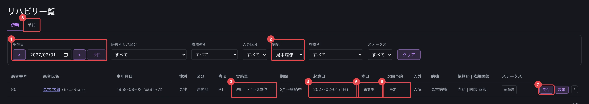
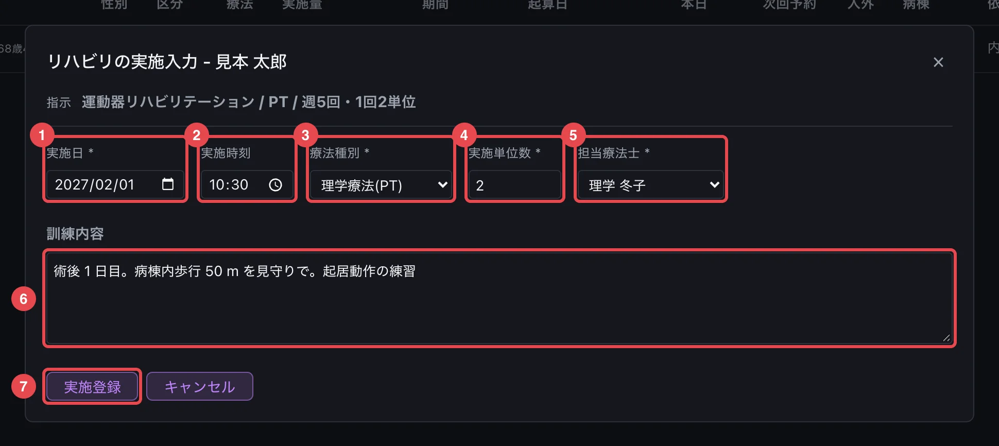
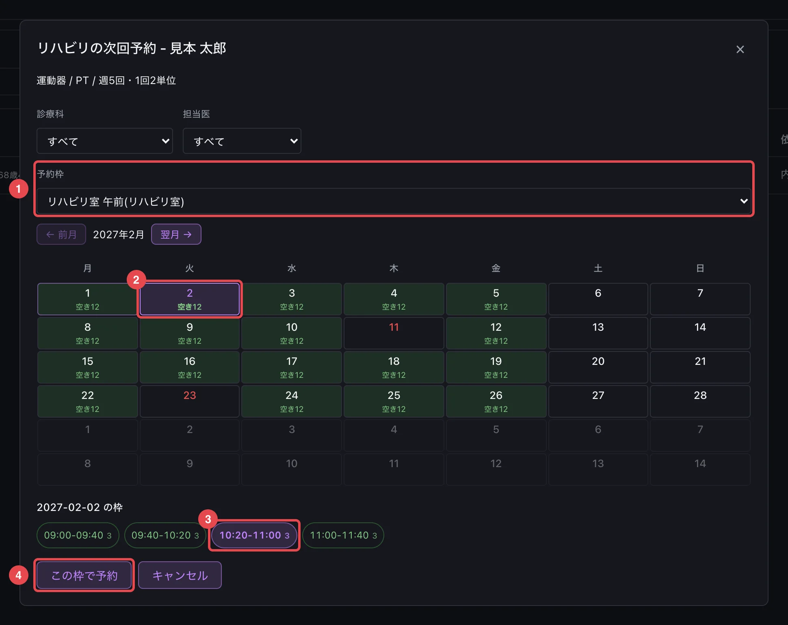
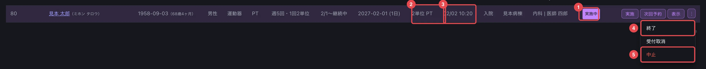
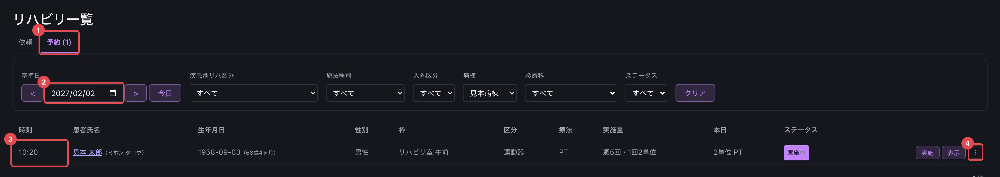

# リハビリ一覧

リハビリ部門が、医師のリハビリの依頼をリハビリ一覧で受け付け、日々の実施を記録し、次回を予約する操作です。
リハビリの流れ全体は、業務フローの[リハビリオーダー](../flows/rehab.md)を見てください。依頼は[リハビリ](rehab.md)のページです。

- リハビリ一覧は、画面の上の「部門業務」>「リハビリ部門」>「リハビリ一覧」で開きます。ホームの「リハビリ」のカードからも開けます。
- リハビリの依頼は、1 件が数か月続く期間の依頼です。一覧には、選んだ基準日に期間の入っている依頼が並びます。
- 依頼は「依頼済」→(受付)→「実施中」→(終了)→「終了」と進みます。実施を記録しても状態は実施中のままで、日々の実施が積み上がります。

## リハビリ一覧の見方

{ .screen }

1. 「基準日」を選びます。その日に始まっていて、まだ終わっていない依頼が並びます。
2. 「疾患別リハ区分」「療法種別」「入外区分」「病棟」「診療科」「ステータス」で絞り込めます。写真は病棟で絞っています。
3. 「実施量」に、週あたりの回数と 1 回の単位数が出ます。
4. 「起算日」に、発症日・手術日と、そこからの日数が出ます。
5. 「本日」に、その日に実施した単位数と療法が出ます。まだなら「未実施」です。
6. 「次回予約」に、次の予約の日時が出ます。
7. 新しい依頼は「受付」で受け付けます。受付すると「実施中」になり、「実施」「次回予約」が出ます。
8. 「予約」のタブで、日ごとの予約を時刻の順に見ます。

## 実施を記録する

リハビリを行ったら、行の「実施」を押します。

{ .screen width="970" }

1. 「実施日」を確かめます。
2. 「実施時刻」を入れます。予約の行から開いたときは予約の時刻が入っています。
3. 「療法種別」を選びます。依頼の療法が 1 つならその療法が入っています。
4. 「実施単位数」を確かめます(1 単位 20 分)。依頼の単位数が入っています。
5. 「担当療法士」を確かめます。ログインしている人が入っています。代わりに入れるときは実施した療法士を選びます。
6. 「訓練内容」を書きます。
7. 「実施登録」を押します。

- PT と OT を同じ日に行ったときは、療法ごとに 1 回ずつ登録します。
- 器材・薬剤・訓練項目の入力はありません。リハビリの算定は単位数で決まります。

## 次回を予約する

次回をいつにするかは、実施のあとにそのつど決めます。行の「次回予約」を押します。

{ .screen width="970" }

1. 「予約枠」で、リハ室の「リハビリ予約」の枠表を選びます。
2. 暦で日を選びます。日ごとに空きの数が出ます。
3. 時刻の枠を選びます。枠の右の数字は残りの空きです。同じ時間帯に複数の患者を入れられます。
4. 「この枠で予約」を押します。

- 予約は 1 回ぶんで 1 枠です。単位数ぶんの枠をまとめて押さえることはできません。
- 予約を取れるのは実施中の依頼だけです。依頼済なら先に受け付けます。

{ .screen }

1. ステータスは「実施中」のままです。
2. 「本日」に実施した単位数と療法が出ます。
3. 「次回予約」に予約した日時が出ます。
4. リハビリを終えるときは「⋮」の「終了」で終了日を入れます。終了日の翌日以降の予約は取り消され、枠が空きます。
5. 取りやめるときは「中止」を押します。今日以降の予約は取り消されます。

## 予約を見る

「予約」のタブでは、その日の予約が時刻の順に並びます。

{ .screen }

1. 「予約」のタブを開きます。タブ名に件数が出ます。
2. 基準日を、見たい日にします。
3. 時刻・患者・枠と、依頼の内容が並びます。行の「実施」から、予約の時刻が入った状態で実施入力を開けます。
4. 「⋮」の「日時変更」「予約取消」で予約を直します。カルテの予約タブからも直せます。

- 入院中の依頼は、退院の画面の「リハビリオーダーを退院日で終了する」で、退院日に終了日を付けられます。
- 押し間違えたときは、「終了取消」で実施中に、「中止取消」で依頼済に戻します。取り消した予約は戻らないので、「次回予約」で取り直します。
