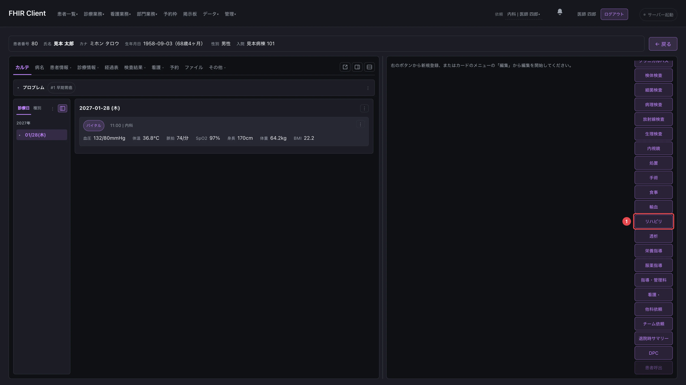
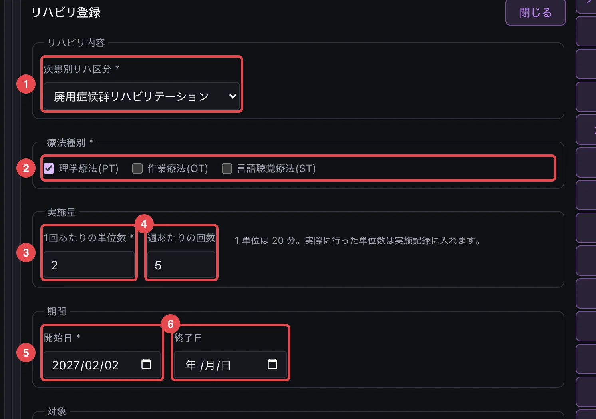
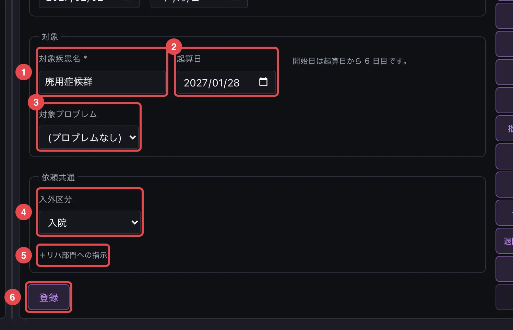
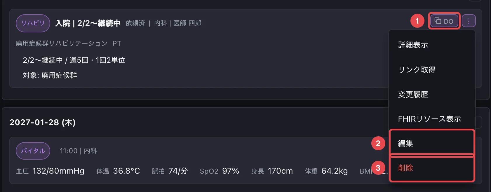

# リハビリ

医師がカルテからリハビリテーション(理学療法・作業療法・言語聴覚療法)を依頼する操作です。
リハ部門の受付・予約・日々の実施・終了までの流れは、業務フローの[リハビリオーダー](../flows/rehab.md)を見てください。

1 つのリハビリオーダーで、開始から終了までの期間の訓練をまとめて依頼します。予約は、リハ部門が受け付けたあとに取ります。

## リハビリ登録を開く

患者のカルテを開いておきます。

{ .screen }

1. カルテの右側に並ぶボタンから「リハビリ」を押します。右側に「リハビリ登録」が開きます。

## リハビリ内容・実施量・期間を入れる

項目名に「*」が付いたものは必ず入れます。

{ .screen width="746" }

1. 「疾患別リハ区分」を選びます。
2. 「療法種別」で、理学療法(PT)・作業療法(OT)・言語聴覚療法(ST)のうち行うものにチェックを付けます。いくつでも選べます。
3. 「1回あたりの単位数」を入れます。1 単位は 20 分です。
4. 「週あたりの回数」に目安の回数を入れます。曜日は決めません。
5. 「開始日」を入れます。
6. 終わりが決まっていれば「終了日」を入れます。空のときは、終了するまで続きます。

## 対象を入れて登録する

{ .screen width="748" }

1. 「対象疾患名」に、リハビリの対象の疾患を入れます。疾患別リハの算定に要るので、必ず入れます。
2. 「起算日」に、発症日や手術日を入れます。開始日が起算日から何日目かが横に出ます。
3. 「対象プロブレム」で、対象の病名を選びます。
4. 「入外区分」を確かめます。入院中の患者は「入院」が入っています。
5. リハ部門へ伝えることがあれば「＋リハ部門への指示」を押して入れます。
6. 「登録」を押します。

登録すると右側が閉じ、カルテの開始日のところにリハビリのカードが出ます。見出しに期間が出ます。

## 登録したリハビリを使う・直す

カルテのリハビリのカードから操作します。

{ .screen width="841" }

1. 「DO」を押すと、同じ内容が右側の「リハビリ登録」に入ります。開始日は今日になり、終了日は空になります。
2. 「⋮」の「編集」を押すと、右側に編集が開きます。直して「更新」を押します。受付や予約、実施の記録は変わりません。
3. 「⋮」の「削除」を押すと、理由を入れてリハビリを削除します。取ってある予約も取り消されます。

- 実施の記録があるリハビリは削除できません。
- リハビリを終えるときは、リハビリ一覧の行のメニューの「終了」で終了日を入れます。途中でやめるときは「中止」で止めます。カルテのカードには終了・中止はありません。
- 退院するときは、退院の画面で「リハビリオーダーを退院日で終了する」にチェックを付けると、退院日で終わります。外来で続けるときは、新しいリハビリを出します。
- 予約は、リハ部門がリハビリ一覧の行の「次回予約」で、そのつど取ります。
