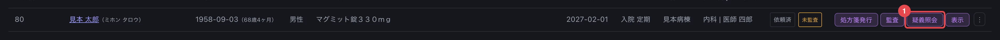
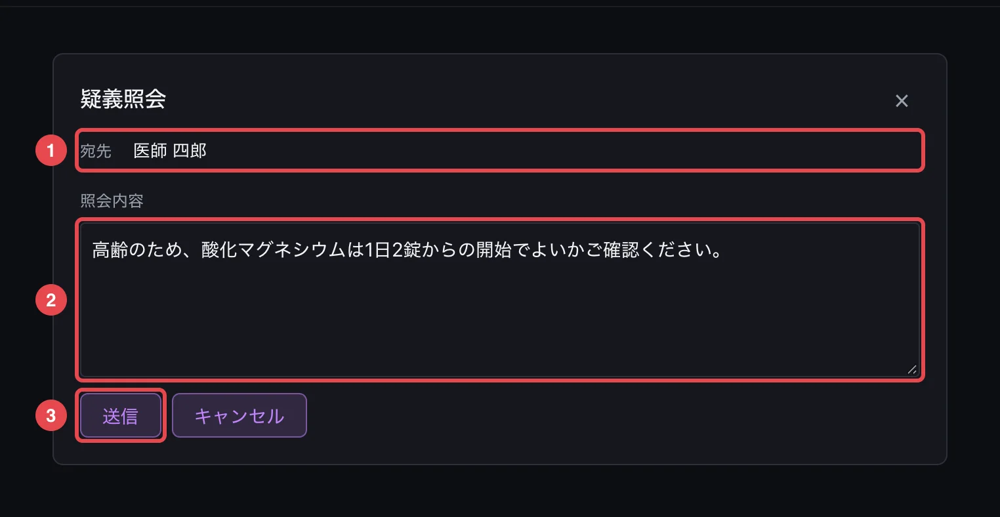
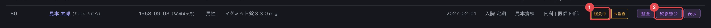
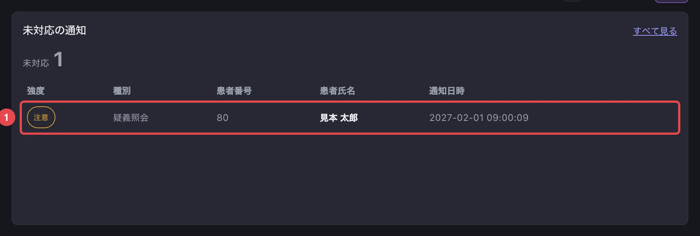
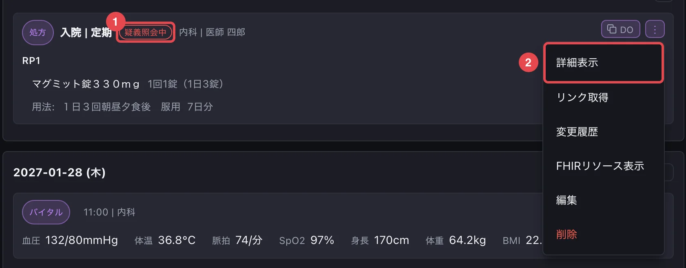
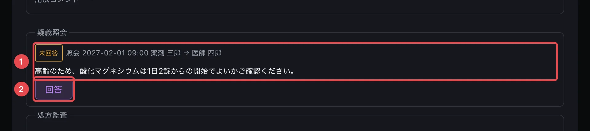
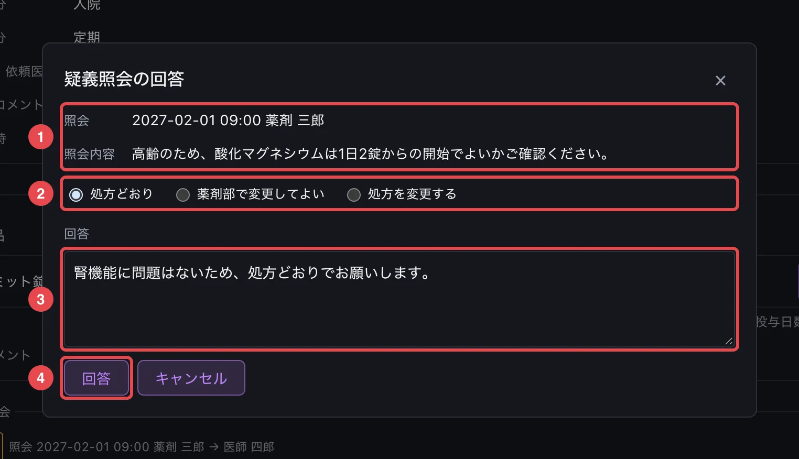
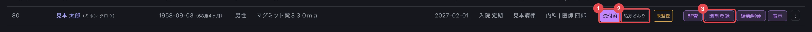

# 疑義照会

薬剤師が処方・注射について処方医に問い合わせ、医師が回答する操作です。処方と注射で同じ操作です。
照会から回答までの流れは、業務フローの[処方オーダー](../flows/prescription.md)「疑義照会の流れ」を見てください。

- 照会している間は、その処方・注射の調剤・払出を止めます(一覧から「調剤登録」「払出登録」が消えます)。
- 1 つの処方・注射に出せる照会は、同時に 1 件です。
- 照会の宛先は、その処方・注射を出した医師です。

## 照会を送る(薬剤師)

処方一覧(注射は注射一覧)の行から照会します。[処方監査](rx-verification.md)の画面からも開けます。

{ .screen }

1. 照会する処方の行の「疑義照会」を押します。

{ .screen width="762" }

1. 「宛先」に処方医が出ます。
2. 「照会内容」に、問い合わせることを入れます。
3. 「送信」を押します。処方医に通知「疑義照会」が届きます。

{ .screen }

1. ステータスが「照会中」になり、回答が来るまで調剤登録ができません。
2. 回答の前に照会をやめるときは、「疑義照会」を押して「取下げ」を押します。照会の前の状態に戻ります。

## 回答する(医師)

照会が届くと、ホームの「未対応の通知」と、画面の上のベルに通知「疑義照会」が出ます。

{ .screen width="960" }

1. 通知「疑義照会」が出ます。「すべて見る」で通知の一覧を開き、行の「カルテ」で患者のカルテを開きます。通知の扱いは[通知](notifications.md)を見てください。

カルテでは、照会を受けた処方のカードに「疑義照会中」の印が出ます。

{ .screen width="841" }

1. 「疑義照会中」の印を確かめます。
2. カードの「⋮」から「詳細表示」を押します。

{ .screen width="960" }

1. 「疑義照会」の区画に、照会した薬剤師・日時と照会内容が出ます。
2. 「回答」を押します。

{ .screen width="762" }

1. 照会した日時・薬剤師と照会内容が出ます。
2. 回答の区分を選びます。

    | 区分 | 回答のあと |
    |---|---|
    | 処方どおり | 処方を変えずに、薬剤部が調剤を続けます |
    | 薬剤部で変更してよい | 薬剤部が調剤のときに内容を変えて調剤します |
    | 処方を変更する | 回答のあと右側に処方の編集が開きます。医師が処方を直して「更新」を押すまで、薬剤部は調剤できません |

3. 「回答」に、薬剤師へ伝えることを入れます。
4. 「回答」を押します。照会した薬剤師に通知「疑義照会回答」が届きます。

「処方を変更する」と回答したあと、処方の編集を閉じてしまったときは、カードの「⋮」の「編集」から直します。
それまでカードには「処方変更待ち」の印が出ます。

## 回答を確かめて調剤する(薬剤師)

回答が来ると、通知「疑義照会回答」が届き、一覧の処方は調剤できる状態に戻ります。

{ .screen }

1. ステータスが「受付済」に戻ります。処方箋を発行する前に照会した処方も、受付済になります。
2. 回答の区分が印で出ます。
3. 「調剤登録」(注射は「払出登録」)で調剤します。調剤登録の画面の下に、照会と回答の履歴が出ます。

調剤登録・払出登録をすると、通知「疑義照会回答」は自動で対応済になります。
照会と回答の履歴は、一覧の「表示」とカルテの処方の詳細でも見られます。
