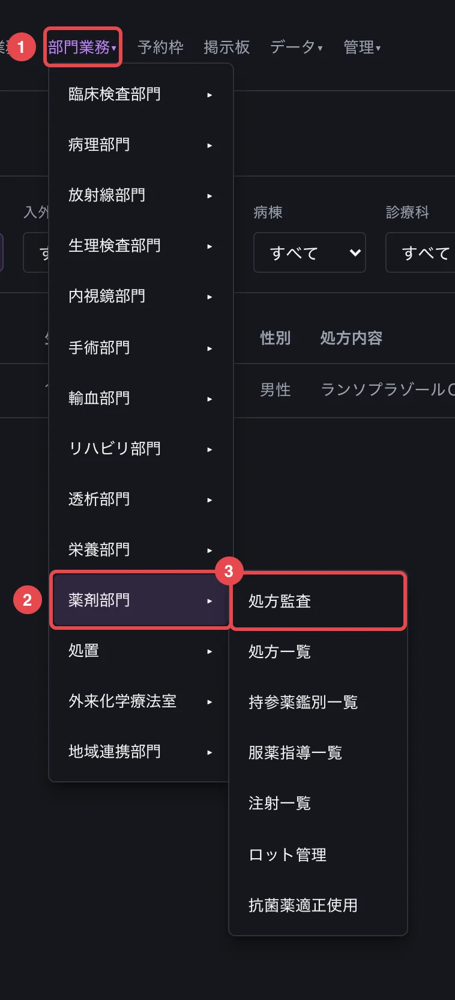
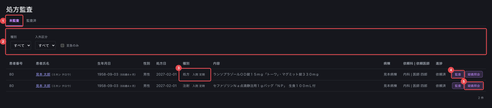
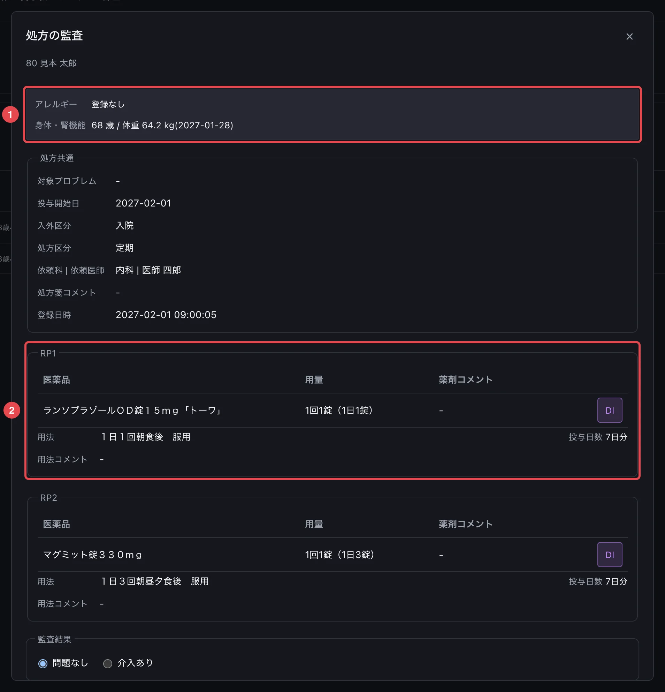
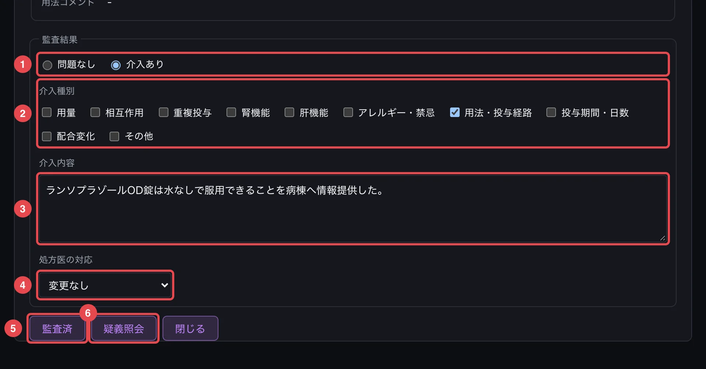
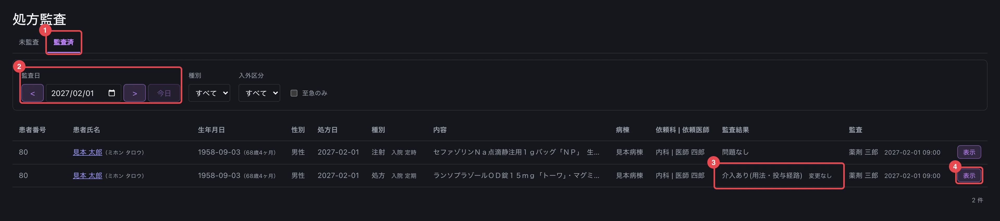
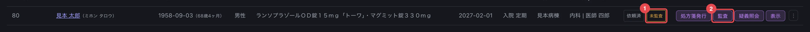

# 処方監査

薬剤師が、院内の処方と注射を確かめて「監査済」にする操作です。
処方と注射の流れの中での位置は、業務フローの[処方オーダー](../flows/prescription.md)と[注射オーダー](../flows/injection.md)を見てください。

- 監査するのは院内の処方と注射です。院外処方(保険薬局が監査します)と、持参薬を続ける処方は対象になりません。
- 医師が処方・注射を登録すると、処方監査の「未監査」に並びます。
- 連日の注射は、続く日をまとめて 1 回監査します。化学療法の注射は投与日ごとに監査します。

## 処方監査を開く

{ .screen width="379" }

1. 画面の上の「部門業務」にマウスを乗せます。
2. 「薬剤部門」にマウスを乗せます。
3. 「処方監査」を押します。

ホームの「処方監査」のカードからも開けます。

## 未監査の一覧

{ .screen }

1. 「未監査」のタブに、まだ監査していない処方・注射が日付を問わず並びます。至急のものが先に、それ以外は届いた順に並びます。
2. 「種別」(処方・注射)、「入外区分」、「至急のみ」で絞り込めます。
3. 「種別」の列に、処方か注射かと、入外区分・処方区分(注射区分)が出ます。
4. 「監査」を押すと、監査の画面が開きます。
5. 処方医に問い合わせるときは「疑義照会」を押します。

- 監査した処方・注射を医師が編集すると、未監査に戻り、内容の列に「再監査」の印が付きます。

## 内容を確かめる

「監査」を押すと、処方(注射)の監査の画面が開きます。

{ .screen width="954" }

1. 患者のアレルギー、年齢・体重と、腎機能(eGFR・CCr)が出ます。
2. 処方の内容が、カルテの処方の詳細と同じ並びで出ます。「DI」を押すと、その薬の医薬品情報(外部のサイト)が新しいタブで開きます。

アレルギー・重複・相互作用・用量などの警告があるときは、登録のときと同じ警告が上に出ます。
疑義照会をしたことがあれば、照会と回答の履歴も出ます。

## 監査結果を入れる

画面の下で監査結果を入れます。

{ .screen width="960" }

1. 「問題なし」か「介入あり」を選びます。
2. 介入ありのときは、「介入種別」で当てはまるものにチェックを付けます。いくつでも選べます。
3. 「介入内容」に、何をしたかを入れます。
4. 「処方医の対応」で、「処方変更」「変更なし」「中止」から選びます。まだ決まっていなければ「未定」のままにします。
5. 「監査済」を押します。監査した薬剤師と日時が残り、一覧から消えます。
6. 処方医に問い合わせるときは、ここから「疑義照会」を押すこともできます。

介入の記録は、データ抽出の「薬剤師介入」で集計できます。

## 監査済の一覧

{ .screen }

1. 「監査済」のタブに、監査した処方・注射が並びます。
2. 「監査日」で、監査した日を選びます。「<」「>」で 1 日ずつ動かせます。
3. 「監査結果」に、問題なし・介入あり(介入種別)と処方医の対応が出ます。
4. 「表示」を押すと監査の画面が開き、結果を直して「監査済」を押し直せます。

## 処方一覧・注射一覧での表示

処方一覧と注射一覧でも、ステータスの横に監査の状態が出ます。

{ .screen }

1. 「未監査」か「監査済」の印が出ます。
2. 未監査の行には「監査」のボタンが出て、処方監査を開かずに監査できます。

- 施設の設定で「監査済まで調剤登録・払出登録を出さない」にしていると、未監査の行には「調剤登録」「払出登録」が出ません。
  この設定をしていなければ、監査と調剤は並行して進められます。
