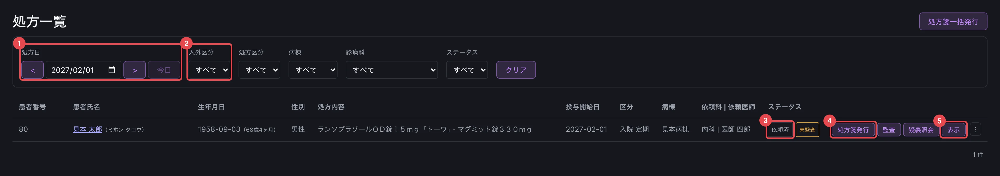
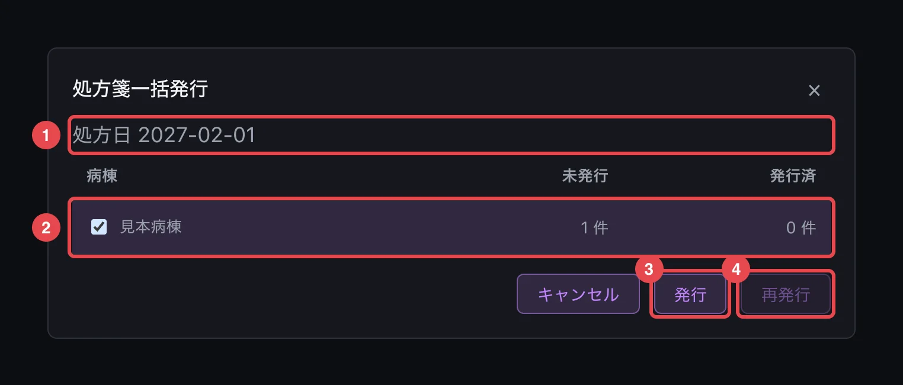
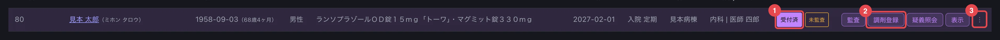
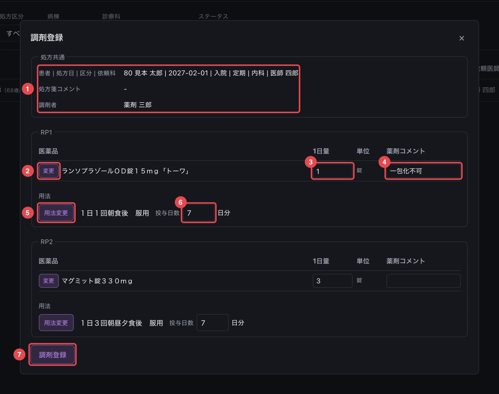
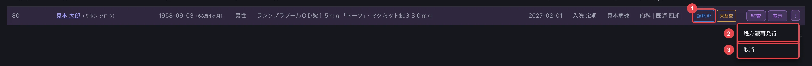

# 処方一覧と調剤

薬剤部が、医師の出した処方を処方一覧で受け、処方箋を発行して調剤し、調剤の結果を登録する操作です。
処方の流れ全体は、業務フローの[処方オーダー](../flows/prescription.md)を見てください。

- 処方一覧は、画面の上の「部門業務」>「薬剤部門」>「処方一覧」で開きます。ホームの「処方」のカードからも開けます。
- 薬剤部の作業は「依頼済」→(処方箋発行)→「受付済」→(調剤登録)→「調剤済」と進みます。
- 処方の内容を確かめる処方監査は、調剤と並行して行います。操作は[処方監査](rx-verification.md)を見てください。

## 処方一覧の見方

{ .screen }

1. 「処方日」で、処方が出された日を選びます。「<」「>」で 1 日ずつ動かし、「今日」で今日に戻ります。
   処方日は医師が処方を登録した日です(投与開始日ではありません)。先の日から始まる定期処方も、出された日に並びます。
2. 「入外区分」「処方区分」「病棟」「診療科」「ステータス」で絞り込めます。「クリア」で絞り込みを外します。
3. 「ステータス」に薬剤部の作業の状態が出ます。横には処方監査の「未監査」「監査済」の印が出ます。
4. 依頼済の処方は「処方箋発行」を押して処方箋を刷ります。
5. 「表示」を押すと、用法・用量を含めた処方の内容が開きます。

- 疑義照会中の処方は、ステータスが「照会中」「処方変更待ち」になり、回答が来るまで調剤登録ができません。操作は[疑義照会](rx-inquiry.md)を見てください。
- 持参薬を続ける処方(処方区分「持参」)は、ステータスが「持参(調剤なし)」で、処方箋の発行と調剤はしません。

## 病棟ごとにまとめて処方箋を発行する

病棟の処方箋は、右上の「処方箋一括発行」で 1 つにまとめて刷れます。

{ .screen width="762" }

1. 一覧で表示中の処方日の処方が対象です。
2. 刷る病棟にチェックを付けます。病棟ごとに、未発行と発行済の件数が出ます。
3. 「発行」を押すと、未発行の処方箋を 1 つにまとめて別のタブで開き、それらの処方を受付済にします。
4. 「再発行」を押すと、発行済の処方箋を同じ内容で刷り直します。ステータスは変わりません。

- 対象は、処方を登録したときに入院していた病棟の処方です。外来の処方は対象になりません。一覧の絞り込みは効きません。
- 疑義照会中・中止の処方、持参の処方は刷りません。休止中のレジメンの処方も刷らないので、行から 1 件ずつ発行します。

## 処方箋を発行して受け付ける

行の「処方箋発行」を押すと、処方箋が別のタブで開き、その処方が受付済になります。発行したタブから印刷します。

{ .screen }

1. ステータスが「受付済」になります。
2. 「調剤登録」が出ます。調剤が済んだら押します。
3. 「⋮」から「処方箋再発行」で処方箋を刷り直せます。「取消」で依頼済に戻し、「中止」で処方を中止します。

- 施設の設定で「監査済まで調剤登録・払出登録を出さない」にしていると、監査が済むまで「調剤登録」は出ません。

## 調剤登録

「調剤登録」を押すと、調剤登録の画面が開きます。初期値は処方の内容のままです。処方どおりに調剤したなら、そのまま登録します。

{ .screen width="1002" }

1. 患者・処方日・区分・依頼科と処方箋コメントが出ます。「調剤者」はログインしている薬剤師です。
2. 後発品などに銘柄を変えて調剤したときは、「変更」を押して医薬品を選び直します。医師が銘柄変更不可にした薬は変えられません。
3. 1 日量を直せます。
4. 「薬剤コメント」に、薬ごとの補足を入れます。
5. 用法を変えたときは「用法変更」を押して選び直します。
6. 投与日数(頓用は投与回数)を直せます。
7. 「調剤登録」を押します。処方が調剤済になります。

RP の数と、RP の中の薬の数は変えられません。疑義照会をした処方は、照会と回答の履歴が画面の下に出ます。

## 調剤したあと

{ .screen }

1. ステータスが「調剤済」になります。
2. 「⋮」の「処方箋再発行」で、処方箋を刷り直せます。
3. 「⋮」の「取消」で受付済に戻せます。登録した調剤の結果は残ります。

## 中止する

依頼済・受付済の処方は、行の「⋮」の「中止」で中止できます。中止した処方は、医事会計への送信から外れます。
間違えて中止したときは、「⋮」の「中止取消」で依頼済に戻します。
