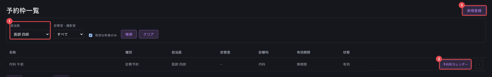
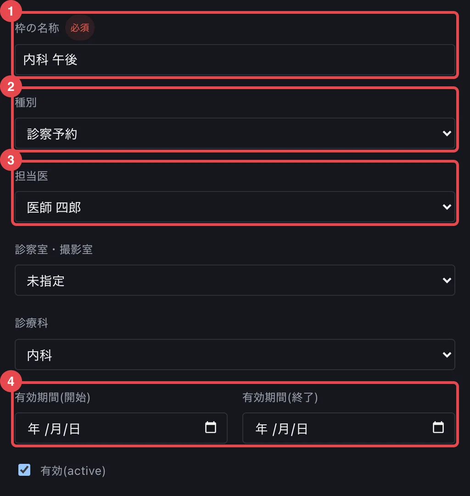
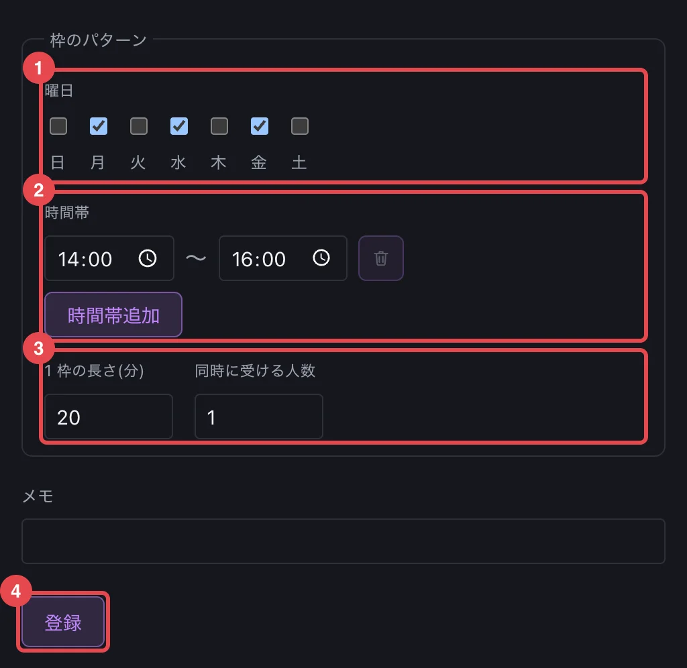
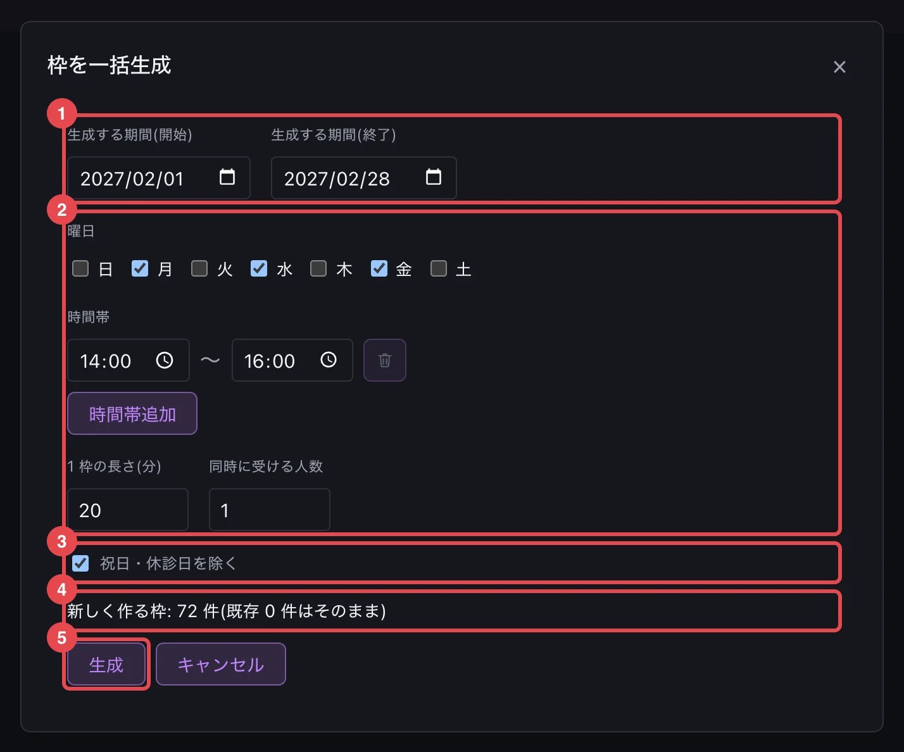
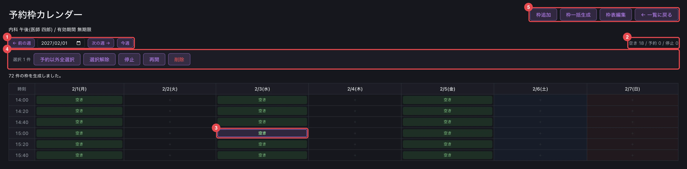

# 予約枠

診察や検査の予約を取るための枠を、枠表(医師・診察室・検査室ごとの枠の決まり)として作り、日ごとの枠を一括で作る画面です。
外来の診察の予約は、ここで作った枠からカルテの右ペインの「予約」で取ります([予約](appointment.md)のページ)。
外来の流れ全体は、業務フローの[外来の受付から会計まで](../flows/outpatient.md)を見てください。

- 予約枠は、画面の上の「予約枠」で開きます。
- 透析室のベッドの枠表は、透析室の設定で作ります。この画面では作りません([透析一覧](dialysis-worklist.md)のページ)。

## 枠表の一覧

{ .screen }

1. 「担当医」「診察室・撮影室」で絞り込み、「検索」を押します。「有効な枠表のみ」を外すと、無効にした枠表も出ます。
2. 「予約枠カレンダー」で、その枠表の日ごとの枠を開きます。
3. 新しい枠表は「新規登録」で作ります。

行の「⋮」の「編集」で枠表を直し、「削除」で枠表とその枠をまとめて消します。予約の入った枠も消えるので、使わなくなった枠表は削除せずに無効にします。

## 枠表を作る

{ .screen width="600" }

1. 「枠の名称」を入れます(必須)。予約の画面で枠表を選ぶときに出る名前です。
2. 「種別」を選びます。外来の診察は「診察予約」、放射線・生理検査などは「検査予約」、ほかに「リハビリ予約」「栄養指導予約」「化学療法予約」があります。
3. 「担当医」「診察室・撮影室」「診療科」を選びます。診察の枠表は担当医を、検査の枠表は撮影室・検査室を選びます。
4. 「有効期間」を入れます。空にすると期限の無い枠表になります。

{ .screen width="600" }

「枠のパターン」は、枠を一括で作るときの初めの値になります。

1. 「曜日」で、枠を作る曜日を選びます。
2. 「時間帯」に、枠を作る時刻の範囲を入れます。午前と午後のように分かれるときは「時間帯追加」で足します。
3. 「1 枠の長さ(分)」と「同時に受ける人数」を入れます。同時に受ける人数を 2 以上にすると、同じ時刻に複数の予約を取れます(検査予約では出ません)。
4. 「登録」を押すと、その枠表の予約枠カレンダーが開きます。

## 枠を一括生成する

{ .screen width="700" }

予約枠カレンダーの「枠一括生成」を押します。

1. 「生成する期間」を入れます。
2. 曜日・時間帯・1 枠の長さ・同時に受ける人数は、枠表のパターンが入っています。この期間だけ変えるときは、ここで直します。
3. 「祝日・休診日を除く」に印があると、祝日と休診日には枠を作りません。
4. 作る枠の数が出ます。すでにある枠はそのまま残し、足りない枠だけを作ります。
5. 「生成」を押します。

## 予約枠カレンダー

{ .screen }

1. 「← 前の週」「次の週 →」で週を動かし、「今週」で今週に戻ります。日付を選んで、その週を開くこともできます。
2. その週の枠の数(空き・予約・停止)が出ます。
3. 枠を押して選びます。もう一度押すと外れます。
4. 選んだ枠を「停止」で予約できなくし、「再開」で予約できるように戻します。「削除」で枠を消します(確認が出ます)。「予約以外全選択」で、その週の予約の入っていない枠をまとめて選びます。
5. 「枠追加」で 1 件ずつ枠を足し、「枠表編集」で枠表を直します。

- 予約の入っている枠は選べません。
- 空いている時刻のマス(「+」)を押すと、その日時で枠を足せます。
